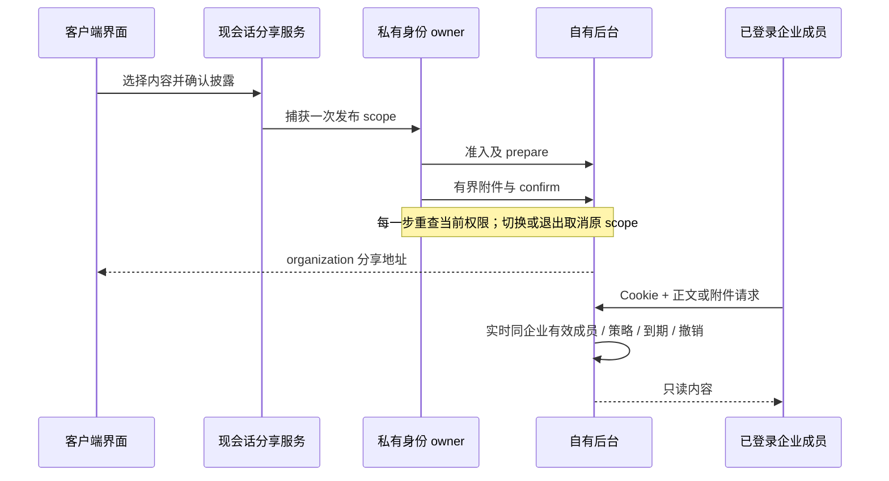

# 已登录企业成员会话分享

用户在 2026-10-18 选择补齐自有后台发布、存储和访问接口，仅允许已登录企业成员访问。本规格是实现合同。后端合同、真实 TCP/文件库/Cookie、跨仓真实 HTTP 闭环已通过。本机实际 Electron 生产构建也已完成正常会话→原 ShareService→后端 confirmed→同企业无席位成员只读，另有浏览页真实 Cookie/下载/跨企业/撤销验收；详见 `docs/client-member-sharing-test-2026-10-18.md`。身份与模型为受控本机服务；真实企微、外部 MCP、网盘、默认浏览器/剪贴板及三平台安装仍保留边界。

## 产品行为与所有者

- 新访问模式为 `organization`：发布者当前企业的有效登录成员可只读查看所选会话及明确选入的附件。不能通过匿名链接读取，不能凭 share code 导入或继续执行。原 `private` 和两个 public 模式不重定义。
- 自有后台持有不可变分享内容、附件字节、发布状态、到期与撤销事实。分享 URL 不是访问凭据。每次正文和附件读取都重新校验原有会话、当前成员与企业。
- `enterprise-identity` 继续独占 Host 会话、issuer、ownerKey、切换与取消；`IConversationShareService` 继续独占所选对话投影与发布编排；现 HTTP client 只增加受管传输适配，不增另一套身份或对话状态。
- Renderer 只取得公开身份状态、可选 `organization`、发布进度和受控分享地址，不取得供应商 API Key、Host Bearer 或浏览器会话值。浏览器凭 HttpOnly Cookie 登录，登录/企微 claim 的 cookie-only delivery 不返回 Token JSON。
- managed 配置下，能力预检、发布、预览、下载及明确拒绝的 continuation 都必须进入私有通路。未登录、撤权、合同错误或网络错误不得回退旧 OAuth、旧分享站或匿名 URL。

## 权限

发布沿用 `execute`、有效订阅、local 渠道及当前已发布 sharing 配置。`publish=disabled` 拒绝；`organization` 或 `internet` 可以创建本合同的 organization 分享，但本接口绝不创建公网分享。附件另需 `sharing.files=true`，客户端读取源文件仍沿既有文件权限闸门。后台为组织 API 自身提供存储服务，不以互联网域名配置将其转成匿名出口。

浏览者必须是原身份系统 `kind=session` 的当前有效成员，与分享记录 tenant 相同，且通过当前企业 IP 规则。只读查看不要求模型席位、不预留或扣减模型额度；不能复用只允许管理员的 `requirePermission(read)`。设备令牌不作为浏览登录凭据。关闭分享策略、记录撤销或到期后，后续正文和附件请求拒绝。撤销允许发布者本人或同企业具备现 write 权限的管理角色，重复撤销幂等。

撤销和清理不能再要求发布席位、有效订阅、local 渠道或启用 sharing；收权后仍须允许 owner/管理者撤销自己的既有内容。当前有效登录、同企业和 IP 规则仍检查。

对跨企业或无权访问的 opaque ID 返回一致的不可用结果，不泄露标题、作者、正文、附件名或字节。未登录返回登录要求；登录页仅可提供完成企微认证所需的公开登录信息，不嵌入分享正文。

## 自有 HTTP 合同

沿现后端标准错误 `{ error: { code, message }, requestId }`。受管 client 在传输边界适配到现分享服务的错误类别，不能让服务端错误正文变成权限授权。成功 DTO 复用既有分享 snake_case 字段。

| 方法与路径                                           | 行为                                                                                              |
| ---------------------------------------------------- | ------------------------------------------------------------------------------------------------- |
| `GET /api/client/shares/capabilities`                | 当前发布能力，`access_modes=["organization"]`；无旧 OAuth 请求                                    |
| `POST /api/client/shares/preparations`               | 绑定当前 tenant/user、稳定 `client_request_id`、标题、schema、payload SHA 和附件数量，返回准备 ID |
| `POST /api/client/shares/preparations/:id/artifacts` | JSON `{ descriptor, content_base64 }`，校验实际字节/长度/SHA；仅准备 owner 可写                   |
| `POST /api/client/shares/preparations/:id/confirm`   | 校验所选 turn、完整投影、披露确认、payload/projection/artifact-set 摘要及所有附件完备，原子发布   |
| `GET /api/client/shares/:code/preview`               | 实时成员授权后返回只读投影和同源、仍需身份验证的附件 URL                                          |
| `GET /api/client/shares/:code/artifacts/:id`         | Host 私有 JSON 读取，返回有限 `{ descriptor, content_base64 }`，仍逐次授权                        |
| `GET /api/client/shares/:code/artifacts/:id/content` | 浏览器同源 Cookie 下载，再授权后强制附件、octet-stream、nosniff，不执行 HTML/脚本                 |
| `DELETE /api/client/shares/:code`                    | owner/管理员撤销，撤销后正文和附件均不可读                                                        |
| `POST /api/client/shares/:code/continuation`         | 明确拒绝，不创建导入 grant 或任务                                                                 |
| `GET /share/:code`、`GET /cn/share/:code`            | 自有同源只读浏览页；未认证时只显示登录入口                                                        |

prepare 以 `(tenant,user,client_request_id)` 唯一约束绑定完整请求指纹；同 key 同内容可重放，异内容 409。upload 同 artifact ID 相同 descriptor/字节可重放，异内容 409；confirm 相同 payload 重放同一分享，异内容 409。不能用新 key 自动重试不确定的发布。

新 prepare 每 tenant/user 每小时最多 60 次，每成员同时未到期 preparing 最多 20 个；正常同 key 重放不重复占新建额度。每企业实际 BLOB 与已确认 JSON 的 UTF-8 字节合计最多 64 MiB。分配前在原事务校验，超限返回 429，已有重放结果保持；撤销或过期清退释放正文/附件容量。不能用未信任的声明长度计存储配额。

本轮边界为 schema 1、最多 2,000 rows、confirm JSON 最多 1 MiB、最多 8 个附件、单附件最多 512 KiB、附件合计最多 1 MiB。准备 10 分钟到期，已发布分享 7 天到期，能力响应明确这些上限。递归 JSON 结构另有有限深度/节点数，非法 Unicode、非有限值与过深内容拒绝；不以堆栈异常作为校验策略。附件字节存数据库 BLOB，不使用上传名称或原始路径创建本机文件；不替客户端抓取任何 URL。

首批附件组合固定为 `text/txt/text/plain`、`md/md/text/markdown`、`image/png/image/png`、`image/jpg或jpeg/image/jpeg`、`pdf/pdf/application/pdf`。能力响应逐组合公开，HTML、Office、脚本及未声明组合拒绝。允许组合不表示内容已做恶意软件扫描；PDF/图片也只下载、不在服务端解析或执行。下载文件名不作为路径，后端不读取用户 HOME 或源文件。

发布后的投影与 descriptor 集合不可变。关闭 files 时拒绝后续上传和附件字节读取，正文预览仍可返回原 descriptor 元数据及仍需认证的 URL，摘要不因访问策略变化而重写；不能删掉 descriptors 后回传旧摘要。关闭 publish 则正文和文件都拒绝。

摘要使用既有分享 JSON canonicalization 语义：对象 key 排序、有限数字、有效 Unicode；projection 摘要仅绑定 rows，artifact-set 摘要按已上传 descriptor 的 artifact_id.localeCompare 顺序计算，payload 摘要绑定整个 confirm 请求。confirm wire 不含 artifacts 数组。除摘要外，artifact rows 与上传 descriptor 的 ID/ref/所属 turn/类型/名称/大小/SHA 必须一致、引用闭包完整，不能让重新计算的合法摘要掩盖错接附件。数据库唯一约束和事务保证发布原子性；失败不留下可读取的部分分享。草稿不参与实时授权。过期准备及分享有确定的清理入口，并保留受控重启持久化验证。

preview 顶层可提供 `can_revoke` 提示，不能插入 descriptor 集合影响摘要。浏览页为 owner/管理者提供真实撤销确认；DELETE 仍重新做当前权威角色检查。Cookie-only 登录/claim 使用 `delivery="cookie"`，要求明确同源 Origin，不返回 token；旧 Native 缺省 token delivery 保持兼容。

## 实现与验证次序

1. 先补自有后端合同测试，确认当前缺路由的实际 RED，再实现存储/权限/幂等和有界附件；只用独立测试库，不改主库或重启主后台。
2. 现私有 scope 只增加有限 share 路径，不接受任意 URL/调用方鉴权头。publish 全程用原 scope；独立只读能力/预览另捕获当次 scope，前后核 current，不能将 A 内容交给 B。
3. 移除受管 UI 的旧账号登录依赖；受管 capability 只提供 organization。share URL 必须校验为当前后台同源和已知 share 路径，不能使用旧分享站默认值。
4. 浏览页复用身份 owner 的 Cookie 登录与企微尝试，文本/Markdown 内容以安全文本或严格安全渲染呈现，不执行上传内容、工具或外链。响应不缓存，不把会话值写入 URL/localStorage/日志。
5. 真实 HTTP/磁盘重启验证发布→同企业另一成员查看→他企业/未登录/设备拒绝→策略撤销/退出/成员停用→附件再授权；并补 Native 正常入口、所选内容与取消/切换竞态。只有源测试和 200 不计为 UI 完成。

Native 插件切片先以冻结候选完成并收口，分享接线随后正常构建新候选并独占复测；两组原始源、CLI/stage、产物及运行记录各自绑定，不以后续文档更新改写历史候选。主后台的恢复与新 admin 部署也在独立测试资源关闭后另行备份和取证，不将独立测试成功视为主服务运行证明。
