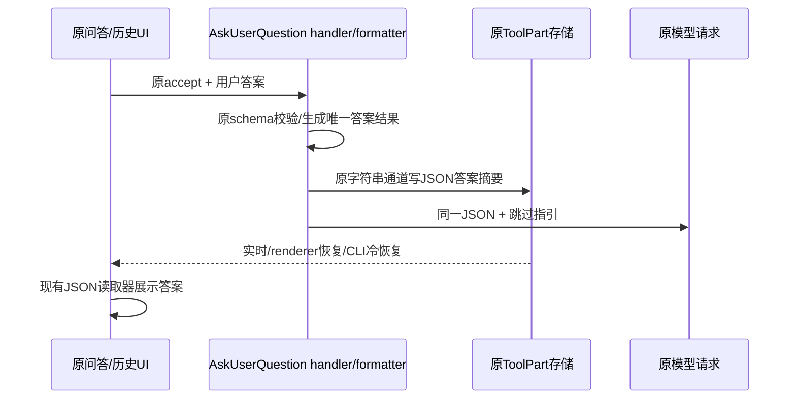

# 问答结果的结构化展示与历史恢复

已确认原页面问题：AskUserQuestion答案正确进入模型，但formatter将原结构化answers压成自然语言摘要；该字符串也写入完成态ToolPart。现有UI只读JSON answers，故实时/刷新历史卡错误显示“未提供回答”。

原handler的AskUserQuestionOutput仍是唯一答案所有者，原outputSchema、RPC string通道、持久ToolPart和UI JSON读取入口都保留。formatter的string内容改为JSON answer summary：`{ answers, annotations?, guidance }`。answers为原字典，annotations按原输出传递；guidance明确全答/部分跳过/全部跳过的含义，不重复答案和原questions/options，避免扩大输出预算。模型、持久化和UI消费同一摘要，不新增状态/cache，不反解析自然语言。

兼容边界：旧JSON/legacy answered格式的读取保留。旧自然语言历史无可靠结构化映射，不修改旧DB或猜测答案；完成成功但answers未知时优先原样展示保留的旧摘要（React纯文本转义，不猜字段）；没有可用摘要时显示“历史回答不可用”。已知空字典显示原“未回答，已自动继续”，部分回答缺项才显示“未提供回答”。不新增共享wire union成员/数据库结构，不强制旧renderer升级才能读新JSON。

验收：格式化器和现有UI读取器可往返中文引号/换行/逗号、部分/零答案和annotations；不复制未选的大preview。原单题UI选择南京后，工具卡展开应显示南京；原renderer reload及同profile Main/CLI冷重启恢复后仍一致，推理/账本零重放。原多题+待答刷新实际证据保留，不为格式改动重复旧整套；新跳过全题原UI验证JSON空答案及非拒绝指引。旧记录未知/已知未答区分有定向回归。Desktop continuous与其他共享UI消费的replayable通道都复用同一持久字符串事实，不增加移动/远端实现。
