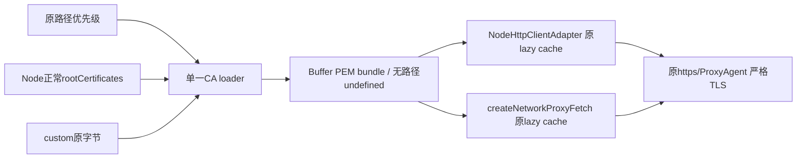

# CLI 自定义 CA 为附加信任根

2026-10-18。桌面 `httpProxyCaCertPath` 的说明是 `NODE_EXTRA_CA_CERTS` 附加语义；Host已有默认根+自定义CA合并。CLI此前将自定义文件Buffer直接作为tls.ca，Node的显式ca会替换默认根，导致同进程私有后端可连而正常公网证书失去信任。

Root已用正式39175/正常proxy证明真实CDN RED：仅自签CA时tuple/TLS连接路径成立，但catalog报unable to get local issuer certificate；同版本独占control追加Node正常根后成功46条。control是归因，不是正式修复或Native验收。

唯一修复owner为 `adapters/src/network/http-config.ts::loadTlsCaCertificates`，保持 `Buffer | undefined`：

- 没有显式有效CA路径仍返回undefined，沿原Node默认信任链，不主动加载文件。
- 有路径先按原优先级读取原文件，再合并Node `rootCertificates` 的PEM和custom原始Buffer。以换行分隔，不解析/改写custom、不造全局cache。
- caCertFile优先于已有ZCODE_AGENT_CA_CERT；路径trim、读取失败仍抛错，不以undefined吞错。空custom文件不删除默认根。
- NodeHttpClientAdapter和createNetworkProxyFetch继续调用同一loader，保持各自惰性缓存；不改两个caller、proxy/noProxy/beforeDispatch、TLS hostname/证书验证、Host、配置API或环境透传。
- 不设置rejectUnauthorized:false/NODE_TLS_REJECT_UNAUTHORIZED、不追加fixture专用信任bundle作为产品修复，也不扩代理allowlist。

先补loader RED：配置新自签CA后必须同时保留所有Node根的X509指纹和custom证书，旧loader只有custom将明确失败。回归还覆盖undefined、显式/环境优先级、文件错误、空custom。真实loopback TLS矩阵对两个生产caller各验direct/owned CONNECT：信任custom成功，另一自签CA仍失败。单元不需要也不访问公网，临时证书/服务/连接均owned且回收。

聚焦命令（client根、固定Node24.14）：`node --import tsx --test apps/zcode-cli/packages/adapters/test/httpConfigTls.test.ts`。先记录RED再改loader。架构前后和聚焦lint/无emit类型按源码范围验证，Root统一完整gates/正式CLI构建、stage及后续Native新候选；本slice不build/读写out、dist、stage，不改common或旧R。
