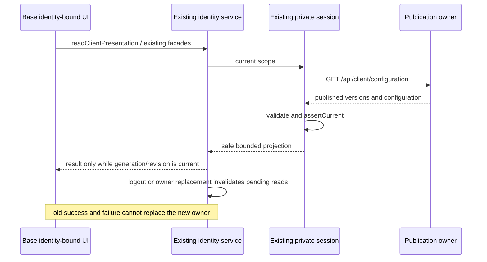
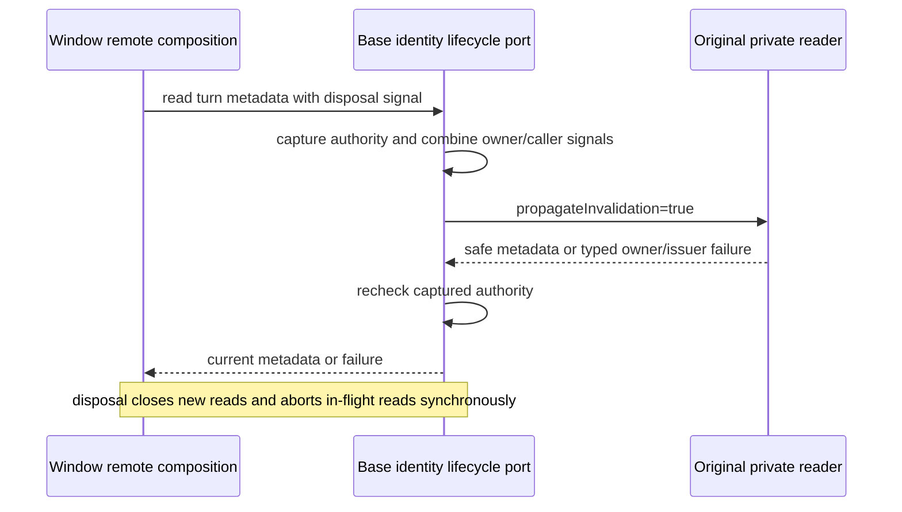

# Published client experience through the existing identity owner

This client slice implements `SPEC-client-experience.md` in the backend repository. The backend's existing draft/revision/publish/history owner publishes `scenes`, `help`, `desktop` and `plugin-store` through authenticated `/api/client/configuration`. No legacy anonymous aliases, account services, plugin installation or cloud feedback are added.

## Contracts and owners

`createUWorkBackendSession` remains the sole private HTTP and identity boundary. `createClientPresentationReader` validates the current tenant and publication, calls `scope.assertCurrent()` before releasing data, and exposes no token, backend URL or private configuration. The existing `IEnterpriseIdentityService.readClientPresentation()` RPC keeps the welcome/risk projection and adds `scenes`, `help`, `desktop` and `pluginStore`.

Each new kind is `ready` with nonnegative `version` and validated `data`, `unsupported` when the backend omits both kind and version, or `unavailable` when only one side is present or the data is invalid. A new backend's explicit version-zero defaults and empty arrays are valid ready values. HTTP/owner failures invalidate the whole projection; a missing new kind does not discard a supported welcome. The private reader accepts cancellation and an internal invalidation-propagation option for the separately implemented turn-context path; these options are not Renderer RPC inputs.

Shared boundary schemas mirror the frozen backend contract without importing backend source. Limits are ID 64, localized title 100, prompt 4000, description 1000, 20 entries per scene group, scenes 128 KiB, Help 16 KiB and plugin order 64 KiB. Objects are strict, strings trimmed, and at least one localized language is required. Plugin-order record keys must already be trimmed so normalization cannot silently merge keys. Icons are canonical kebab names; draft actions are only the two existing navigation enums. `pluginStableId` is at most 200 characters of opaque metadata. The existing workspace reference-catalog hook binds it only to one exact enabled, nonconflicting installed entry. Selection rechecks that same installed catalog before filling a mention; missing, disabled, conflicting, revoked or unavailable entries fall back to the plain prompt, never marketplace refresh or installation. Off-Peak IDs normalized by removing `item[-_]?` and lowercasing cannot be `customize`. Scheduled cron is whitespace-normalized and must pass the actual UI editor's lossless subset, verified with golden examples against its existing predicate.

`IClientScenesService` and `IClientConfigService` retain their existing public facades, but consume the same identity-owned presentation without anonymous HTTP or accepted/TTL caches. Scene options are generated from normalized data with fixed namespace `uwork`; there is no administrator-controlled legacy options grammar. Remote workspace service composition borrows the base Host facade rather than rebuilding an anonymous scenes reader. This does not forward credentials to a remote Host or claim remote execution acceptance.

Turn metadata has a separate, finite Node-only port on that same identity instance: `readEnterpriseIdentityTurnPresentation(service, signal?)` returns only `ClientTurnPresentation`. The existing lifecycle module registers the original private reader callback, not an accepted value or another session/cache. The port combines the caller's cancellation with the current identity authority signal and checks the original generation/revision before returning or propagating a failure. Missing or disposed ports, logout and owner replacement fail; issuer/configuration invalidation from the private reader remains a failure even when the public view revision does not change. The public display RPC retains its no-argument unavailable projection and cannot be used for turn metadata. Remote workspace composition borrows this finite port from the base identity, passes its own disposal signal and retains its source-service/view-revision fence. Disposal synchronously closes the port and aborts outstanding reads before awaiting cleanup.

## Ordering and UI projections

The scenes SWR resource and plugin-order hook bind derived values to the existing base identity service and view revision. Identity changes synchronously hide old data, invalidate late reads and separate deduplication scopes. A managed failure does not preserve a previous tenant's scene/order. Deliberate published empty data is distinct from unsupported/unavailable; unmanaged local behavior remains independent. These are disposable display projections, never execution authorization.

Main's window/child Help and trace projection, tracing epochs, and CLI reservation/turn-context changes are separate owners' implementation slices. They consume the shared DTO and existing identity getter; this slice does not modify Main IPC or CLI protocol. Managed Help never falls back to old anonymous services or built-in cloud feedback. Desktop flags do not authorize execution or enable packaged dynamic workflows.

## Unified feedback entry and legacy egress

All direct `feedbackStore` submit/feature-request/ticket intents are intercepted by the single `FeedbackHost`. Only an explicitly unmanaged current presentation mounts the legacy FeedbackCenter. Managed external feedback delegates to the existing `platform.openFeedback()` for Main's current-child revalidation; disabled, unsupported, unavailable and pending states close the old intent and show a localized message. Native open-dialog events never redirect back into `platform.openFeedback()`, preventing an IPC reentry loop. Identity changes unmount the old center synchronously; late effects cannot open feedback for a new owner. The existing presentation hook also reads an unconfigured/signed-out owner so unmanaged status is explicit rather than inferred from a missing projection; a ready response while signed out is not displayed.

The actual Node feedback RPC remains an egress boundary: the existing service constructor receives the same current presentation reader and rejects all managed legacy create/read/comment/upload calls before local preparation or old HTTP. Each operation synchronously captures a receipt from the original identity authority's generation/revision/signal, combines that owner signal with caller cancellation, and retains the receipt through all preparation, HTTP, credential and OSS phases. Re-reading an unmanaged mode does not authorize a response from another generation. The HTTP adapter for that single operation rechecks before every retry, final ApiClient dispatch and response consumption, and before its direct OSS upload dispatch. Local list/get/comment results and ticket upserts use the same receipt; the local store checks immediately before dispatching its actual write after any asynchronous read/directory preparation. New operations may explicitly use the new unmanaged owner, while the previous operation fails. No user context, attachment or enterprise token is posted to the configured external Help URL. Cancel and explicitly local log-export cleanup remain available. A request or local write already dispatched while current cannot be undone; new dispatches and late results after a mode/owner change are denied.

## Verification

Start with failing publication/facade tests; then validate strict boundary schemas, per-kind absence/invalidity, stale identity/issuer/HTTP results, cancellation, legacy welcome compatibility, normalized scene mapping and actual editor cron parity. Verify UI scope transitions including old successes and failures, and base facade reuse for scoped remote displays. Use a real owned backend HTTP contract test once the backend's new kinds are available. Run client typecheck, focused strict test types, lint and architecture checks. Native/browser acceptance and coordinated CLI/Desktop builds belong to Root; do not rebuild shared formal artifacts from this slice.
