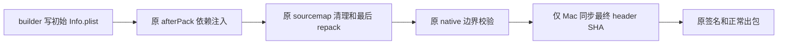

# macOS 最终 ASAR header 元数据同步

状态：已授权实施最终 metadata 同步；唯一接线位于 `electron-builder.config.js` 的原 afterPack。重包 helper、fuse、v9/v11/v12 冻结包均保持不变；正常新包构建与 Native 验收须另行执行。旧源码中已观测的声明差异不直接称为包损坏，也不与 x64 首启耗时/AOT 原因混同。

## 问题与精确合同

当前匹配版本为 electron-builder/app-builder-lib 26.8.1、@electron/asar 3.4.1、Electron 41.10.7。builder 在 `beforeCopyExtraFiles` 之前计算 ASAR header SHA 并写入 App Info.plist；项目的实际 `afterPack` 随后可因运行时依赖注入、sourcemap 清理重新 pack `app.asar`。修复前 hook 没有在最终重包后更新 `ElectronAsarIntegrity['Resources/app.asar']`。

正确 SHA256 的输入是 Pickle `ReadString` 提取的 **原 UTF8 JSON header 字节**；不含文件前八字节、Pickle envelope/padding，不是整个 ASAR SHA，不重排或 stringify 规范化 JSON。Electron 官方 `archive.cc` 210–228、`asar_util.cc` 126–132、`archive_mac.mm` 37–58（v41.10.7 tag）与 installed builder `readAsarHeader`/`hashHeader` 同意此范围。当前冻结包的 embedded validation fuse 原为 disabled，严格签名与完整 ASAR 文件摘要已有独立核验；本修复不启用该 fuse，也不将旧签名验证说成 header 声明已同步。

## 唯一所有者与最小实现位置

最终打包产物的唯一 owner 是原 `afterPack` pipeline。`packages/desktop/scripts/macos-asar-integrity-metadata.mjs` 提供单一异步文件边界，在原 hook 的所有 ASAR mutation 完成、原 native policy/prebuild 校验之后、xattr 清理和任何签名之前调用一次。Caller 使用原 `resolveAppAsarPath(context)`，不复制 productFilename/fallback 定位规则。不要在两个 repack helper 内重复写 Info.plist，不增加 afterSign 修包路径，不令 Renderer/Host/runtime 持有第二份 metadata cache。



实施合同：

- 仅 `context.electronPlatformName === 'darwin'` 生效，沿原 `resolveAppAsarPath`/productFilename 规则定位该新产物的 `Contents/Resources/app.asar` 与 `Contents/Info.plist`；不读取或修改用户安装目录、旧包或其它平台。
- 复用已匹配 builder 的原异步 header reader，或等价受限异步 Pickle reader；准确散列上述原字节。解析/读取/写入失败必须使正常打包失败，不吞错，不使用旧值继续签名。
- 更新 `Resources/app.asar` 的 algorithm/hash，保留 Info.plist 所有其它值及其它 ASAR 条目；已一致时保持幂等，不改无关字段、路径、版本或签名参数。
- 此 helper 的唯一写入是正在构建的新 scratch App Info.plist；不重包 ASAR，不改 native bytes/fuse/权限，不自行签名、不构造启动缓存条件。
- 非 Mac 必须直接返回；本轮不实现 Windows PE resource writer、不声称无实机 Windows 已验。

## 回归与真实 RED

新永久测试 `packages/desktop/test/macosAsarIntegrityMetadata.integration.mjs` 使用真实 @electron/asar 生成小 ASAR，以匹配 installed builder `computeData` 产生初始声明、真实 plist 序列化，不伪造 metadata oracle。它直接执行原配置导出的实际 `afterPack`，并以真实 sourcemap 注释/map 文件触发重包。

为使不相关的 runtime scan/native guard 在小 fixture 中真实运行，测试带上当前 closure 的原 package.json 和一个原有 darwin-arm64 node-pty prebuild（只归档，不加载）。这不是完整依赖/ABI/发布验收，也不复制整个 runtime 依赖树。禁止用 VM 改写 hook、stub 掉 mutation 或测试自己复制的 metadata 同步公式来凑绿。

核心断言：初始 header 声明等于真实 builder hash；实际 hook 确实删除 mapping/map 并改变 header；**hook 返回后声明必须等于最终 header**。旧源码应在最后这条失败。无 sourcemap/mutation 的同 fixture 正对照保持成功，并保留其它 Info 值和另一未改 ASAR 的声明。

阶段命令（client 根、固定 Node24）：

```sh
node scripts/check-workspace-freshness.mjs
node scripts/architecture/architecture-check.mjs check --changed
node scripts/architecture/architecture-check.mjs context desktop
node --test packages/desktop/test/macosAsarIntegrityMetadata.integration.mjs
```

已保留旧源码实际 afterPack 的一项 RED 与无 mutation 正对照。接线后同一回归断言原样执行，要求两项均 GREEN；不得降低断言或跳过测试。独立 helper 八项回归覆盖实际重包/installed builder oracle、原 UTF8 Unicode 与非规范 JSON 空白、幂等字节和 mtime、不修改 ASAR、非 Mac 零 IO、缺失/坏 plist/缺声明及坏 header 失败。执行目标回归与现有 desktop-asar-runtime/desktop-release 测试，再跑 typecheck、lint、architecture。具体执行结果记录于独立 evidence，不将 scratch hook 测试当作完整包、签名、ABI 或 Native UI 验收。正常新包静态 header/plist/signing 与原 Native app/UI 回归单独审定；不重签冻结包，也不以 metadata 修复宣称 x64 原三十秒门已关闭。

## 边界

涉及源模块在当前 architecture-policy 中是 unmanaged desktop/build 脚本边界；不新建业务 owner、服务或对外 RPC，不变 Host/Main/Agent 协议。保留仓库原 dirty 工作、Root source29/冻结用例；git 提交由 Root 原子处理。
