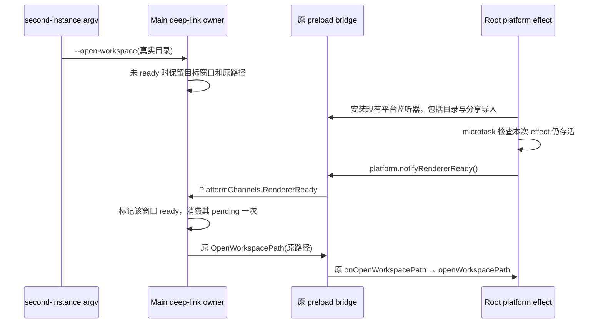

# Renderer 就绪与 second-instance 工作区投递

## 目标与证据

运行中的桌面窗口接收正式 `--open-workspace <目录>` 后，必须通过现有平台事件打开该目录。2026-10-17 的 Native 证据确认 Main 收到有效目录却一直等待 renderer ready；`useRootPlatformEffects` 已安装目录监听，但没有调用仍存在的 `IPlatformService.notifyRendererReady`。证据见仓库根 `evidence/client-native-workflow-gap-20261017/second-instance-gap.md`。

## 所有者与时序

`desktopOAuthDeepLink` 继续唯一拥有窗口 ready set 和 pending deep link；preload 继续拥有 IPC 到 UI 订阅之间的短暂回放。Root 只拥有本次 effect 订阅的存活期，不保存第二份 ready 状态或工作区请求。

通知位于平台订阅 effect 全部监听器安装之后。使用 microtask 是为使同步 setup/cleanup/setup 的 StrictMode 生命周期只由存活的 setup 通知；不使用延时、轮询或重试。cleanup 先使本 effect 失效，再释放所有原 disposer。

重订阅可再次通知；Main 原有 pending 清空和窗口绑定保证一次请求不重复消费。关闭窗口仍走 Main 已有 `clearOAuthRoutesForWindow`，不把旧窗口 pending 投递给新窗口。平台拒绝通知（同步抛错或运行时异步 rejection）由现有 logger 记录；不把失败记作本地 ready，也不阻塞 cleanup，下次正常订阅仍可通知。Web 继续经平台的原空实现，不分叉业务流程；Windows/macOS/Linux 复用同一个口。

## 实现与验证

源码仅修改 `packages/ui/src/root/useRootPlatformEffects.ts` 的现有订阅生命周期；不改 Main、preload、平台契约或 workspace/session owner，不增加依赖。中文注释说明缓存缺口与 cleanup 的依据。

先运行 `node --test packages/desktop/test/rendererReadyWorkspace.integration.mjs` 观察现有源码 RED，再作最小修复并运行 GREEN。该测试直接捆绑当前 hook、desktop adapter、preload、second-instance parser、Main IPC 注册与 Main deep-link owner；只替换 Electron 和无关 UI/遥测边界，不以文本搜索或复制实现代替行为。

验收覆盖：未 ready 请求确实缓存；监听器装好后相同路径只收到一次；重复 ready/重新订阅不重放；StrictMode setup/cleanup/setup；已 cleanup 通知取消；同步与异步通知失败后可清理、重订阅；目标窗口绑定和关闭清理；三种桌面系统与 Web 默认空平台行为。执行仓库 `pnpm typecheck`、`pnpm lint`、`pnpm architecture:check --changed`，报告真实结果。

Native second-instance 实测由 Root 统筹，必须使用更新后的独占 Renderer 和原正式 Main/Host/CLI，证明已运行窗口收到 argv 后真实进入项目。冷启动初始目录成功不能替代本项验收。不碰主环境、主数据库、运行中的 Native profile、外部 checkout、正式 CLI 或 Desktop out。
