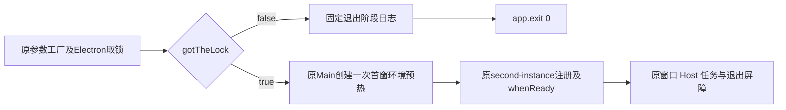

# 拒锁副实例的退出与预热所有权

2026-10-21：Mac x64正常v9包的真实v6诊断中，原副实例已返回acquired=false，原app.quit同步调用也返回，但未在原spawn起算10秒内自然结束，最终SIGKILL。该事实证明现有拒锁退出路径未满足有界副实例契约；不证明本app的before-quit屏障或某个native分支是根因，也不把quit后剩余约两秒说成“quit挂了整十秒”。原失败、CPU证据和30秒renderer缺口均保留。

## 所有者与行为

Electron App的原gotTheLock是唯一持锁事实。成功持锁的Main拥有窗口、Host、任务、普通退出确认与清理屏障。拒锁进程不进入应用bootstrap，不参与普通用户退出，不拥有窗口/Host/任务；继续保留原whenReady的false guard。

Main在拒锁时调用app.exit(0)，不用app.quit，也不添加重试、超时或process.kill。只改变原false分支；requestSingleInstanceLock的factory、参数、次数、原boolean、异常传播及主实例second-instance处理顺序保持。false也可能表示PROFILE_IN_USE或LOCK_ERROR，不能写成消息已送达/ACK；原确认和实际workspace切换仍由持锁Main及正常原包UI复测证明。

拒锁前还有一个真实子进程资源：首窗login-shell环境预热会创建独立POSIX进程组，其4秒AbortController属于当前Main。不能先创建它再立即退出并声称“副实例没有任何资源”。因此初始preparation仍由原Main的同一let持有，但初值为null；只有gotTheLock=true后才以原createRuntimeProcessEnvPreparation创建一次首窗预热。takeRuntimeProcessEnvPreparation消费一次首窗结果、后续窗口重新采集的行为不改，不新增owner、缓存或服务接口。Windows继续由原capture函数返回其平台结果；不改services捕获、4秒、PATH或shell参数。

日志沿用既有固定phase与字段白名单；secondary-quit-start是兼容的终止请求标记。真实app.exit通常不会返回，因此缺secondary-quit-return不是失败或成功证明；若边界替身返回/抛错，原helper仍只记录实际发生的事件，异常对象不吞。退出成功必须使用真实child exit0、timedOut=false、无SIGKILL判定，不能用日志代替。

## 依据与范围

[匹配Electron41.10.7实现](https://github.com/electron/electron/blob/v41.10.7/shell/browser/browser.cc)中Browser::Quit通过可取消的正常退出通知；Browser::Exit在尚不能设置loop退出码时直接exit(code)，否则标记is_exiting并退出，不走before-quit/will-quit。该源码说明策略不同，不证明本例实际走了哪个C++分支。[官方App合同](https://www.electronjs.org/docs/latest/api/app#appexitexitcode)定义exit的即时终止语义。

此次仅修拒锁进程退出与首窗环境预热归属；正常主实例的退出确认、任务清理、锁/ASCII wire/ACK调度、workspace确认队列、ready门、SDK/CLI/PTY、fuse、builder及原10秒测试均保持。旧observability规格“不得app.exit”是此前仅日志变更的约束，本次行为修复以本规格为准，不改写旧诊断成功/失败证据。

## 验证

先在旧Main实际代码上得到RED：拒锁走quit且启动了pre-lock环境采集。再在同一真实Main代码块/let初始化/take函数上验证：false调用exit0一次、quit0次、预热0次；true退出0次且取锁后预热一次；首窗take复用一次、后续窗口重新采集。退出抛错、每阶段logger/clock失败不阻断正确API或伪造返回，factory/request异常对象保持；原false whenReady不启动Window/Host/Agent，原true到达bootstrap。

执行既有wire/dispatch/确认/ready/退出相关矩阵、根typecheck/lint/architecture changed及受影响文件格式检查，保留实际告警。独立审查与file-scoped原子提交后正常产新Mac包，原v9/v10全部保留，CDF Agent及冻结的Server/native源不变。先在新x64原包以原10秒验证自然exit0/无SIGKILL、主实例仍存活及实际通知；再执行原7项UI/Host/Agent/后端模型与账务闭环，原30秒不延长。新ARM64包做相同主路径回归；Windows原生验收仍需目标机器，Linux按用户要求不新增。

首窗预热后移属于主实例启动时序变化，必须观测实际CLI环境/cwd、任务和PTY，不以纯测试宣称无回归。若新包仍失败则保留失败并继续定位，不能因单测通过将实验性策略称为已修复、关闭原30秒或物理Intel验收。
