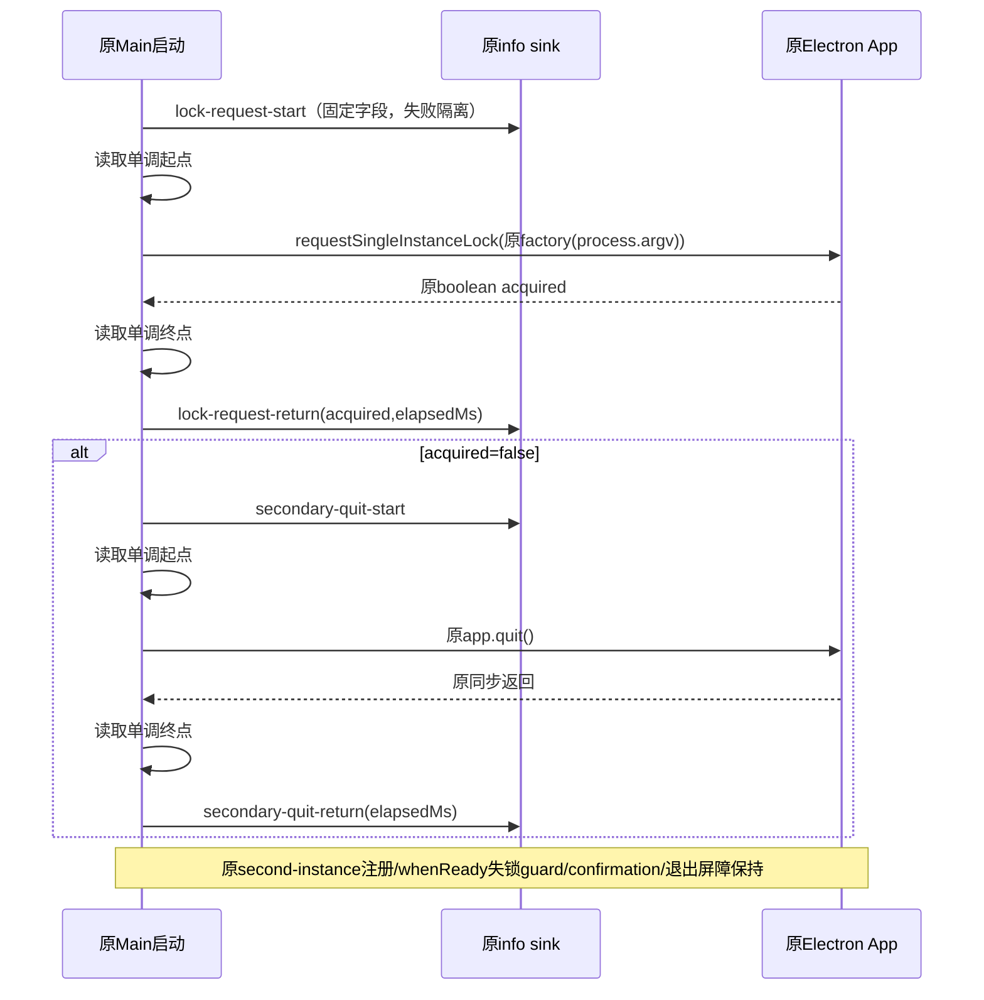

# Desktop 单实例启动固定阶段日志

状态：Root与独立peer已审核规格并授权5文件范围TDD；源码与永久回归已完成，等待独立源码复核；未构建、未GUI。正常产包/GUI仍须另获资源与审查授权。

## 背景与诊断问题

同一immutable macOS x64包在Rosetta下多次原可信workspace入口触发原设施10s期限；已知secondary到Main日志和协议注册、Primary收到通知，但没有lock返回/quit调用的事实。v8 `/usr/bin/sample` 在其1500ms保护内未产报告，0B不能定位锁或退出屏障。本变更仅补低频日志，不将任一候选根因先写成结论。

需回答三件事：

1. secondary是否到达原 `requestSingleInstanceLock` 调用；调用是否返回、原boolean acquired是什么、该同步调用耗时多少？
2. acquired=false后是否到达原 `app.quit()`；调用是否返回、同步调用耗时多少？
3. 与已有进程前缀PID、原controller单调时序和现有before-quit日志合并后，期限落在请求前、请求中、quit调用中，还是quit已返回后的生命周期？缺日志只能标记未观察到，不能自动等同未执行。

`app.quit()`返回不代表进程退出、窗口销毁、before-quit清理完成或ACK已送达；lock返回只描述Electron原返回值，不等同renderer ready/confirmation完成。日志落盘本身也不是业务成功。单调时钟读取也仅为诊断；读取抛错/无效或起止不可比较时省略elapsedMs，不影响原API、不伪造零耗时。

## 所有者与顺序

唯一所有者仍为Desktop Main的原Electron App对象；原Electron持锁状态/原gotTheLock boolean是事实，不新增缓存、队列、owner、重试、计时器、ready状态或独立状态机。

原数据factory调用次数和表达式位置不变：`const gotTheLock = app.requestSingleInstanceLock(createDeepLinkSingleInstanceData(process.argv));` 直接留在Main；新增日志helper不持有app、不接收factory、argv或payload、不包装原API，也不catch/重抛API异常。两处单调时钟只围绕原直接调用；起始日志在计时前发出，返回日志在终点读完后发出，使elapsedMs不包含两个info调用本身。锁耗时包括原argument factory求值，必须准确称“原请求表达式耗时”，不伪称纯Chromium IPC时间。

只有原false分支调用原app.quit一次；true分支不加quit。原API抛出的同一对象继续向外抛出，后续返回阶段日志不伪造；factory抛错也保持原异常，不伪造acquired。不得app.exit、改boolean、提前return整个模块、移动whenReady/second-instance注册、裁剪ready或确认门。

## 固定日志合同与秘密边界

沿用原 `logger.info`、原info级别、现有时间/PID/main前缀；单进程单启动仅一个锁请求，最多四个固定阶段，不新增UUID、指标依赖、持久状态或相关性ID。现有PID前缀加本case原child句柄用于进程关联。

| 固定字段  | 取值                                                                                            |
| --------- | ----------------------------------------------------------------------------------------------- |
| message   | 固定 `[single-instance-startup]`                                                                |
| event     | 固定 `desktop_single_instance_startup`                                                          |
| phase     | `lock-request-start` / `lock-request-return` / `secondary-quit-start` / `secondary-quit-return` |
| acquired  | 仅lock-request-return，原boolean                                                                |
| elapsedMs | 仅两个return阶段，`performance.now()`同进程差值，有限且非负；时钟不可用时省略                   |

不log argv/URI/path/workspace/identity/用户/租户/令牌/环境/附加数据/请求来源内容/错误message或stack；不将原对象spread到日志。helper只允许上述判别联合类型字段，构造新常量对象，拒绝通过泛型metadata把任意内容带入。原日志中其他既存内容不因此宣称已脱敏。

logger当前并非完全no-throw：message JSON序列化、目录创建、非EPIPE console同步错误仍可能抛，appendFile错误才在其内部吞掉。因此拟新增小型同层 `desktopSingleInstanceStartupLog.ts`，仅负责固定阶段info同步调用的隔离，不建通用框架，不改变logger全局实现；logger失败不再回调logger/warn/console，避免递归或二次异常改变原API结果。同步info失败可导致该阶段日志缺失，业务结果优先，不能假造成功落盘。

既有logger的stdout/stderr异步非EPIPE错误策略不在本次范围；局部try/catch不能消除所有异步stream故障，也不将其描述成全进程无日志副作用保证。日志依旧有同步IO开销，不能称零扰动或据新增耗时直接断定原包的性能。只新增固定无payload事件，不扩大任何原日志权限或访问真实用户数据。

## TDD与原路径验证计划

拟文件ownership只含：原Main/index.ts、同层新固定日志helper、对应永久纯测试/原Main接线integration测试、本规格。与Root/其他agent协调后才创建实现文件，禁止改共享PTY/Server12源、logger全局、fixture、ready/confirmation源、builder/fuses或CLI。

先永久RED，再最小实现GREEN：

1. 新纯测试先要求四阶段字段白名单、只有固定info输出、原logger info抛错时不向外抛；无argv/URI/path/env和原异常内容。
2. 新integration实际读取原Main的单实例启动代码块（固定原注册/调用锚点），执行真实日志helper与原直接调用代码，仅stub Electron App/logger/clock边界；不复制同逻辑成测试替身。旧源码缺阶段时必须真实RED。
3. acquired=true与false两分支：factory一次、request一次、原同this/同payload对象；true不quit；false仅quit一次；事件顺序与注册点不变。logger在每个阶段单独抛错时，仍得到原boolean/调用顺序；request/factory/quit各原错误对象identity保留，不产生虚假的return日志。原Date.now回拨不改变monotonic差值，时钟任一读取失败或返回无效值都不得阻断原调用，省略不可证明的elapsedMs；无额外timeout。
4. 原追加数据wire/dispatch/fallback、external confirmation、renderer ready等已有永久矩阵保持，不删断言/skip/调宽期限。原审计指出失锁whenReady无bootstrap曾缺定向永久覆盖；本轮另在actualMain integration执行完整原whenReady callback，false不得触首bootstrap marker，true必须到达首marker sentinel，并以仅内存去掉guard的控制证明用例能检出该退化，不修改原ready源。其余具体入口以当前实际package/tests为准：desktopSingleInstanceWire.test.ts、desktopSecondInstanceDispatch.test.ts、startupFallbackCwd.test.ts，以及externalWorkspaceConfirmation.integration.mjs、rendererReadyWorkspace.integration.mjs、startupFallbackCwd.integration.mjs。
5. 正常typecheck/lint/architecture changed及格式检查；保留真实已有告警，不更新baseline掩盖违规。docs-only阶段不运行无关全量测试；实施后不能只凭纯日志测试宣称native通过。

前置只读已完成：pinned Node24.14.0 freshness exit0（分支无tracking/origin main，相关检查跳过），architecture pre-check exit0/0violations，desktop受控context当前unmanaged、无module contract/declared依赖。本变更不增加跨模块能力/协议。

## 正常原包与真实复测计划

实现经独立peer和Root review、永久RED/GREEN及必需门禁后，由Root file-scoped原子提交绑定源码；未实现前不占用Desktopout/targetassets。下一producer必须先获唯一共享构建owner与GUI资源窗。

正常prepare目标darwin-x64→原build:no-runtime-assets→原builder `--mac --x64 --dir --publish never`，新Library/Caches目录和新manifest；cleanenv+原guard、原ad-hoc/生产Preview、原配置/targets/fuses不改。保留旧v8及arm64v6/v7所有immutable字节；CDF Agent固定原SHA，不重建CLI/复用错误架构资源。新current source包含已提交PTY修复而非冒称旧v8已含，12个Root已冻结Server/native资产源需前后核SHA稳定。

实际产物核验全资源SHA、x64 native MachO、严格签名、helper按原可选fallback真实absent，不造helper、不将3资源称5。新的独立严格loader/manifest必须绑定新source/asar路径，不修改旧历史manifest以让其通过。使用新fresh自有profile、同原后台受控模型及原7链断言，原secondary10s和业务次序不改；仅原正常包日志帮助定位。若失败先读四阶段日志与真实child收据，不自动改Main/app.exit、不延时求绿，也不自动下一例。

结束必须保留原result、原stdout/stderr模式0600、阶段日志安全摘要、进程代次/elapsed、fixture/BH/OSguard/协议/PID/端口收口。未完成全部7链时继续明确open；Rosetta不替代物理Intel，optional helper未验、真实企微受拒浏览器/外部MCP/网盘边界保持。

## 本轮源码验证收据（不替代原包验收）

实际旧Main block控制先跑15项，10RED/5PASS：缺阶段导致9个实际路径断言失败，新helper尚不存在另1项失败；原源码和block SHA保留。最小实现后原19项GREEN，再补完整whenReady callback三定向例，现新矩阵22/22。原API表达式直接留在Main、原gotTheLock/false→quit/this/payload/异常对象保持；clock四个读取位置失败仍保原调用且不伪造elapsed。

新矩阵与现有wire/dispatch/fallback/确认/ready实际组合74/74（node:test报告数；原fallback脚本内子场景另由其原断言执行），无skip。正常根typecheck、lint、architecture changed、5文件oxfmt均exit0，lint仍114条既有warning/0error。根typecheck当前只含Desktop host配置，不能称它覆盖所有Main；另对新helper及TS永久测试执行严格noEmit检查通过。

该独立严格CLI检查的前两次只因TypeScript6要求显式ignoreConfig、显式types node而退出，日志保留；未改源码或降低类型规则，使用strict/noEmit/Node类型后正常0。旧spec/plan审核SHA与本实现后的spec不同，实施授权及源冻结材料须分别引用。Root仍唯一gitwriter；没有提交、原包构建或GUI验收。
