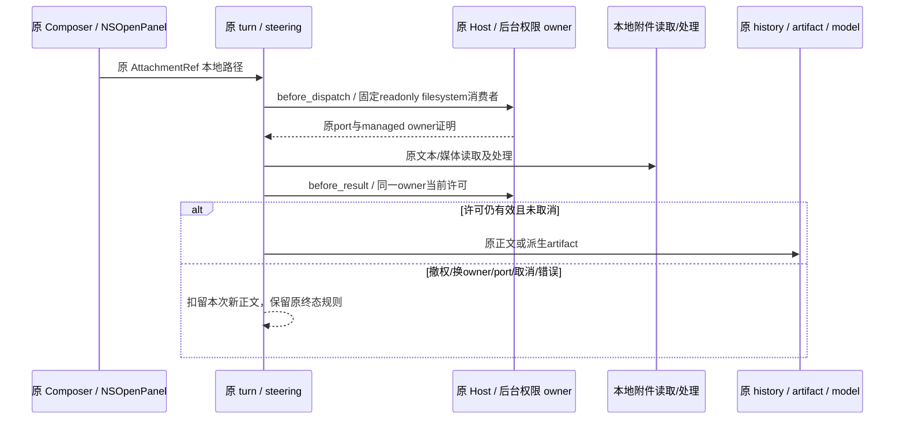

# 企业本地附件正文消费

状态：2026-10-19 源码确认独立消费路径，真实 Runtime RED/修复与 Native OS 联测待执行。属于现有 filesystem 策略的遗漏入口，不新增身份、策略字段或产品功能。

## 原入口与唯一所有者

原 Composer `chat-attachment-button → chat-attachment-menu-item` 在 Desktop 调用既有 SelectFiles IPC，Main 使用真实 `dialog.showOpenDialog(openFile,multiSelections)`。本地路径经原 AttachmentRef 映射进入 Core ordinary turn 或 steering 的 `resolveTurnAttachments`。文本直接读取，图片/视频/PDF读取并处理后可写派生 artifact；该路径不经过 builtin Read ToolExecutor，不能用 G07c/G07d 的通过替代。

后台仍拥有有效 filesystem 策略。沿原 PermissionService 的 `EnterpriseToolAuthorizationPort`、现有 CLI私有协议桥与 Host resolver取得当前许可，不创建新的身份 owner、权限缓存、任意RPC或 Renderer 授权口。选择文件表达用户输入，不能越过企业 filesystem=false。

固定内部消费者名为 `PromptAttachmentRead`，capability 仅允许 filesystem、readOnly=true、destructive=false、sideEffectScope=none。复用现有 before_dispatch/before_result 与 managed owner proof，Shared/Host 仅为该固定消费者窄扩 before_result 校验；不能冒充 builtin Read、放宽任意工具或把 body/Key/token放入授权元数据。CLI→stage→Desktop须同版正常构建，旧协议不以宽松解析兜底。

## 消费合同

- 每个本地路径附件在原消费入口绑定当前 authorization port、原 workspace/session 与 managed owner；首次许可通过后才能启动读取。原 unmanaged 路径保留既有行为。
- 读取/媒体处理完成后，在新正文、preview、prompt/history 或派生 artifact 写入开始之前，用同一 port/managed owner复验当前许可。owner/port变更、缺证明、拒绝或异常都不得把新正文交给下一所有者。媒体必须在 `persistAttachmentDataUrl/writeToolResultArtifact` 之前复验，不能只在 resolver 最终返回后拦截。
- 不为此改写普通工具、内部配置或历史存储的 FileSystemPort。text/image/video/PDF共用同一证明语义与消费入口；不只修文本路径。
- ordinary 与 steering 均使用原 active turn 的 AbortSignal、截止和终态。等待中的授权/读取即使不合作，也不能让取消之后的迟到正文进入模型/历史或启动派生写入；不把取消吞成一次可继续消费的成功。
- 未获准的本次附件可以沿原明确失败/占位语义处理，普通文本模型请求可按原规则继续；不凭 filesystem=false 推断整个 turn 必须零模型。此前已经接纳的A历史不擦除，已经派发的操作不承诺回滚；验证使用未消费B的独立marker。
- URL引用、已有inline/artifact与本机path保留原来源语义，不把显示文件名误作本地读取路径，也不新增下载或抓取URL功能。

## 验收

先用真实 `AgentRuntime.executeTurn`/`steerTurn` 与原 typed authority建立RED，不以新增helper callback自证。只替换I/O端口，捕获真实模型参数、新history与artifact写入：正控、初始禁读、读取/媒体处理在途撤权、owner/port变化、取消、证明不完整；覆盖本地文本及三类媒体共同入口和原unmanaged兼容。原已接纳A保留，未消费B正文不得进入任何新消费结果。

Shared/Host严格合同需证明：仅固定附件消费者可携同owner进行before_result，错误capability、缺owner、任意工具名、错session/workspace和旧owner仍拒绝；原builtin Read合同保持。

修复后完成相关Core/Host/Shared回归、标准类型/Lint/架构和正常CLI/stage/Desktop构建。再以全新独占Native profile，通过原按钮与真实NSOpenPanel选择自有文件；仅对已核Main PID操作，固定owned绝对路径，无默认文件列表/截图/剪贴板/全局键盘。允许路径的新marker进入真实受控供应商请求并由后台计量；拒绝路径的新B正文不进入请求或派生artifact；取消不添加/发送，零新增模型。计量按实际发生记录，不套用builtin Read的调用次数。

Root已无提示验证当前helper的AX/PostEvent权限为true，不能外推到其它工具进程。旧retained根/BH/opaque输出与主后台PID42125不参与；新根从创建起0700，未知writer或不确定收尾保留，不查其身份。真实企微、外部MCP和网盘继续排除；不声称签名安装或其它平台已验。
