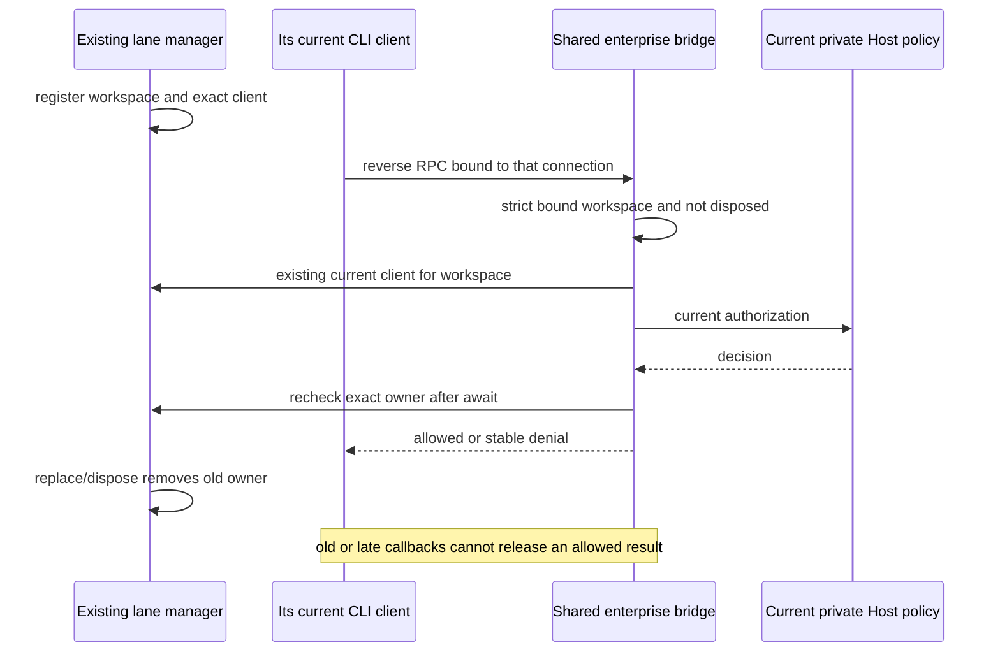

# Enterprise reverse RPC ownership across control lanes

## Defect and owner

`createZCodeAgentService` owns the existing chat, plugin-management and MCP-status process managers. All three wire their actual `ZCodeProtocolClient` through the same enterprise reverse RPC bridge. A current plugin or MCP-status client must not be rejected merely because it is absent from the chat manager.

The three managers remain the sole process/client owners. Bridge composition reads their existing `getExistingClient(workspace)` query and accepts only exact client identity in one of those managers for that workspace. It does not spawn a runtime, copy ownership into a cache, create an identity authority, or weaken permission checks.

## Invariants and ordering

1. Chat, plugin and MCP-status current clients are authorized by the same existing policy contract.
2. Same path with a different workspace identity, forged workspace routing, replaced clients and disposed clients remain denied. The bridge's existing pre/post-await checks and cancellation behavior remain intact.
3. Real Desktop Host `McpSync.listWorkspaceMcpServerStatuses` connects and lists a harmless owned loopback peer under published allow. A preceding denial and subsequent `personal.connectors=false` publish must send no new peer frame. No model invocation is required.
4. Production source changes are limited to bridge composition after all three manager declarations. No protocol, manager interface, identity/session owner, TTL, UI, or persisted data format changes.

## Regression and verification

The source composition regression uses real process managers and real staged CLI clients. Observation wrappers retain the real registered reverse handler and record attempted responses without fabricating `isCurrent` or owner-query results; retained handlers model delayed callbacks after actual manager replacement/disposal. A separate production Desktop Host smoke uses the actual MessagePort/McpSync/CLI/TCP path and current backend HTTP configuration. Source guard probes do not claim Native transport acceptance.

Use exact Node 24.14.0. Run the focused source regression before/after the fix, the real Host regression against the current artifact to preserve RED evidence, source typecheck/lint/architecture, and the Host regression after Root's coordinated desktop build. Do not rebuild shared out/CLI while the independent Native session uses them. Keep Native error copy and its owned peer separate.
