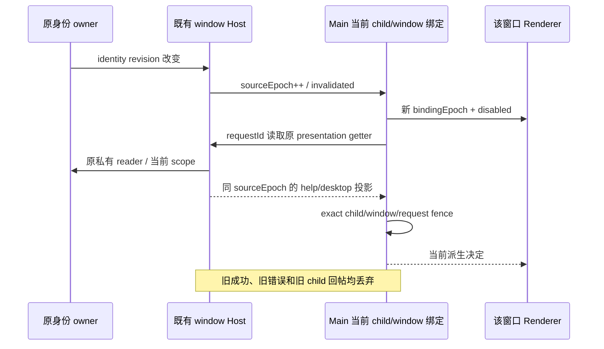

# 企业客户端配置的 Desktop 与 CLI 接线

本文件落实仓库根 `SPEC-client-experience.md` 的 Main/Host/CLI 切片。后台发布仓库和既有 `UWorkBackendSession`/企业身份仍是唯一事实与私有读取所有者；本切片不新增配置 HTTP、凭据、租户缓存或远端身份。

## 复用的入口及文件边界

- Host 的 `IEnterpriseIdentityService.readClientPresentation()` 是现有无参数 RPC getter；ready 投影中的 `help`、`desktop` 使用共享 `UWorkPublishedFeature<T>`。Main 只取得这两个字段，不取得 welcome、scenes、pluginStore、成员身份或 token。
- `desktopHostProcess.ts` 已有每个 utility child 的 `message` listener，Main 到 child 使用 `postMessage`，Host 的统一 `parentPort` listener 校验 `hostIncomingMessageSchema`。资源采样已有 requestId request/result 模式；本切片沿同一传输添加窄消息，不另开 socket、端口或 service owner。
- Main 既有 `windowHostProcessMap` 以 webContents ID 定位当前 child。生命周期接线使用准确 child 对象比较，不按可复用 label 判断。
- 主会话沿 `session/requestRuntimePreferences` 反向协议读取，服务端 root 的 node resolver 由 services 实施线接入同一个私有 presentation reader；Main 不参与 CLI context 的业务裁决。

本切片拥有 Desktop Main/Host transport、shared Host/Platform/反向协议 schema、renderer trace producer、CLI bootstrap/core turn surface 及对应测试。services DTO reader、node 装配、scenes/order hooks 和后台/admin 由其他实施线拥有。

## 窄 Host 消息与窗口因果

计划消息名：

- Main → Host `client-presentation-read`：仅 `requestId`。
- Host → Main `client-presentation-result`：`requestId`、单调 `sourceEpoch`、仅含 help/desktop 的安全投影（ready/unavailable/unmanaged）。
- Host → Main `client-presentation-invalidated`：仅单调 `sourceEpoch`。

Host bridge 只保存订阅、请求代次和失效计数；每次读都调用上述原 getter，不持有已接受配置副本或 TTL。原 identity `onDidChange` 回调先同步推进 sourceEpoch、发 invalidated，再异步读取；旧 sourceEpoch 的成功与失败不能发为当前结果。Host 服务替换/销毁时先关闭同一 bridge fence 并释放订阅。

Main 的每个绑定由现有 window/child 对象和随机非秘密 binding ID 构成。请求只发给当前 `windowHostProcessMap.get(webContentsId)`；pending 回帖同时匹配 requestId、准确 child 和当前窗口映射。新 child、窗口销毁、Host 退出、sourceEpoch 推进立即使旧派生 view 不可用。并发读取只合并同一绑定的在飞工作，不缓存成功数据；超时/失败不沿用旧 ready 值。

Main 可保存该绑定当前派生 view 和其 fingerprint 以推送 Renderer、验证已入队 trace；这不是网络缓存：每个 help 点击、trace get/轮询、trace 入队与派发都重新读当前 Host，失败覆盖为 unavailable。每次有意义的派生决定变化（包括 ready→unavailable、版本变化、owner/child 失效）旋转非秘密 `bindingEpoch`；相同配置的重复成功读取不旋转。该 epoch 不使用 token、ownerKey、tenantId 或 published version 单独充当身份。

## Help 与 trace

Help 的 IPC 按 event.sender 解析窗口；原生菜单命令按其明确 targetWindow（缺席时为当时实际 focused window）解析。点击前重新取当前绑定的 help；ready 的 HTTPS URL 为唯一远端 URL，null/disabled 不回本地或内置反馈。unavailable 不打开；unmanaged 保留本地帮助且不读取旧匿名 configs HTTP。await 后、调用 shell.openExternal 前再次验证同一绑定，已发出的外部打开不声称可回滚。

删除 Main 生产路径的全局 context/trace rollout、firstHost 决策 latch、全窗口 trace 广播和 lastConfig。trace get/changed 只作用于 sender 所属窗口。managed 值优先于本机强制开启 debug；ratio 维持 0–0.2。unmanaged 可保留显式本地 debug，local TTFT 仍独立按现有本机设置处理，不把其开关当作远端追踪授权。

共享 trace config/batch 增加可选 `bindingEpoch`（有界非秘密字符串）；managed batch 必须携带当前精确 epoch。Renderer 换 epoch 时清 completedQueue、取消旧 activeActions/timer，旧 handle 不能重新提交；正在 flush 的后续批也不得改盖为新 epoch。

Main 在入队前复查 sender 当前 child/window/epoch、当前 enabled/groups；既有 broker 队列条目携带原绑定准入闭包，首次 export 与明确失败后的 retry 前重新读取并复核。身份/child/配置失效后旧队列丢弃。已发出的 exporter 请求不能撤回，不宣称追溯回滚；不改变既有超时不重试语义。trace 不含身份、用户文本、凭据或新增上报地址。

## 每个实际 turn 的 context

原 strict `session/requestRuntimePreferences` scope 增加 `turn-presentation`，result 只新增 optional：

- `presentationSurface: "terminal" | "zcode_desktop"`；与原 runtimeConfig 同一枚举，不新增第二个 context enabled 状态。
- `presentationStatus: "ready" | "unsupported" | "unavailable" | "unmanaged"`，只供诊断。

其他 scope 不额外读取网络。Host resolver 使用同一私有 reader（内部可传 process/client dispose signal、`propagateInvalidation: true`）：managed desktop ready+enabled 才返回 zcode_desktop；503、坏/缺 metadata 返回 terminal 并保留 unavailable/unsupported 诊断，模型仍走原独立准入。unmanaged 省略 surface，保持原受信入口默认；取消、identity/configuration_changed 不降级成功。

CLI bootstrap 注入一个有限的 turn-presentation resolver port（非 JSON、非 Renderer 参数）给现有 AgentRuntime。`executeTurnCommand` 沿原 FIFO/dequeue/reservation 后、context prefix 构造和模型派发前读取一次；`requestClient` 复用现有 AbortSignal/timeout，连接销毁或 turnAbortSignal 终止等待。Host 的反向读取受原 owner/process signal 限制；协议取消不伪装为跨进程分布式回滚，迟到回帖不会应用。

本次取值只写原 `runtimeConfig.presentationSurface`，本 turn 的 steer/模型重试/后续 model step 不重新读取。下一次真正执行的 queued/promoted turn 再读一次，原 `rebuildContextPrefix` 负责整体替换 prefix；不热改已派发模型调用。entrypoint 的进程默认只能补缺省 surface，不无条件覆盖受信 runtimeConfig。

取消/owner 改变或严格协议错误进入现有 turn outcome 并释放 reservation，不新增悬挂阶段。custom system prompt、workflow actor 和专用 subagent context 保留原有不注入 Desktop 段的规则；terminal/manual app 不因新字段获得 Desktop surface。旧 Host 缺方法/旧字段只适用原明确兼容路径，不吞掉当前取消或身份错误。

## RED、验证和交付边界

先验证 exact-child request/result、双窗口同版本不同 owner、invalidated 后旧回帖、help 点击 await 间切换、trace epoch 清旧 producer pending、入队后/重试前失效。测试使用纯生产模块或隔离 VM 的真实窄函数，不启动 Electron 或读取实际企业环境。

CLI RED 覆盖并发 admission 仍仅一个 reservation、配置慢读时取消/原终态、同 turn 重试保持快照、queued turn 重新取值、503/unsupported 使用 terminal 但仍调用原模型准入，以及原 actor/customPrompt/subagent 排除。协议及配置 schema 保持 strict。

执行有意义的 focused/source 回归、类型/lint/架构/格式检查；不自行构建正式 CLI、stage 或 Desktop/out，不用旧 CLI 读取新字段。Root 最终统一 CLI → stage → Desktop，同版 Native 和真实双窗口验收另行记录。
