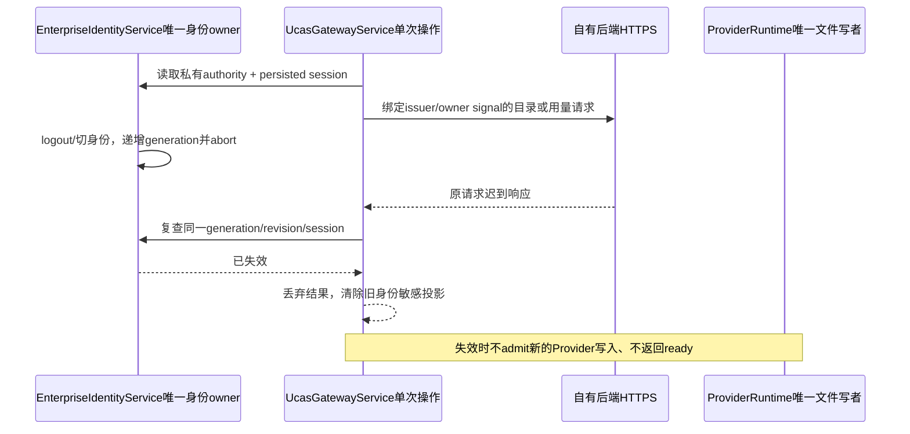
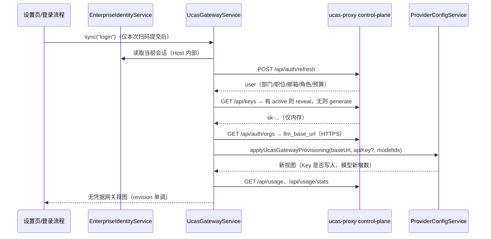
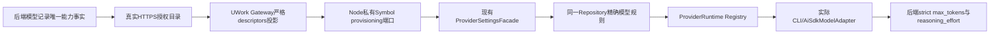
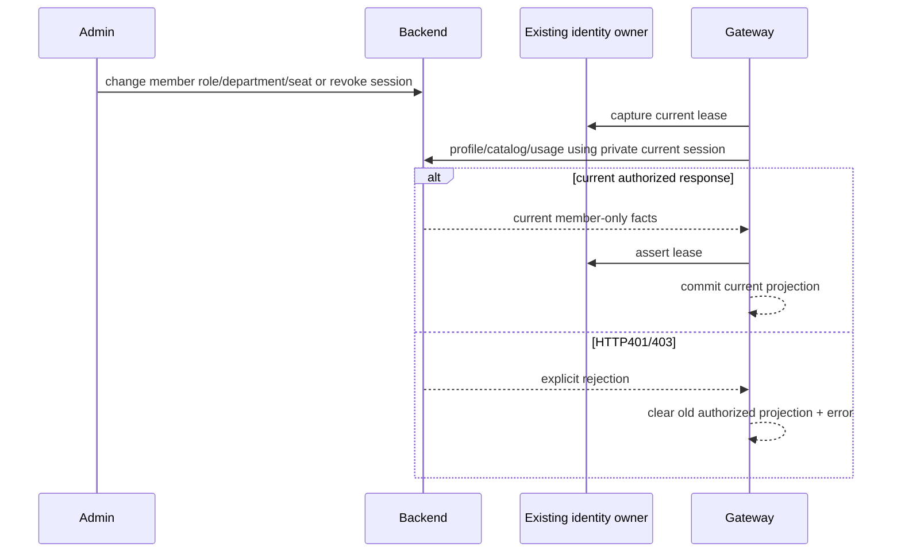
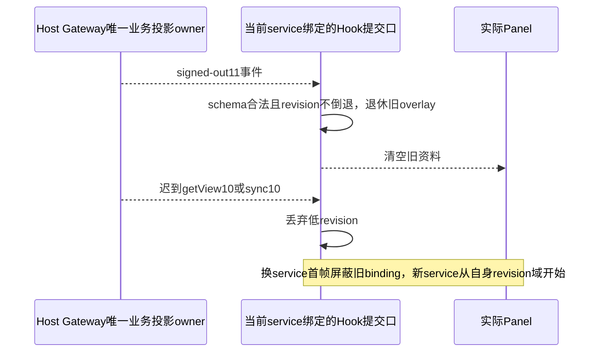

# 企业网关自动配置（UCAS Proxy 复用）

## 自有 UWork 后端协议（2026-10-14）

公开配置新增 `backend: "uwork"`，缺省仍是 `"ucas"`。显式切换后由现有 EnterpriseIdentityService 持有不透明会话，新的适配器按 attempt/proof 领取，不假设 JWT；Renderer 不持有新增身份状态。取消同时通知服务端，restore 由 `/api/auth/me` 验证。

现有 UcasGatewayService 继续唯一持有网关视图。当前自有 UWork 模式使用 Host 私有登录会话转发模型请求，不申请或下载 device API key，不复制会话到 Provider/CLI/Renderer。Provider 只保存 enterprise-session 访问方式、后台地址及公开模型能力；原终端令牌在迁移成功后吊销。旧 UCAS 模式保持原行为，用量单位仍为 Credit。完整当前合同见 enterprise-model-relay.md 与 enterprise-session-provider.md；2026-10-14 的 device credential 配置路径仅保留为历史/旧客户端 API 兼容，不是当前桌面模型出口。

本切片覆盖身份、模型与用量。资产/菜单/Host 安全的完整终端应用另需通过后端 HostConfigurationPorts 合同接入各自现有所有者，不能把快照获取写成已完成所有终端 enforcement。真实扫码与三平台安装仍需逐组织验收。

## 身份与迟到结果（2026-10-17，去 Key 前发现及持续约束）

真实HTTPS/磁盘联动发现：models响应已在服务端计算但延迟发送时退出，旧同步仍将已吊销device写入Provider并返回ready；usage晚回包也能返回旧身份视图，applyModels直接沿用缓存模型清单而未读当前身份。

- EnterpriseIdentityService仍唯一拥有generation/revision/session/AbortSignal。Gateway仅持有单次操作的私有authority引用，不创建第二份身份或授权缓存。Node注入现有readEnterpriseAuthority端口；managed=uwork时缺少端口、session不符、issuer/组织/用户不符或端口失效均拒绝，不宽松降级。旧UCAS协议保持原流程。
- 每次sync/refreshUsage/refreshModels/applyModels绑定开始时的当前owner。等待identity/config/网络/Provider后、发起新的副作用前和发布视图前都复查authority及持久session；退出/换身份/issuer变更/销毁使旧操作失效。HTTP合并owner AbortSignal与已有超时，迟到成功和迟到错误都不能复活ready或覆盖新身份投影。
- 同一用户/组织退出再登录也产生新generation/token；不能仅比较profile ID复用旧目录。managed模型快路径必须复查原投影lease及issuer origin，失效时走同一sync重取当前目录；refreshUsage/refreshModels不得把新owner的局部结果混入旧user/key/endpoint/models投影。
- applyModels是写命令：缓存endpoint/available只是投影，不能代替当前owner。退出后不先调用getView也必须拒写；跨身份缓存先清理或走同一sync重新获取，不能拿前一组织清单写入当前Provider。
- ProviderRuntime仍为文件唯一写者，Gateway通过现有私有Symbol端口admit写入。写者已接受的文件事务没有分布式回滚保证；本切片拒绝admission之前已经失效的owner，并拒绝失效后的结果提交和后续请求。真正模型执行继续由Host/后端每次准入，磁盘上历史key不构成授权。
- 验收使用公开email交互session和device API，加密SharedIdentitySessionStore仅作明确合成登录初始化桥，真实adapter.restore/logout/Gateway/ProviderRuntime/NodeApiClient/Host网络与当前后端全部走实际TCP。`profile.provider=wecom`仅为旧schema枚举，不调用任何企微授权/provider。



实际平台安装/真实扫码/复杂供应商能力与外部MCP/网盘不由此合成桥验收。原始RED与GREEN另存后端仓evidence/client-live-20261017-gateway，不提交凭据或owned测试数据。

## 旧 UCAS 协议背景与目标

企业微信登录此前只提供姓名展示，模型 Key 与网关地址需要手工填写。本能力让已认证的 UWork 桌面客户端复用现有 ucas-proxy（control-plane）后台接口：

1. 读取企业用户资料（姓名、部门、职位、邮箱、头像、角色、月度预算）。
2. 自动配置默认 UCAS 供应商的 API Key（用户已有 active Key 时复用，没有时为企业账号生成）。
3. 自动配置网关地址（只取 HTTPS 公网入口 `llm_base_url`，不使用也不展示内网明文入口）。
4. 展示套餐（订阅额度、周期重置）与用量（请求数 / 费用 / Token 趋势与模型分布）。
5. 从当前套餐获取可用模型并补进 UCAS 供应商模型列表。

## 产品规则

- 本能力只在企业身份已认证时工作；未登录、已跳过时网关面板展示未登录空态，不发请求。只读手机 attachment 不触发登录后的自动同步，但可以查看桌面 Host 已同步的网关数据。
- 已有非空 UCAS API Key 的用户不被覆盖：默认只补缺失。用户可在网关面板显式执行「使用企业密钥替换」。
- 网关地址不是新的事实源：UCAS 供应商 Base URL 仍由 Provider Config 唯一持有，只是其固定值改为「网关端点覆盖值 ?? 随包默认值」。
- 网关入口固定为 HTTPS 公网地址；内网明文入口不进入客户端（不探测、不展示、不写 Provider 配置）。
- 旧 UCAS 模型同步是追加语义：只添加服务端返回且本地不存在的模型，不删除、不改参数、不改顺序、不启用/禁用既有模型。自有 UWork 托管模型同时更新后台声明的能力和上限，规则见下文；界面提示须说明这一区别。
- 套餐与用量是只读展示；本期不提供购买、重置、撤销 Key 的 UI。
- API Key 不在 UWork 界面呈现（面板不显示掩码 Key 与别名）；只保留「使用企业密钥替换」这一个显式动作，本地已有 Key 不被自动覆盖。
- 退出登录清除企业身份会话，但保留已写入的 UCAS Key 与网关地址（与本仓库既有的「退出不清除 Key」一致）；网关面板回到未登录态，不再刷新。
- 日志、错误文案不得写入 API Key 全文、JWT 或内网地址。

## 所有者与边界

| 事实                                            | 所有者                                               | 说明                                                    |
| ----------------------------------------------- | ---------------------------------------------------- | ------------------------------------------------------- |
| 企业身份会话（JWT）                             | `EnterpriseIdentityService` + `IdentitySessionStore` | 唯一写入者；网关服务只通过 Host 内部回调读取            |
| 网关快照（用户/端点/Key 元数据/套餐/用量/模型） | `UcasGatewayService`（新增，Host 服务）              | 内存视图 + 状态文件，只发布无凭据视图                   |
| UCAS Provider 配置（baseUrl/apiKey/模型）       | `ProviderConfigService` + Personal Repository        | 文件锁事务；网关只是写入方之一                          |
| 网关状态文件                                    | `UcasGatewayStore`（新增）                           | `{appConfigDir}/ucas-gateway.json`，原子私有写 + 文件锁 |

依赖方向：`services` → `provider`；`provider` 不认识 gateway 服务，只接受注入的 `ucasEndpointSource`（读端点覆盖值）。UI 只经 RPC 服务读取视图，不接触 JWT。



## 服务接口（RPC）

`IUcasGatewayService`（channel `ucas-gateway`）：

- `getView(): Promise<UcasGatewayView>`
- `sync(reason: string): Promise<UcasGatewaySyncResult>`：用户资料 → Key → 端点 → 应用 Provider → 模型 → 套餐/用量。
- `refreshUsage(input): Promise<UcasGatewayView>`：`period ∈ 7d|month|30d`，`metric ∈ requests|cost|tokens`，`force` 绕过服务端缓存。
- `refreshModels(): Promise<UcasGatewayView>`：只重读套餐可用模型，不写 Provider。
- `applyModels(): Promise<UcasGatewaySyncResult>`：把已读取的可用模型追加进 UCAS 供应商。
- `replaceApiKey(): Promise<UcasGatewaySyncResult>`：显式用企业密钥覆盖本地 Key。
- `onDidChange: Event<UcasGatewayView>`

视图字段（全部无凭据）：`revision`、`status ∈ signed-out|idle|syncing|ready|error`、`configured`（本机/随包企微配置是否存在）、`user`、`endpoint`、`key`（id/alias/maskedKey/status）、`subscriptions[]`、`usage`（summary/trend/models）、`models`（available/unrestricted/hasSubscription/applied 数）、`lastSyncedAt`、`error`。

## Provider 侧改动

- `ProviderConfigService` 新增依赖 `ucasEndpointSource?: { read(): Promise<string | undefined> }`；UCAS Base URL 解析为 `normalizeUcasGatewayBaseUrl(override ?? UCAS_BASE_URL)`。
  - `ensureSeededPersonalProvider` 每次启动把 UCAS Base URL 纠正为解析值（沿用原「固定地址」语义，但允许网关端点）。
  - `savePersonalProviderOverlay` 的固定校验改为与该解析值比较。
  - 新增 `applyUcasGatewayConfig({ baseUrl, apiKey?, replaceApiKey? })`：文件锁事务内写 `api.baseUrl`；`apiKey` 仅在缺失或 `replaceApiKey=true` 时写入。
- Base URL 规范：去尾斜杠；路径为空或 `/` 时补 `/v1`；已含路径时原样保留。

## 验收

- 未配置企微或未登录：网关面板显示空态，`sync` 返回未登录错误，不发网络请求。
- 首次登录且无 Key：自动生成/读取企业 Key 并写入 UCAS 供应商，登录后不再弹出原 Key 输入对话框；写入失败时回退到原对话框。
- 已有 Key：登录与同步不覆盖；`replaceApiKey` 才覆盖。
- 网关地址只取 HTTPS 公网入口：Provider Base URL 恒为 `<llm_base_url>/v1`；状态文件与视图不保留内网地址。重启后仍沿用上次解析值，无需重新登录。
- 套餐展示 `amount_total/amount_used/next_reset_time/status`；用量按周期与指标切换，`force` 刷新绕过缓存。
- 模型同步只追加；重复执行 `applyModels` 幂等（新增 0）。
- 定向单测覆盖：客户端解析与错误码、端点探测回退、Key 复用/生成、模型追加、状态文件读写、Provider 端点覆盖与 `applyUcasGatewayConfig`。

### 本次验证记录

- 2026-10-04：`packages/services/test/ucasGatewayService.test.ts`（6 项）与 `ucasGatewayProviderConfig.test.ts`（3 项）通过，覆盖未登录不发请求、内网优先 / 公网回退、复用与生成 Key、401 归类为 unauthorized 且不写 Provider、模型重复应用幂等、端点覆盖播种、Key 补缺 / 保留 / 显式替换、固定 Base URL 校验。
- 既有 57 项身份、UCAS 与模型发现测试全部通过；`pnpm typecheck`、`pnpm lint`（0 错误，56 条既有警告）、`pnpm architecture:check --changed`、`pnpm fmt:check` 通过。
- 未验证：真实企业微信扫码、与本机 ucas-proxy 实例的端到端联调、已安装 Desktop 客户端上的面板交互。上述 Node 测试使用注入的 fetch 与内存 Store，不代表真实服务响应。共享 UI 浏览器 E2E 需要先在本机 Chrome 允许远程调试（browser-harness 交互授权），本轮未执行；Electron 端到端同样未执行。

### 本地端到端联调（2026-10-04）

用本机假后端（HTTPS `https://127.0.0.1:9443` 模拟 control-plane + HTTP `http://127.0.0.1:14001` 模拟内网模型网关）与预置的加密会话，在真实 dev 实例（tsup + vite + Electron + Host）上验证：

- 会话恢复成功后自动触发 `sync("startup")`，请求序列与设计一致：`POST /api/auth/refresh`（身份）→ `POST /api/auth/refresh`（资料）→ `GET /api/keys` → `GET /api/keys/{id}/reveal` → `GET /api/auth/orgs` → 内网 `/models` 探测 → `GET /api/usage/models` → Provider 写入 → `GET /api/usage` / `GET /api/usage/stats`。
- Provider 实际写入：`api.baseUrl = http://127.0.0.1:14001/v1`（内网优先）、`access.apiKey = sk-local-test-key`（复用企业 Key）、模型 = 6 个默认 + `ucas-local-plan-only`（按套餐追加，原顺序保留）；`ucas-gateway.json` 落盘 endpoint/key 元数据。
- 内网不可达（连接被拒）时回退公网：`endpoint.source=public`、Provider `baseUrl=https://llm.example.com:15000/v1`。
- 已有本地密钥 `sk-user-entered-key` 未被覆盖，仅地址被同步为新端点。
- 重复同步幂等：模型 7 项、无重复。
- 应用日志无 API Key / JWT 明文，无 renderer 错误；`ucas-gateway` 通道注册、`getView`/`sync` RPC 正常。

本机联调注意事项（dev 环境，非本能力缺陷）：

- 从 App 内 Bash 工具启动 dev 时，宿主会注入 `ZCODE_BUILTIN_PROVIDER_CONFIG_FILE` / `ZCODE_PERSONAL_PROVIDER_CONFIG_FILE`，桌面主进程优先采用该显式路径（指向已安装版本的 CDN builtin 缓存，无 `ucas` 模板），表现为 `Provider Template 不存在: ucas` 且播种失败。用 `env -u ZCODE_BUILTIN_PROVIDER_CONFIG_FILE -u ZCODE_PERSONAL_PROVIDER_CONFIG_FILE pnpm dev:desktop:test` 或在普通终端启动即可恢复。
- Host 有意剔除 `NODE_EXTRA_CA_CERTS`（统一走桌面 custom CA 设置，`settings.httpProxyCaCertPath`）；本机模拟 HTTPS 控制面时用 `NODE_TLS_REJECT_UNAUTHORIZED=0`，仅限测试。
- 仍未验证：真实企业微信扫码、真实 ucas-proxy 服务、网关面板的视觉呈现与交互（需要 CDP/browser-harness 授权）。

## UWork 托管模型元数据（2026-10-17）

真实 Native SDK 的 JSON/SSE RED 已证明：把后台不透明model ID仅作为字符串追加，会继承UCAS默认Vision=true/context=1M/low|high|max；通用OpenAI规则还输出max_completion_tokens/thinking/enable_thinking/reasoning等本后端未声明字段，真实请求400且供应商0次。不得改fixture flags或放宽所有供应商协议来掩盖。

- 后端 `/v1/models` 继续兼容旧字段并返回context_window/max_output_tokens/supports_vision/supports_reasoning/supports_tools。UWork adapter严格校验并归一化为descriptors `{id,name?,contextWindow,maxOutputTokens,supportsVision,supportsReasoning,supportsTools}`；`name` 只用于当前显示，完整替换、私有写者、远端分发拒绝和同版 CLI 迁移边界见 `enterprise-model-catalog-projection.md`。旧UCAS readPlanModels的models字符串列表与原语义不变。
- Gateway为唯一目录投影owner，沿现有Node私有provisioning target透传 `managedModels`；ProviderRuntime的Symbol入口是消费该描述的唯一可信写口。公开ProviderSettings.applyUcasGatewayProvisioning不消费managedModels，即使JS调用者伪造多余字段也不能走该元数据豁免。
- 复用ProviderSettingsFacade和同一ModelConfig Repository writer，对descriptor ID在ucas provider下写精确规则，保留既有enabled/排序；本后端托管model的能力/上限/maps按当前server事实覆盖，已落盘的旧错参数也被修正。其他个人model IDs、默认六个UCAS模型及legacy UCAS模板不变，不新增第二份配置文件或模型owner。
- contextWindow精确采用后台值；图片和工具能力采用后台bool，音频/视频/PDF/native搜索/JSON-schema输出等未声明能力显式关闭。maxOutputTokens.max取后台上限，map仅 `{"max_tokens": maxOutputTokens}`。
- reasoning=false时values=`["none"]`、map=`{}`，不输出thinking/enable_thinking/reasoning等方言字段；reasoning=true时values=`["low","medium","high"]`，map只把这些合法值输出为reasoning_effort，旧max或未知档位不透传。精确maps不能被普通UCAS通配规则覆盖。
- refreshModels只展示当前目录；managed applyModels在现有owner准入后重读当前descriptors，再经同一writer应用。缓存view中的ID列表不代替当前后台参数或执行准入。未实现的外部/平台安装不因此声称完成。



验收：真实Gateway.sync→ProviderRuntime的server false/128k/output16逐字段一致；旧1M/Vision/最高reasoning参数再同步后修正；server更新描述后同ID再次同步生效；JSON/SSE实际SDK请求无不支持方言且成功/计量；旧UCAS及个人配置哨兵不变。只在独立磁盘/合成email与device/本机TLS和零费用provider上执行，不调用企微/外部MCP/网盘。

## 多成员当前资料与服务端撤销（2026-10-17）

受管Gateway仅投影当前认证成员的真实姓名、邮箱、原始平台角色（owner/admin/operator/auditor/member）及后台membership返回的企微externalId、部门名称。无该字段的旧后端仍返回null；不从客户端输入猜测身份/部门，不将Credit额度映射为USD。legacy UCAS角色映射不变。

同一组织的不同客户端会话各自持有既有身份owner/加密store、Gateway及Provider文件，不共享成员用量或身份投影。目录依当前席位、部门祖先scope与角色读取，部门转移/角色变化须在下次实际刷新反映；本地Provider旧模型条目不授后端执行权。

服务端明确401/403拒绝刷新或同步后，Gateway必须撤掉旧目录、套餐/用量及ready授权投影；401还清旧资料。不得仅设置error而保留可见的旧授权模型或旧成员用量。该动作仅撤销Gateway投影，身份是否恢复/退出仍由既有EnterpriseIdentityService处理，不创建第二身份owner。临时网络/5xx失败可保留最后快照但必须标error而非ready；保留数据不构成执行准入。当前成功的后续全sync可恢复投影。



验收使用独立磁盘+本机TLS真实HTTP：同租户两个企业成员、父子部门scope、部门额度、转部门、角色变化、撤席位与服务端会话失效，实际经Host私有relay生成及本人用量隔离；不调用真实企微/外部MCP/网盘，不读取主实例环境或数据。

当前成员套餐新增可选 `effectiveAllowance`：固定 `application=uwork`、账期、`amountRemaining`、`blocked` 与稳定原因。它是当前订阅/企业/成员/所有祖先部门/uwork应用约束扣除settled/uncertain/reserved后的预算下界，不披露共享使用明细或其他成员标识，不替换旧amountTotal/amountUsed口径，也不授执行许可。预算归零不等于禁止所有模型，显式零价模型仍由既有逐请求原子admission决定。

永久真实HTTPS回归入口（本仓根目录）：`node --import tsx --test scripts/client-user-journey-smoke.ts`。包含24组新的多成员流程：本人非等量用量隔离、已发布配置、五种平台角色、祖先scope/预算/部门变更、四种Gateway入口的席位及服务端会话拒绝、撤权恢复时局部刷新不能冒称完整ready、统计阶段中途撤销，以及受控503失败/成功恢复、真实Registry默认候选/撤权重启与成功目录收缩/空目录。外部企微provider被显式禁止调用，绑定仅为本机合成管理元数据；不会验证真实企微授权。

## 当前受管模型候选与默认选择（2026-10-17）

受管模式不能把旧UCAS模板自带的模型混入当前后端目录。当前scope-bound plan.ids经同一私有Symbol传入Provider的既有原子writer，派生为 `enterpriseModelIds` 候选快照；缺失或空数组均无受管候选。Resolver只在enterprise-session模式用它缩小真实Registry/selectable/default候选，不修改旧builtin/personal membership、规则或用户磁盘默认偏好；legacy访问模式忽略该快照。该字段只承载派生目录，不提供执行授权，用户改配置也不能绕过后台当前模型scope/会话/席位/额度检查。

公开create/save不能提交reserved `enterpriseModelIds`。Gateway写目录、拒绝后的清候选均绑定原操作scope.isCurrent；同一writer在实际磁盘变更前检查这个Host私有回调，旧owner的迟到拒绝不能清新owner目录。managed401/403后把候选清为空；既有磁盘规则保留供诊断及legacy恢复。新scope完整同步才重新建立受管候选。默认选择由既有ModelSelection owner从真实Registry得出，不靠UI隐藏，更不凭空创建后端未授权模型。

自有协议401为unauthorized（重新登录），403为forbidden（权限/席位不足但不伪造身份失效）；两者均撤销授权投影和候选，旧UCAS错误映射不变。

私有编排先发布空候选，再由既有Facade写入精确模型能力，最后同一原子writer发布当前IDs；失败保持候选为空，不能在描述就绪前短暂继承UCAS旧能力。该编排helper不保存身份、目录或任务状态。成功refreshModels仅在同owner完整旧投影仍存在时更新候选；明确拒绝清空后，局部刷新不能重建可选模型，必须由完整同步重建资料与当前目录。

自有控制面目录/配置请求明确402（如SUBSCRIPTION_INACTIVE）与403同属forbidden，清旧active套餐/有效额度与候选，但保留identity owner；401仍unauthorized。该映射只作用UWork控制面client，不改变经Host relay返回的模型POST402（如单次预占额度不足），也不改变legacyUCAS错误语义。真实回归先HTTP使订阅过期，再实测目录402、Gateway失效及Registry/重启无默认，登录会话仍可GET me。

## 用量刷新与授权失效并发（2026-10-17）

自有模式的用量“刷新”在同一个请求serial/身份scope内读取当前套餐/effectiveAllowance和所选period/metric/force的统计，一起提交；后台调整额度后不要求另点全量同步。legacy只刷新usage的协议行为保持。套餐明确inactive（或effectiveAllowance.reason=subscription_inactive）作为forbidden清授权投影及候选；quota_exhausted/剩余0不等于撤销目录，不禁零价模型。

服务端401/403/控制面402清授权投影前，同时使同Gateway已有usageSerial失效。旧owner本地仍authenticated不代表旧HTTP200可发布：服务端已拒绝后的迟到统计/套餐不得复活旧用量、active额度或ready状态。仅使用既有Gateway serial与身份owner，不增第二身份或任务所有者。

## Gateway投影准入代次

同owner服务端撤权也会使先前已计算的models/usage/sync200过时。Gateway内部投影admission generation在新的完整sync及当前明确拒绝时推进；不是身份代次，不保存token，也不建立新身份/任务所有者。所有操作scope与Provider isCurrent回调叠加此代次，旧操作迟到成功/失败直接丢弃，不能发布、清理或覆盖新快照。拒绝清候选绑定推进后的代次，后续完整sync使旧clear失效。usageSerial仍独立保留所选统计请求的最新胜出规则。

已提交projection仅持原identity lease；同owner已完成快照的临时503可保留缓存。新owner/启动未绑定快照的完整sync先以当前准入scope stage空候选再读取目录，失败时不能把前owner目录当默认候选。该初始清理同样受锁内isCurrent保护。

```mermaid
sequenceDiagram
  participant GW as Gateway唯一投影owner
  participant Old as earlier HTTP200
  participant New as current control rejection
  participant Repo as existing Provider writer
  GW->>Old: capture admission N + identity lease
  GW->>New: capture admission N
  New-->>GW: 401/403/control402
  GW->>GW: admission N+1, invalidate usage serial
  GW->>Repo: clear candidates bound N+1
  Old-->>GW: late 200
  GW->>GW: discard N; no publish or late catch cleanup
  GW->>GW: new full sync advances N+2
  Repo-->>GW: old clear N+1 cannot commit after N+2
```

## Renderer 网关视图交付顺序（2026-10-18）

Gateway 继续唯一拥有网关业务视图，EnterpriseIdentityService 继续唯一拥有身份/lease。Renderer Hook 只订阅公开 View 并发送已有命令；不持凭据、不创建授权缓存，不代替 Host/后端准入。

getView、事件、sync 与用量返回的 View 经过同一 schema/revision 提交口。同一当前 service 不接受倒退 revision；相等 revision 可幂等接纳。service 更换的 render 当帧即隐藏旧绑定的资料、用量、busy 和待响应选择，新 service 从独立 revision 域开始；当前已提交 service 的提交引用仅在已提交 effect 更新，废弃 render 不得关掉仍可见 service 的提交口。

已接受 usage=null 或公开用户投影变化时，原子退休旧的 pending period/metric；signed-out 或前一已知用户投影换 owner 时退休旧 operation。正常冷启动 idle→syncing 的 usage 仍为空时，本次同步 busy 保持到自己的完成。正常 period/metric 请求立即展示本次在途选择，当前权威回显后采用 View 字段；请求结束/失败不继续冒称在途选择。旧 service/旧操作的 finally 不得更改新 service/新操作的 busy。



验收包含真实 React Panel/ServiceProvider 的合法公开 DTO 次序：初始旧返回晚于 signed-out；sync旧返回晚于 signed-out；7d在途后退出/新owner month；服务更换首次layout无旧用户且新服务低revision可接受；A旧busy不能锁B，旧A完成不能清B新busy；冷启动null usage同步保持busy直到完成。新增的用量返回提交另验返回先于事件、迟到旧revision与请求拒绝。组件复现不冒称真实Native注销/网络故障；Native与HTTP验收独立保留。

未登录提示的中英文只说明自动同步企业模型配置、套餐与用量，不承诺向客户端下发模型 API Key。此文案规则不改变已有认证模式、密钥所有者或权限合同。
