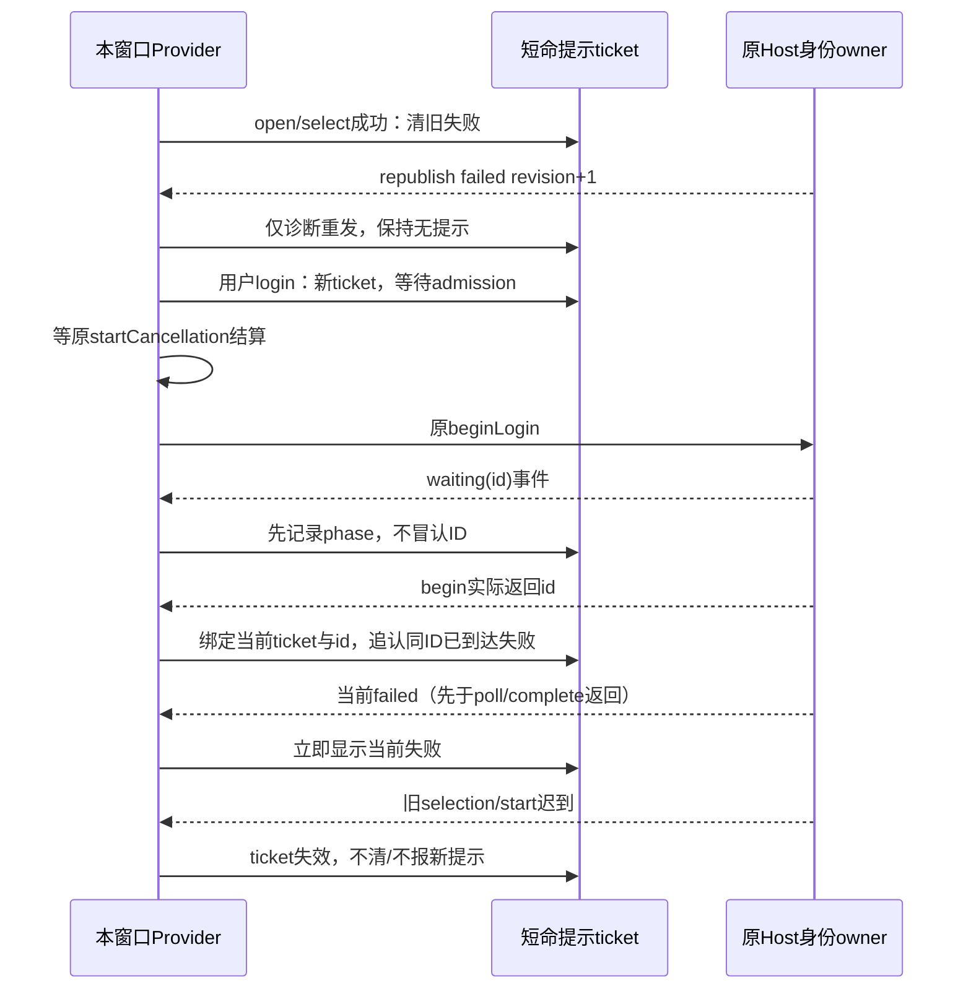
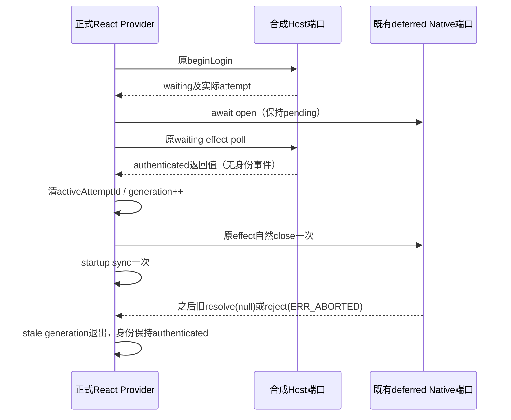

# 企业登录：窗口失败提示的生命周期

2026-10-18，Root与独立review已批准no-getView小方案，按下列TDD验收。不新增getView或其它异步读取。

本增量修复真实Native观察到的“B登录失败后，跳过/重开或成功改选A仍显示旧失败”。只改变本窗口`EnterpriseIdentityProvider`的失败提示presentation，不改Host/session/gateway、服务API、身份投影规则或认证准入；Host保留`signed-out + error=failed`诊断是合法行为。旧证据和正式产物保持原样，新共享UI测试不能冒称Native通过。

## 单一所有者和最小状态

Host与原Zustand投影继续唯一决定认证状态、组织偏好、pending及revision。窗口失败提示由Provider内一个短命presentation状态拥有，不再在render时与原始`view.error`做无条件OR。

一个具名小纯helper管理owner绑定的提示状态：递增ticket、提示是否可见、短暂观察到的view phase，以及判别operation（initial/clear/selection/starting/attempt）。starting只在原取消屏障之后进入；attempt携带当前begin实际返回的ID，不另存admission布尔值。一个判别值表达互斥阶段，不要求每个concept一个ref。只保留revision/phase/pendingId等排序元数据，不持token、不持第二份认证view、不形成请求队列，也不决定Host操作是否准入。原pendingStart/startCancellation/activeAttempt/surface一起置于每owner新建的窗口句柄对象，actionGeneration仍沿原路径；纯factory仅初始化句柄，不执行IO。旧owner清理只取消其真实active ID，迟到begin仍由捕获旧owner的闭包精确取消；新owner不用旧屏障/ID。跳过与返回复用同一个取消路径，返回回调显式无参数，不能把MouseEvent当作关闭窗口的布尔值。

所有异步提示更新都校验产生它的owner和ticket；owner改变后的首帧不显示旧owner提示，旧回调也不能重新打开新owner页面。现有认证view投影、取消及gateway后续流程保留既有围栏，不因一个旧presentation ticket而拒绝本来合法的认证事实。

## 用户动作与提示

| 动作                   | 窗口失败提示                                                                                         | Host及原流程                                                                     |
| ---------------------- | ---------------------------------------------------------------------------------------------------- | -------------------------------------------------------------------------------- |
| 初始restore/getView    | 当前owner的首次失败或当前restore拒绝可以显示；之后用户操作使旧回调失效。                             | 保留先订阅后读取、原revision投影；不能取消共享restore。                          |
| openLogin              | 新ticket，清旧提示；Host仍failed不应立即复活。                                                       | 仅重开窗口，不写Host诊断或身份。                                                 |
| skip / back            | 新ticket，清旧提示、退休原attempt的提示归属。                                                        | 保留原pending-start结算/取消屏障；只取消实际旧ID，不发无ID cancel。              |
| select开始             | 新ticket阻断旧selection/start/poll对提示的迟到更新；未成功前不伪造新选择。                           | 仍调用现有selectOrganization，不能抢写选中项。                                   |
| select成功             | 仅当前owner/ticket清提示；失败状态的republish不算新失败。                                            | Host可能增加revision并保留failed，照常投影真实选择。                             |
| select失败             | 仅当前owner/ticket显示；已提交的旧组织保留。                                                         | 不吞persist失败，不写Host。                                                      |
| login开始              | 新ticket清旧提示；在取消admission等待期不接收旧attempt的提示。                                       | 先等原startCancellation，拒绝仍是拒绝，不转换为成功。                            |
| login过admission       | 进入starting，再走原beginLogin；Host等待/失败先到时仅记录其attempt phase，等真实返回ID后归属。       | 不加额外getView、RPC超时或队列，保留原action generation/owner检查。              |
| 当前新失败             | 当前start拒绝（即使无ID/Host连续failed）、poll/complete拒绝、当前attempt的waiting→failed通知都显示。 | 不要求Host先清诊断，不要求状态一定有false→true。                                 |
| authenticated / logout | 当前真实认证成功清提示；logout失败只归当前owner/操作。                                               | 保持既有身份成功、窗口关闭和退出语义；旧owner的logout catch不能打开新owner窗口。 |

本增量只处理`failed`窗口提示，现有未配置/过期规则与文案保持；不增加视觉样式、文案或新的交互控件，复用现有role=alert和DESIGN语义色。

## Host通知与Promise的归属

`revision`每次publish都会递增，组织republish也会递增。因此“failed且revision变大”既不代表新失败，也不能作为提示永久屏蔽线。

1. 在现有订阅/合法RPC view投影入口同步观察phase顺序，不依赖React effect看到每个中间render；同批waiting→failed也要识别。
2. 新login在原startCancellation未结算前不接收旧start的提示；屏障结束后进入starting，仍不从第一个waiting就猜它是本次start。真实begin返回ID才归属当前ticket，取消返回的旧ID与新ID不能混用。
3. 已绑定当前ID后，同attempt的waiting→signed-out/error=failed立即显示，即使poll/complete Promise尚未返回。若waiting/failed先于begin的ID返回，短暂记住其ID/terminal phase；同failed republish或较旧snapshot不能清掉这个failedForId。返回真实ID匹配时追认失败，并在打开surface/扫码页前结束该已失败尝试的窗口流程，不能误开过期页。begin成功返回不是清错误动作。
4. 没有pendingId的start失败不能从Host的failed→failed republish猜测来源，靠当前start Promise catch归属；重复失败仍必须显示。poll/complete返回failed view但不throw时，通过同一phase观察路径显示。
5. open/skip/back/新操作使旧ticket失效；旧Promise无论success/failure都不能改变新提示。老view仍按原规则参与身份投影，不能因presentation token过时就跳过合法认证投影或关闭，也不能借raw OR绕回提示。重复/低revision view只做原投影去重；新较小snapshot不回退已经同步观察的phase。没有新的snapshot读取或永久failed floor。
6. owner更换时仅当前owner的presentation可渲染；旧callback不清/报新错误、不重开窗口。原取消屏障必须保留产生它的owner归属：A的屏障只约束A，不能因A永不结算或拒绝而阻塞/报错到B；A的清理仍继续，同owner的新start仍必须等待原屏障。不新增Host命令或改变共享restore。
7. 提示ticket与现有actionGeneration职责不同：用户动作/owner使提示ticket退休；view终态触发的surface清理可能推进原actionGeneration，但不能因此丢掉已经识别的当前失败。只因ticket过时不改变认证流程；仅已确认同ID失败时阻止打开失败扫码页。

timing边界：begin尚无真实ID且Promise一直不结算时，不猜Host failed属于本次，不为此增加读请求；用户仍可按原skip/back取消窗口并退休提示。任务要求的“先于poll/complete结算显示”在当前ID归属后即时满足；故意延迟ID的测试另外验证返回时追认与不打开失败surface。fast-poll认证成功仍通过原store/project立即关闭，不等待提示归属。

## TDD与真实React共享UI验证

先加新fixture并在未修hook上取得实测RED，再实现最小helper/hook改动。测试模拟的是已有service/platform port，必须按正式合同保持failed诊断、每次publish增加revision；选择成功不能偷偷改error=null。实际Provider/登录页/订阅/回调执行生产代码。

| 场景                            | 必要断言                                                                                                                     |
| ------------------------------- | ---------------------------------------------------------------------------------------------------------------------------- |
| B失败→skip→reopen               | 提示消失，Host仍failed；同failed重发新revision不能复活。                                                                     |
| B失败→成功选A                   | A真实投影后清提示，Host诊断保留。                                                                                            |
| 选择写失败                      | 当前提示可见，旧org不变；之后新成功选择能清。                                                                                |
| 连续无ID start失败              | 每次新login catch均能显示，不能被旧诊断floor吞掉。                                                                           |
| waiting→failed通知先到          | Promise故意未结算时alert已经出现；poll/complete后返failed不throw同样覆盖。                                                   |
| begin真实ID晚到                 | waiting→failed→同failed republish→较旧snapshot→返回同ID后提示出现、不打开已失败surface；不把旧ID失败追认成新ID。             |
| 旧start success/failure迟到     | skip/back→reopen→新login仍先等取消结算；旧失败不显示，旧ID才被取消，新attempt不被误取消。                                    |
| 旧poll success/failure迟到      | 不能复活清掉的旧提示或清掉当前新失败。                                                                                       |
| 两次selection乱序/与新login重叠 | 旧selection成功不清新错误，旧失败不报到新operation；身份/偏好仍走原投影。                                                    |
| owner A→B                       | 旧restore/start/poll/selection/logout拒绝或成功不污染B窗口；A永不结算/拒绝的barrier不阻塞B但A清理继续；B自身当前失败可显示。 |
| auth先于迟到ID                  | 真实认证投影立即关闭，退休提示；迟到begin不复活失败或原扫码页，不按旧ticket丢合法auth view。                                 |
| 认证/取消回归                   | 原fast-poll成功、surface取消、无ID不取消restore、显式旧ID取消屏障不退化。                                                    |

纯helper测试先覆盖这些事件序列，不用定时器猜测完成。浏览器用新的独占localhost Vite/Chrome/CDP/BH profile，不读取主env、旧封存目录或用户OS profile；root/env/cache均owned，外部DNS拒绝且合成platform不执行外部导航，model/真实企微/paid均0。测试授权值先经正式authorization schema校验，不能借不完整fixture绕过真实回调路径。BH daemon归属以本run唯一PID文件、OS出生时间/命令及owned UNIX socket共同确认；退出后实际lsof核对所有已知进程、TCP端口与owned UNIX socket，未证或仍有写者时保留root。spawn错误立即结算为失败值，不能在等待daemon时因未处理rejection跳过finally。

产品控件全部用真实BH鼠标/键盘、DOM/AX只读核对。延期/释放与owner替换属于有限合成port控制：可放独立fixture控制页，正常按钮操作后经同源有限fixture消息驱动，避免被产品modal遮罩；driver不DOM.click、不window.release、不直接调用service/React/store。这个控制面不能移植到Native或称真实认证验证。

实现后按Root安排跑纯测试、共享UI browser、client typecheck/lint/architecture/改动格式检查，记录真实baseline。该slice不build、不启动Native/CLI，不改正式Desktop/Host/CLI字节。Root独审/gates后才统一正式构建并另起Native复测；新结果不覆盖旧145/252证明。

## C3：poll 成功先于 Native open IPC 交付

沿用 `enterprise-login-error` 的真实 React Provider、现有 deferred poll/native 门及 runner。单一合成 Host 仍拥有身份事实，fixture companion 只记录 Hook 公开投影、Native close 与 gateway sync 调用，不成为第二个身份 owner。两个新 case 都通过原登录按钮进入，先证明 open 仍未决且原 waiting effect 已进入 poll，再仅 resolve 原 poll promise 为 authenticated，不发合成认证事件绕过 effect。

| 场景                  | 必要断言                                                                                                                                                       |
| --------------------- | -------------------------------------------------------------------------------------------------------------------------------------------------------------- |
| `poll-native-null`    | poll 先成功，原认证 effect 自然 close 一次；之后旧 open resolve(null)，owner.cancelLogin/completeLogin 均未进入，身份不回退、无失败提示、startup sync 仅一次。 |
| `poll-native-aborted` | 同一顺序，之后旧 open reject(ERR_ABORTED)；旧 generation 的异常不能再次 close/cancel/sync 或复活失败。                                                         |

成功后持续观察超过原 1500ms poll 周期；投影从 authenticated 起不能出现回退。此处的 native port 是 UI fixture，不能把这些合成控制消息注入真实 Native，也不能称为 Electron IPC、真实 WeCom、后台 claim 或原生登录验收。

## 本次共享 UI runner 的有限生命周期

每次运行新建独占 evidence、Vite、Chrome profile/CDP 与 BH 私有根。BH 子环境清除继承的 BU*/BH*/Browser Use 连接配置，只绑定本次 CDP；BH_RECORD=0、BH_TELEMETRY=0、debug clicks 为空串，外部 DNS 拒绝。一次同 run 执行新 2 与旧 23，共 25 个有限 case，不作业务重试；首次 case 失败仍先关闭两个 fixture tab，写失败结果并退出，交 runner finally 清理与保根。

进程只按本次 runner、spawn PID 和私有 daemon PID 文件起点核对 PID/PPID/birth，最多 256 条、每个查询 1 秒，禁止全局进程表/外部 holder 发现。100ms tracker 不重入，finally 停止扩树并等当前有界查询。daemon 需在 5 秒内通过私有 PID 文件与精确 socket 核验；driver 自 spawn 起 180 秒总截止；所有总 timer 在 finally 清理。Vite 完整 close 另有 3 秒截止，失败后仍继续已知 Chrome/BH/PID 清理；只有 close resolve 才能标记完成，不能把 HTTP listening=false 当作完整 close。

删除前只对本次两个新根执行 scoped lsof 的 PID/FD 元数据聚合，不输出未知持有者身份、不 signal 未知 PID。只有 driver 明确成功、完整 Vite close 与本次已知资源均收口、两根 FD 查询完整且为零时才删除；失败、超时、未知 FD 或查询不确定时都保留两根 0700，即使已知资源已关闭。FD 检查只证明删除前的两根快照，不扩大为 OS 隔离或未来写入不存在。
