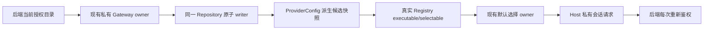
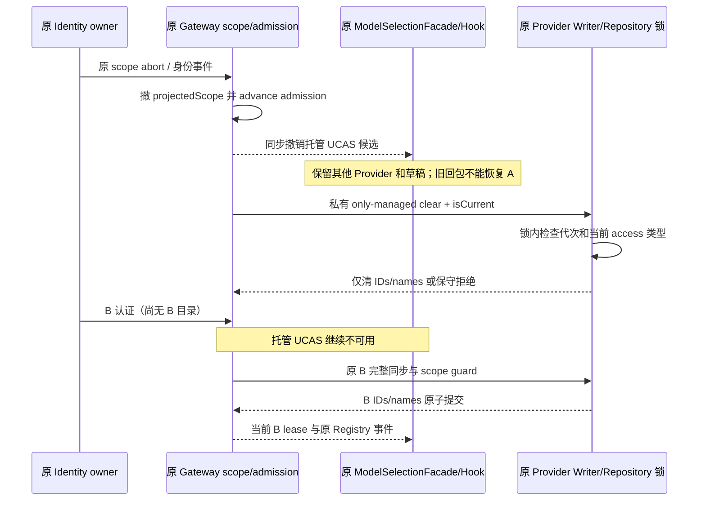
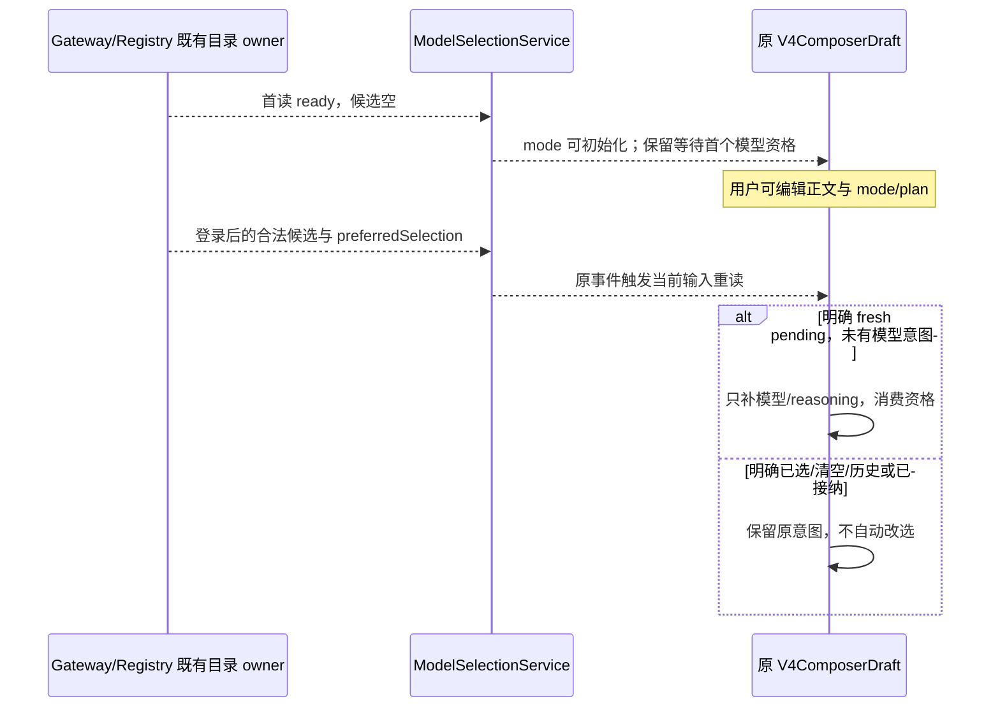
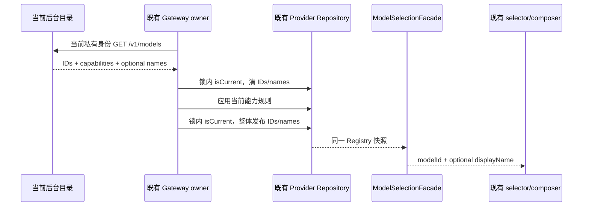

# 企业会话模型目录的候选投影

2026-10-17 真实新成员 Native RED：后台只授权一个不透明模型 ID，新 HOME 却默认选择种子的 `ucas-deepseek-flash/max`，首次真实 Native 请求观测为 400 参数错误（旧 UCAS 方言先触发严格校验）；即使移除方言，目录外模型 ID 仍应由后台拒绝，不能将理论 404 当作这次实测码。根因是 ProviderRuntime 的六模型播种、Gateway 的追加式 membership 和 Registry 的完整配置准入叠加，UI 与真实可执行候选都继续包含旧 UCAS ID。

## 所有者与合同

后台目录是授权事实，现有私有 Gateway owner 读取当前 scope-bound `plan.ids`。既有 ProviderConfig/Repository writer 原子更新 endpoint、`enterprise-session` access 和非秘密 `enterpriseModelIds` 派生候选快照。无第二份身份、授权队列或配置文件。

`enterpriseModelIds` **不是执行许可**：它只收窄本地 Registry 的可构造/可选候选，不能取代 Host 当前身份与后端每次模型 scope/订阅/额度裁决。公开个人配置 create/save 不允许提交或扩大这个保留字段。手改磁盘不可能借此让后端执行未授权模型。

- 仅 access=`enterprise-session` 时，Resolver 在现有候选的 executable/selectable 判定叠加当前快照成员关系；undefined/null/[] 均无企业模型候选。缺少模型、disabled 或配置错误仍拒绝。
- 设置中的 builtin/personal membership、模型规则、顺序与用户默认偏好保留，不通过删除旧 UCAS 配置或 UI 隐藏实现约束。切回 legacy/API-key 时忽略该候选快照，原配置与偏好继续可用，其他 Provider 不受影响。
- 同一原子 writer 在持锁 mutator 的提交准入点调用 Host-only `isCurrent` 同步回调；过期 scope 不得排队后清掉新 owner 的目录。回调不进入 JSON/配置，已准入的文件事务不承诺回滚。
- 401/403 等明确身份拒绝由现有 Gateway owner 用同一私有 writer 清空快照；旧请求不得越过 owner 校验覆盖新目录。普通读取失败不制造授权，后台仍每次拒绝失效身份/模型。
- 全新草稿继续复用 ModelSelectionFacade/resolveInitialModelSelection：失效 legacy 默认不改写磁盘偏好，从过滤后的真实 Registry 选有效模型及其合法 reasoning 值；目录为空且没有其他合法候选时不回退六个种子模型。已有历史意图不被静默改写为另一个执行模型。

验收：真实磁盘/privateSymbol→Registry→默认选择 7vs1 RED；全新 HOME 私有 Gateway→真实 Registry→默认首次发送，无手选；同 ID 描述刷新、目录收缩/清空/重启/401拒绝后不复活、disabled、legacy/API-key 与个人 Provider 哨兵保持；旧 scope 晚写不能清新目录。测试不调用真实企微、MCP、网盘或付费供应商。

## 退出与换身份时撤销当前托管候选

2026-10-19 原生 RED：A 的原会话退出已由后台返回 204，身份已变为 signed-out，但原模型菜单仍有一个完整、可选且未锁定的 A 模型。没有 B 登录或新增模型/账本调用。这是当前候选失效缺口，不能仅因 Composer 草稿允许保留历史模型而把可选项当作草稿显示。

- Identity 仍唯一拥有会话、generation/revision 与 AbortSignal。Gateway 复用原 projectedScope 和 admission 代次拥有当前目录的有效性；不增加持久授权字段、第二份目录或定时清理。
- Gateway 原 scope 撤销时先同步撤掉托管目录准入并通知模型读侧，再异步清盘。B 已认证但 B 的完整目录尚未提交时，旧 A 目录仍不可读。普通同步网络故障不等同于身份撤销。
- 读侧在原 `ProviderRegistryFacadeSource` 上派生同一 snapshot 的 registry，仅当 `providerId=ucas` 且 `config.access.type=enterprise-session` 时检查当前 Gateway 目录 lease。失效时只排除这个 Provider；普通 UCAS/API-key 和其他 Provider 保持原对象引用。默认与 effective selection 继续由原 ModelSelectionFacade 算法计算，不复制选型算法，不修改原 Registry。
- 明确撤销事件不能被 Hook 的 retained-ready 或已在途的成功回包覆盖。Hook 立即移除旧 View 中已被当前事件撤销的托管 UCAS 候选及其有效选择引用，再通过原服务重读当前输入。普通 IO 刷新失败仍保留原 ready View；草稿、正文、mode、plan、历史选择与默认偏好不因此改写。
- 清盘仅走原 Host 私有 Gateway→Provider Facade→Repository 锁。只清锁内当前仍为 enterprise-session 的 UCAS `enterpriseModelIds` 与 `enterpriseModelNames`；不改 endpoint、membership、模型规则、顺序、默认偏好或其它 Provider。普通 API-key UCAS 必须原样，无论旧 Gateway 内存曾是什么模式。
- 清理绑定本次失效的原身份代次、issuer 与 Gateway admission。进入异步工作前及原 Repository 锁内均再查；B 开始新目录操作或提交新目录后，旧 A 成功/失败、旧 clear 均不得盖掉 B。失效 clear 不伪造可执行的登录 scope，清理标记不进入公共 RPC 或配置文件。
- 清盘失败继续撤销当前托管候选，不允许从 Registry 或 retained-ready 恢复 A。受管 Writer 已准入的事务仍遵守既有无分布式回滚边界；随后的读取和操作必须重新检查当前代次。

Source 验收先覆盖真实 Identity logout→Gateway→私有 Writer→Registry/Facade，包含持锁 clear、旧 A 迟到结果、B 重认证未提交/已提交、清盘失败、普通 UCAS/API-key 与其他 Provider 哨兵。真实 Hook 覆盖已 ready 后回读被挂起/失败、旧成功晚回与 B 新 View；原普通 IO 失败保留 ready 回归必须继续通过。桌面与手机仍使用各自原 Host 投影/交付，不能用本 Source 测试宣称跨平台或原生已修复；正常同版构建和原模型菜单复测由后续验收独立完成。

## 全新草稿等待首个目录

空身份启动时，真实 ModelSelectionView 可以先完成读取但候选为空；同一个未提交的 Root draft 此时仍可初始化 mode、正文和界面。登录后 Gateway 的目录发布与认证投影异步到达，不能用“mode 已有合法值”推定它已经拥有明确的模型意图。

- 仍由原 V4ComposerDraft 唯一拥有初始化资格，复用 `initializeFromNewTask`；不新增 ref、选择缓存或身份 owner。仅明确新建/首次导入且尚未取得初始模型的草稿保留此资格。mode 已有值时 codec 仍保留资格；旧的 mode+empty、已有 Session/history 或用户已保存的空选择没有资格，不能反向猜成 fresh。
- 首个合法 preferredSelection 到达后，只补当前模型与其合法 reasoning 并消费资格；不重新初始化正文、mode、plan 或权限选择。正文编辑和切换 mode/plan 不代表用户选择或清空了模型，不能使迟到的默认覆盖这些字段，也不能让资格提前丢失。
- 用户明确选模型、明确恢复/保存空模型意图或已有已接纳选择后，结束资格。后续目录变化保留原意图，由现有 effectiveSelection 映射/拒绝；不得因选择暂时失效而悄悄改为另一个模型。完整目录持续为空时继续等待，不回退旧 UCAS seed。
- 同一模型事件经真实 Registry/ModelSelectionService 与原 Hook 的订阅重读进入当前 scope。测试覆盖空目录→合法目录、已初始化 mode 的 pending codec/冷恢复、正文/mode/plan 保留、明确选择/清空/历史与目录仍空；不以任意 delay、重挂载或手选取得通过。

定向入口：从客户端根执行 `pnpm exec tsx --tsconfig packages/ui/tsconfig.json --test packages/ui/test/freshDraftModelSelection.test.mjs packages/ui/test/enterpriseModelNames.test.ts`。使用工作区现有 React 19/reconciler 内存 renderer，挂载真实 Hook 并消费真实 Registry/ModelSelectionService 事件；只有存储、设置与无关平台端口采用内存替身，不启动浏览器、Host、CLI 或模型。该 Source 合同不替代重建后的 Native 验收。

## 当前企业模型的显示名称

2026-10-17 真实 Native 与 source RED：后台 `/v1/models` 已返回 `name=联动受控模型`，现有 UWork adapter 丢弃 name，实际 ModelSelectionView → selector → composer 因而显示 `ucas/<opaque ID>`；后台同 ID 改名后仍显示 ID。名称是当前管理员维护的公开显示 metadata，模型 ID 仍是选择、执行和计费身份，两者不得互换。

- UWork descriptor 增加可选 `name`，存在时按后台 text 语义 trim 后长度为 1–200；缺少字段兼容旧 owned metadata，并显示 ID。空白、非字符串或超长名称拒绝整份描述。legacy UCAS 的字符串目录合同保持原样。
- Gateway 仍是唯一目录 owner。沿现有 private Symbol → Facade → Repository，将派生 `enterpriseModelNames`（ID 到名称）和 `enterpriseModelIds` 在同一 `applyUcasGatewayConfig` 锁内 `isCurrent` 准入点整体替换。该字段属于同一 ProviderConfig，不新增文件、目录请求、缓存、身份或 Renderer 写者。
- 现有先清候选、应用能力、最后发布候选的事件顺序不变：初 stage/新 owner、空目录、明确 401/403/402 拒绝均同时清空 names；能力校验或写入失败不得发布部分名称。每次成功使用完整当前目录替换 map，同 ID 改名必须生效，当前 descriptor 缺 name 必须删除旧 label。普通 overlay、排序、播种、codec 和序列化保留本地私有派生事实。
- ModelSelectionFacade 只从同一 Registry 快照为 `providerId=ucas` 且 access=`enterprise-session` 的当前候选投影 optional `displayName`；用 own-key 检查，`constructor`、`toString`、`__proto__` 不得读到原型属性。其他 provider 和 UCAS API-key 忽略 map。现有 selector 使用 `displayName ?? modelId`，composer 继续消费 selector name。selection key/value、默认选择、reasoning、能力、API model ID、计费和 Keyless relay 合同均不改变。
- public create/save 与公开兼容 provisioning writer 拒绝保留 names 字段；兼容 writer 不透传 managed descriptors。名称 map 不属于个人配置远端分发事实：Source 编码信封时移除；Target 在任何 Repository 写入前拒绝含该字段的信封，不将其解释为目标 Host 的企业目录。其余既有远端事实和私有身份缺口仍属独立 T13d，不能据此宣称完整远端安全。
- 新字段扩展 strict Provider schema，旧 CLI bundle 无法读取新配置，可能将配置读为空或拒绝写入。因此发布前必须按顺序重建 CLI、stage 新 CLI、再构建 Desktop，并确认使用同版产物；不能声明纯显示修改兼容旧 a684 bundle。本切片 source 验证不得自行构建或启动旧 CLI。

验收：真实 owned HTTP Gateway → Registry → ModelSelectionService → selector/trigger 初始名称与同 ID 改名；缺名/收缩/空目录、401/403/402 清空后重启、同 ID 新 owner 碰撞、旧 clear 锁排队、非法 descriptor/中间写失败无部分 label；public create/save/compat 伪造拒绝或忽略、正常保存/播种/codec 保留；远端 export 去字段、import 写前拒绝；legacy/API-key/其他 provider 和原型键回归。Native 实际名称与 ordered 同版 bundle 验收由 Root 在 source freeze 后独立完成。

源码验证（2026-10-17）：`packages/services/test/enterpriseModelNames.test.ts` 8 项、UI 同名测试 1 项与 `scripts/client-model-label-live-smoke.ts` 真实受控 HTTP 1 项通过；相关 Gateway/Relay/目录/个人设置/模型发现回归共 79 项通过。`pnpm typecheck`、严格测试类型检查、lint（0 错误，113 条既有警告）、架构检查与目标格式检查通过。provider-node 的旧推断声明曾遗漏新字段，已从实际源码强制刷新该包声明后重跑严格类型检查，不复制 schema。受控 HTTP 无模型生成、无外部付费供应商；其 3 个端口与临时目录已清理。此记录不代表新 CLI/Native bundle 已构建或安装验收。

## 仅文本模型的首轮装配

无手选的真实打包 CLI RED 进一步确认：正确选中目录内、supportsTools=false 的模型后，Core 仍默认装配工具清单，严格 Adapter 因而在任何供应商派发前拒绝。Core 的既有 getTools(model) 必须按该模型能力返回空清单；getTools() 仍用于原注册表/持久化元数据，不能删除工具或改写历史。支持工具的模型保持原清单、权限与 CommandInbox。

不放宽 Adapter/Backend：显式提交工具给不支持工具的模型继续拒绝；已有工具调用/结果历史保留事实并沿既有能力校验明确拒绝，不伪造执行结果，不静默宣称工具已执行。JSON/SSE 新会话则无需工具即可正常文本生成。验收保留 tools=false 原始真实 RED、无手选新 HOME 正向、tools=true 现有真实逐次权限与工具参数回归。
