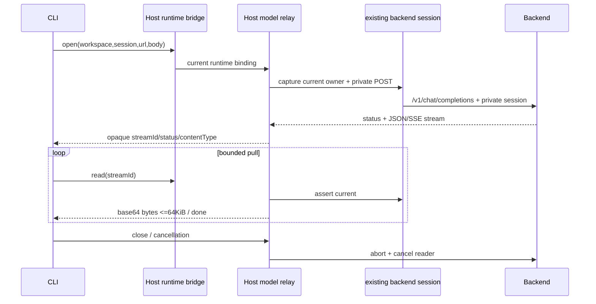

# 企业模型私有会话转发

受管 UWork 模型只保存 `enterprise-session` 访问模式、后端地址和公开模型能力，不申请、下载、持久化 device API key。既有 enterprise-identity 是身份唯一所有者，Provider、CLI、Renderer 均不持有会话 token；legacy UCAS 与个人供应商继续原凭据合同。后台从认证会话解析租户/成员，不信任自报 userId。

Relay 只拥有在途 IO，不拥有任务 admission/对话历史/重试队列。全 Host 最多32个流；随机 streamId 绑定实际 runtime 对象、workspace identity/path 和 sessionId，跨绑定读取或关闭拒绝。RPC 复用 enterprise bridge 的32槽、参数校验、runtime-current 和 requestId 取消。open 固定当前 issuer origin 的 `/v1/chat/completions` POST，不接收 headers、Authorization、userId 或重定向。正文1MiB，单 read64KiB，总响应8MiB，绝对TTL5分钟，同流只准一个 pending read。HTTP错误按实际JSON字节返回SDK。输出先经JSON语义检查；SSE按完整事件检查并保留可能是token前缀的delta，跨事件同字段拼接和至多四层工具arguments JSON转义同样拒绝，正文原始字节不重写。非法类型、私有token回显、超限、身份/issuer/持久会话变化均 fail closed。

生命周期 `open pending -> streaming -> done|closed|denied`：取消按原open requestId绑定，即使RPC已完成而CLI尚未收到streamId也可关闭，不能误杀其他流；open/read取消、owner AbortSignal、runtime关闭、close、TTL、读取失败统一取消reader、abort fetch并移除句柄。close对已结束句柄幂等，读结束句柄拒绝。无replay/resume，断线不重放推理；手机消费既有runtime replayable业务事件，不另建模型出口。

Gateway受管分支只读目录、账户和用量，可信Symbol writer写无字段 `enterprise-session` 配置并清旧API-key字段；公开writer不能伪造此模式。若旧Gateway状态记录了自有device凭据，只在无key Provider写成功后尝试吊销，不碰其他个人/legacy密钥。缓存目录不授执行权，每次推理经当前Host身份与后台席位/订阅/模型/额度策略。

验收：真实TCP JSON/SSE字节；无device签发及Provider/Renderer/CLI token；恶意URL、跨绑定、并发read、超限、取消、退出、迟到回包拒绝；实际CLI SDK走同relay。合成身份初始化不等同外部企微认证验收。
