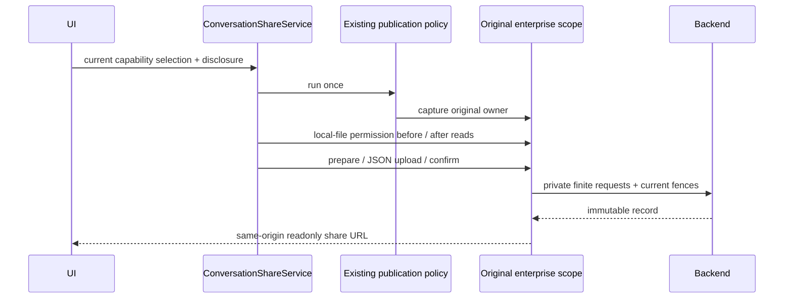

# Managed organization conversation sharing

Authority: repository-root `SPEC-enterprise-sharing.md`, 2026-10-18. This client slice adds organization readonly support through the existing ConversationShareService and enterprise identity owner. Backend storage, viewer, browser Cookie login/WeCom and quotas remain owned by the backend; remote conversation publishing remains unsupported.

## One owner and one transport

`createUWorkSharePorts(enterpriseBackendSession)` returns `{publicationPolicy, managedTransport}`. One publicationPolicy.run captures exactly one private scope before content collection. Its authorization carries only a finite same-scope request port and origin, never credentials. prepare, uploaded bytes, confirm, retries and returned link validation use this original scope with current checks before and after every asynchronous boundary. No request re-captures another owner during a publication.

Independent capability/preview/download/management reads capture the current scope for that operation. Managed mode is selected before old tokenProvider, OAuth, ApiClient or default fetch. Managed errors, missing identity, malformed contracts and policy revocation fail closed. Unmanaged behavior and existing controlled internet policy regressions retain their meaning; the old createUWorkPublicationPolicy helper keeps its internet default, while the production factory explicitly composes organization.

## Finite requests and files

Only exact `/api/client/shares` routes and methods are added to BackendSession. GET capabilities, preview and bounded artifact JSON; POST preparation, artifact JSON/base64, confirm and readonly continuation; DELETE one share. IDs are canonical safe segments, excluding dot segments, escaped separators and unknown paths. Browser `/content` is not admitted to the Host JSON port. Ordinary request/response budgets and all other protocols remain unchanged. Confirm is at most 1MiB; a single 512KiB attachment gets only its exact base64+bounded metadata budget, never a global body-limit increase.

Organization publisher requests use local/execute/subscription/current sharing admission; body/attachment bytes remain scoped. Before and after local file stat/read, and before upload, the same authorization requires sharing.files and security.allowFilesystem. Text sharing remains available when files are disabled; unsupported/unread attachments produce explicit issues/warnings and do not touch paths first. Existing artifact candidate combination matching must continue to handle both PNG and JPEG entries for the same image type.

Host downloads use the finite JSON descriptor/base64 endpoint through the current scope. The current preview descriptor set and integrity remain immutable when files becomes false; the server rejects bytes. No bare fetch, anonymous URL, client URL fetching or managed import/continuation grant is allowed. A managed import is rejected before the existing completed-import shortcut or import-specific filesystem/session writes.

## Contracts and UI

The shared enum gains organization without redefining old private/public modes. Managed capability is exactly organization; unknown/empty capability cannot fall back to private/public. Existing preflight metadata carries allowed access modes into the existing confirmation dock; capability unknown disables publication. An actual mode change resets disclosure and the old publication attempt. Chinese/English text says logged-in enterprise members can view, readonly, cannot import/continue.

Returned share URLs must be the captured backend origin, exactly `/share/<code>` or `/cn/share/<code>`, without credentials/query/hash. Preview/download artifact URLs must match the fixed share/artifact IDs. Validate actual projection/descriptor hashes on raw returned content before decoding, and actual downloaded bytes, size and SHA. Top-level can_revoke is optional presentation metadata and is not added to descriptor hashes. Standard backend error envelopes map to existing safe client kinds, including 429 -> limit_exceeded, without returning raw server bodies or tokens to Renderer.

## Tests-first and acceptance

The candidate is applied. `npm run test:enterprise-sharing` type-checks both sharing test projects (`packages/services/tsconfig.enterprise-sharing-test.json`, `packages/ui/tsconfig.enterprise-sharing-test.json`) and runs the five services test files plus the two UI test files — 49 cases in total, no skips and no weakened existing assertions. The UI project tsconfig is required: `packages/ui/tsconfig.json` only includes `src/**`, so plain `tsx --test` would fall back to the classic JSX runtime and unresolved `@/` aliases for files under `packages/ui/test/`.

Focused cases: actual BackendSession scope with finite synthetic transport; no OAuth/ApiClient/default-fetch in all managed entries; publication capture once; owner/issuer/logout/abort before and after prepare/upload/confirm; large confirm versus unchanged ordinary 64KiB; upload/base64/SHA and unsafe URL/path rejection; readonly continuation/import before side effects; same image type with PNG+JPEG capabilities; local file revocation before/after real source read; capability-driven total UI mappings and invalidation. The real HTTP/backend layer is covered by the backend repository's `scripts/client-organization-sharing-live-smoke.ts` (real file-backed DB, real Cookie sessions, real Host source, member/foreign/anonymous/device/revocation/closed-policy reads). A fresh official Native candidate and real WeCom, public sharing changes and remote authority remain excluded or unapplied.
