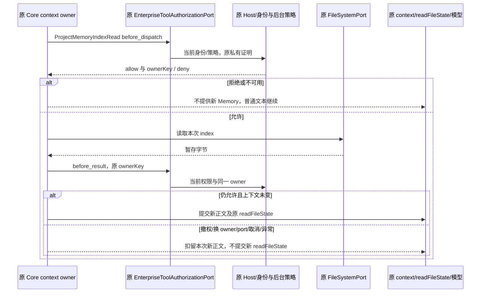

# 企业 Project Memory index 正文准入

状态：已取得显式发布 `allowFilesystem=false` 的真实 Mac Native RED，并完成源码修复与永久回归。新本地 `MEMORY.md` index 正文消费已接入现有 filesystem 策略。正常新 ARM 包与 Native false/true 复测尚待执行；旧 Memory off/on/off 与失败证据均保留，不回写为修复后验收。

## 规则与唯一所有者

企业后台和现有 EnterpriseIdentityService 分别拥有有效策略、身份代次。原窗口 Host 私有 backend-session/EnterpriseToolAuthorizationPort 是唯一准入通道。原 Core context 初始化 owner 拥有本次 pending index 候选和最终同步提交；Memory loader 只准备读取候选，具体函数名随最小实现确定，使用 `runtime.permissionService.enterpriseAuthorization`；不创建身份 owner、权限字段、缓存、持久票据、队列、服务或 RPC。

`memoryEnabled`、CLI `features.memory` 与 `memory.use` 决定功能是否开启，不能授予企业 filesystem 权限。Memory Settings 目录、开关、原 xterm 写入或用户同意不自动授权正文入模。filesystem=false 时普通文本可以继续；要求扣留的是本次未获准的新 index，不能把整个模型请求必须零次作为断言。

实际可复用接口：`PermissionService` 已暴露 readonly `enterpriseAuthorization`；`EnterpriseToolAuthorizationPort.authorize(request, signal?)` 已支持 before_dispatch/before_result 和私有 ownerKey。原附件授权已有操作内捕获/current 比较、managed/unmanaged 证明和取消传播语义。复用这些接口与合同，不能冒充 PromptAttachmentRead 或 Read。`session.context.read` 明确只读既有 UWork 会话历史，不是新本地 Memory 文件的豁免。

## 固定内部消费者及协议

建议唯一固定名 `ProjectMemoryIndexRead`。它不是模型可调用工具，不加入工具目录，不伪造用户工具调用。一次读取的两个阶段固定为：

- `toolName: "ProjectMemoryIndexRead"`；沿用同一新 opaque toolCallId。
- capability 精确为 `permission: "filesystem"`、`sideEffectScope: "none"`、`readOnly: true`、`destructive: false`，不接受额外标志。
- `input: { kind: "project-memory-index" }`，严格固定对象。不传目标 index 路径、Memory root/key、正文、摘要、token、凭据或任意附加 metadata。
- 沿原协议发送被绑定的 session、workspacePath/workspaceIdentity、workingDirectory 和 traceContext；既有工作区路由字段不变，不增加目标路径传输。
- before_dispatch 无 ownerKey；managed 允许后，before_result 只携既有私有协议的 opaque ownerKey 复验同 owner。它是已有私有证明，不是新增 metadata/key，不进入 Renderer、模型、文件或日志。

Shared schema、Core/Host 桥与 Host resolver 只窄开此名称、精确 input/capability 和两个阶段。额外字段、写/破坏/网络能力、asset、其它 phase、任意工具名不能借它通过 before_result。不泛化所有 readonly filesystem 请求，保持原 Read、附件、asset、session-only 合同。后台原 filesystem 策略及 action=execution 合同足够，不新增 endpoint 或权限。

## 一次读取的顺序与提交点



1. 功能禁用、无 Memory root 或 FileSystemPort 时保持原无 source 语义，不额外启动文件读取。
2. 在 readTextFile 前捕获本次 port、session、workspace identity/path、workingDirectory 和实际 index 归属，执行 before_dispatch。managed deny、缺失/畸形证明或不可用必须零次 index 正文 read。
3. managed allowed 必须带合法既有 ownerKey；显式 not_managed 必须无 key。standalone 无 port 时保留原行为，但整个操作仍须无 port 才能释放字节。managed/unmanaged 变化、port 替换/移除、session/workspace/workingDirectory/index 归属变化均扣留本次字节，不降级放行。
4. 读取后只保留操作局部的 pending 原文、formatter结果、readFileState候选和原授权绑定，不能提前设置 runtime.memoryIndexContent/readFileState。原 context.ts 在读取后还有 guarded skill discovery await；必须跨过它和本次所有后续异步准备后，才执行同 owner 的最终 before_result。该授权返回并再次核当前捕获上下文后，不得再 await；在同一同步提交段安装 memoryIndexContent/readFileState/context/history。不能仅在 readTextFile 刚返回时复验，随后在 Skills await 中继续携带旧允许。
5. 拒绝、授权异常、取消或迟到结果不能变成新 source；普通文本继续语义保持。错误只能使用既有稳定拒绝码或受限内部原因，不输出正文、路径或证明。原缺失、不可读、空 index 的无 source 行为保持，不能用错误兜底继续提交被拒字节。
6. turn.ts 已有必需的 turnAbortSignal：必须通过 typed 调用契约显式传入本次 context 初始化，不能 optional 缺省或事后才 throwIfAborted。resolveContextSources、memoryRoot准备、index read、guardedSkills和最终授权的等待均须沿该signal竞速；即使端口忽略取消，turn也应及时终止等待，迟到结果不能提交。沿原Host私有请求deadline，不新增controller、重试或权限timeout。非turn getSkillCatalog 初始化没有现成lifetime AbortSignal，依据现有beginShutdown()同步设置的shuttingDown，在每个异步边界后及提交前禁止关闭后的结果；不承诺其可及时中断不合作IO，也不为此造新controller。

目录准备仍有原ensureMemoryDirectoryExists/createDirectory IO；本规格保证未经许可的index正文read=0和不发布新正文，不夸大为零文件系统IO或全局workspace sandbox。

保留原 Memory 实际 FS IO→guarded skill discovery 的顺序和冷初始化一次发现矩阵。Skill 每项内容 read→post-admit→entries.push 本来就是该消费者已接纳的快照，随后仍可能等待其它 assets/personal；原合同没有全目录 final token，也不要求所有资源在全局同一时刻最新。之后的 Memory 最终授权只做本消费者的权限/owner复验，不再发生 Memory FS IO；不为此循环刷新技能或引入联合 epoch/RPC/cache，不追溯擦除已接纳技能快照。Memory 的 filesystem allow 不能当作 Skill/personal/dangerous/asset 证明；真正 Skill 正文 load 仍保留原独立准入。初始化捕获原 skillPort、enterprise port、session/workspace归属，所有异步边界后及最终同步提交前检查本地换代和 shuttingDown，不能提交旧初始化结果。

须区分策略拒绝与初始化归属失效：纯 filesystem=false 或初始授权暂不可用通常仅省略新 Memory，普通文本可继续；但捕获的 owner/port/session/workspace/skillPort 变化、managed/unmanaged 切换、取消或 release 证明失效，不能吞成 undefined 后继续发布旧 owner 下待提交的 Skills/context。此时应使本次初始化失效并抛出原稳定失效/取消结果（或有明确等价的受控清退，但优先失效），允许 executeTurn 拒绝，禁止新的正文和旧代待提交投影；不删除已合法接纳的旧历史。

这是一次读取的 process-local binding，不持久化 allow/key。已合法接纳的旧消息、旧 index 历史或原 readFileState 不追溯擦除；本次被拒的新内容、mtime/revision 不得替换旧记录。Memory UI 目录不当正文或模型授权收据。

## TDD 与实际验收

### 先行 Native RED

fresh profile、原正常 v13 与受控后台：原 Admin 完整 PUT→publish→GET 明确读回有效 filesystem=false，记录精确 tenant/member、version/revision 与无覆盖策略依据。创建未被旧会话消费的新 index marker；原 UI 开 Memory、原新任务单词 prompt。主请求不应含该 marker/index heading；当前代码若仍出现，保存真实 RED。保留 filesystem=true 的新会话/新 marker 允许对照、同受控模型和真实计费。标题、目录或固定回复不能替代正文证据，不为求 RED 关闭普通文本模型请求。

### 永久原 Runtime 和严格桥接合同

必须执行实际 AgentRuntime/context 初始化及模型参数消费，不只测新 helper 或复制读取公式。用自有临时 regular file/原 FileSystemPort 或受控 IO 端口，独立计数 index read、捕获真实模型参数：

- 初始 filesystem=false：index read=0，fresh marker 不进模型、新 history/readFileState；普通文本沿原准入完成。
- 允许对照：before_dispatch→原 read→before_result 顺序成立，原 formatter 和 readFileState 更新保持。
- read等待与read后guardedSkills等待期间分别撤权，identity A→B（B仍允许）、port替换/移除、缺ownerKey、managed/unmanaged切换：不得提前提交新memoryIndexContent/readFileState；最终新正文不发布，旧合法状态保留。
- 用真实executeTurn传入原abortSignal，在不合作的context source、memoryRoot、index read、guardedSkills等待时分别取消；必须在释放端口前已完成取消终态，释放后的迟到结果仍不得提交。非turn经公开getSkillCatalog开始，再beginShutdown后释放等待，只断无迟到提交，不宣称其有不存在的signal。受控Promise等待不是Mac内核等待。
- standalone 无 port、原显式 unmanaged 正例兼容；无 port 的操作途中出现 managed port 不能沿旧无管路径提交。
- Shared/Host 实际 schema/resolver 正反例：固定消费者双阶段同 owner 允许；伪名称、目标路径/正文 input、额外 metadata、错误 capability/phase、错 session/workspace、旧 owner、before_dispatch 偷带 key 拒绝。原 Read/附件/asset/权限模式回归不降级。

实现后正常 CLI→stage→Desktop 同源重建，不能仅修 source 或只打包 Desktop 冒充交付新 CLI。新包先核资源、签名、最终 ASAR header/manifest，再审 fresh Native false/true、实际主请求/计费与精确清理。filesystem=true 的 AutoExtract 原模型/工具正例另行推进；不借其关闭 false 行为，也不将 Memory 全功能纳入本次窄修。

## 命令及当前边界

client 根使用当前固定 Node24/pnpm：

```sh
node scripts/check-workspace-freshness.mjs
node scripts/architecture/architecture-check.mjs check --changed
node scripts/architecture/architecture-check.mjs context zcode-cli
node scripts/architecture/architecture-check.mjs context shared
node scripts/architecture/architecture-check.mjs context services
pnpm typecheck
pnpm lint
```

现有新增永久测试为 `apps/zcode-cli/packages/core/test/enterprise-project-memory-context.test.ts`，实际执行真实 AgentRuntime 的 executeTurn/getSkillCatalog；第一轮16项为14 RED/2 unmanaged兼容正控PASS、无skip，原日志 `evidence/client-enterprise-project-memory-context-spec-20261021/runtime-red-first.log` 保留。该日志来自backend根命令：

```sh
TSX_TSCONFIG_PATH=clients/uwork/apps/zcode-cli/tsconfig.test.json node --import ./clients/uwork/node_modules/tsx/dist/loader.mjs --test clients/uwork/apps/zcode-cli/packages/core/test/enterprise-project-memory-context.test.ts
```

已执行真实 Native 显式 false 负例（v3，保存初次正文越界后停止）、原 Runtime 29 项回归及附件/技能定向合计70项、严格 Shared/Host 40项，以及企业策略全套192+310项；全部源码回归通过，无 skip。客户端与 CLI 的 typecheck/lint、架构检查通过；CLI 命令显式加入已有 root node_modules/.bin 以解析 turbo，未安装新依赖或改 lockfile。当前只确认源码修复，新正常包和 Native GREEN 尚未完成。Git 由 Root 原子处理。
