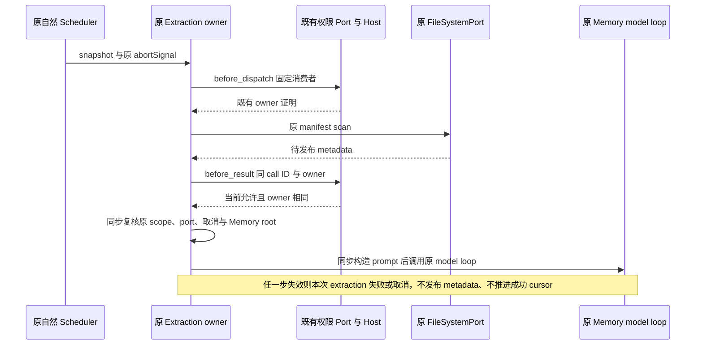

# 企业 Project Memory manifest 正文准入

状态：正常 v15 Native 已复现 filesystem=false 时 topic description 进入 sidecar；Runtime 与 Shared/Host 修复已通过回归，正常包复测待执行。此入口独立于已修复的 index 读取：原 `executeProjectMemoryExtraction` 在自然 scheduler 执行中调用 `scanMemoryManifest`，读取各 topic 前 30 行的 frontmatter description，随后经 `formatMemoryManifest` 进入首个非流式 sidecar。既有 index、Write 工具准入不能替代这里的读取准入。单词 prompt 不触发自然提取，因此先前 filesystem=false 单词 Native 负例不覆盖本入口。

消费与发布 owner 保持原 extraction 执行函数；权限与身份仍由既有 `EnterpriseToolAuthorizationPort`、窗口 Host 和后台有效 filesystem 策略负责。不创建新权限、RPC、身份、缓存、队列或持久 ticket，不将它注册成模型工具。

固定内部消费者为 `ProjectMemoryManifestRead`，严格 input 仅 `{ kind: "project-memory-manifest" }`，capability 精确为 filesystem / none / readOnly=true / destructive=false。原请求携 session/workspace/workingDirectory/trace 与同一 call ID；metadata 不含文件路径、topic 名、description、摘要或凭据。Shared schema 与 Host resolver 只窄开该名字、严格 input/capability 和 before_dispatch / before_result；其它工具、Index、附件和 asset 合同不扩大。

顺序为原自然 scheduler → 捕获操作内 port/scope/owner → before_dispatch → 原 manifest scan → before_result 复核同 owner → 同步构造并发布 extraction prompt。初始拒绝或不可用发生在 listing/stat/range read 前；只跳过本次自动提取，已完成的 main/plain text 不需要失败或零请求。scan 后、最后一个 await 之后必须再次检查原 scheduler abortSignal、同 port、session/workspace/cwd、Memory root、FS port 和 owner；未获准的 description 不得进入 prompt、provider message 或任一后继模型请求。

这里的 execution scope 沿原 `input.snapshot` 的 workingDirectory、workspaceRoot 和 providerEntries 固定，授权两个阶段也携同一份原 snapshot scope。“同 cwd”指本操作捕获的 scope 稳定，不是跟随或强行等于后继 Main 的 live workingDirectory。Main 后续 Bash cd 只改 live cwd 时，只要原 session/project root、Memory root、FS port、enterprise port 与 owner 未变，合法后台提取仍应使用原 cwd，首个实际 sidecar 的 Primary working directory 仍为原值。不得因 live cwd 与 snapshot 不同而拒绝，或把新 cwd 偷换进原提取授权。session/workspaceRoot/Memory root/FS port/enterprise port 换代和 shutdown 仍按上文 fail closed。

等待期间 filesystem 撤权、owner A→B（B 即使仍被允许）、port 换代/消失、managed/unmanaged 变化、缺少/畸形证明、配置/身份失效、异常或 shutdown 均不能释放旧操作字节。复用原 scheduler abortSignal，竞速不合作的授权/scan，迟到结果不得发布；不增加产品 timer 或重试。失败不能伪装成 successful extraction 或错误推进原 scheduler cursor。历史已接纳消息不追溯擦除。没有端口的 standalone 和明确 unmanaged 正例保留原行为；无管操作中途出现受管 port 不能借旧无管路径发布。

先行永久测试必须执行真正 `AgentRuntime.executeTurn`、原 durable SessionStore 和原自然 scheduler，不手工拼 snapshot 或直接调用 scan 替代链路。自有临时 topic description 含独立 marker，marker 不在三词用户 prompt；filesystem=false 时 manifest listing/range read=0、main 完成、所有模型请求无 marker。allow/standalone 正例应产生原首个 sidecar 并消费真实 description。用真实 owned FileSystemAdapter 的扫描读取后设置测试 barrier，覆盖撤权、同允许 B 换 owner、port 换代、无管变受管和 shutdown 的不合作迟到；测试 barrier 不冒称 macOS kernel read-await。

单元测试允许原公开 `drainMemoryExtractions` 等待自然任务，及观测单测中的原 scheduler cursor；这不代表 Native 的私有 cursor 或强制 drain 验收。测试仅使用临时数据库、文件和受控本地 model 函数，不调用外部模型、App 或网络。

正常 v15 上显式 filesystem=false、自然三词以上任务和已有 topic 的实际 Native RED 已先行保存，原输入已归档后才实施修复。后续必须正常 CLI→stage→Desktop 重建及静态独审，然后重测 false 拒绝、true 正控和原回归。旧 76 pins、Index 测试、已冻结 archive/message/Memory 计划与旧包保留各自原证据；新源码不能冒充旧包内容。本轮仅 Mac，不扩 Windows、Linux、外部 MCP 或网络盘。

