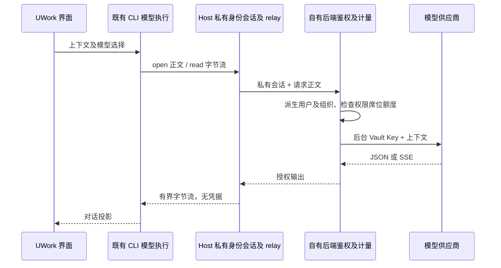

# UWork 企业会话 Provider

2026-10-17 用户要求：不从后台下载模型 API Key，模型请求使用企微登录对应的后台会话。

Provider 配置增加显式 `access: { type: "enterprise-session" }`。该配置没有 Key、Token 或可编辑鉴权头；解析遇到多余凭据字段必须拒绝。类型完整性允许这种无密钥配置进入 Registry，但不能作为已获授权的证明。现有私有 Gateway writer 负责将自有 UWork 托管配置迁移到此模式，移除旧终端令牌；个人和旧 UCAS 配置仍采用既有语义。

迁移复用 `applyUcasGatewayConfig` 同一次 Repository 事务更新访问方式和后端地址；不能先写 Gateway Store 或临时放宽公开固定地址校验。该内部命令增加 `authMode: "enterprise-session"`，拒绝与 apiKey/replaceApiKey 混用，重复同步保持无密钥语义。公开 Service 写口不得让调用方指定该内部模式。

CLI 处理该模式必须通过当前 Host 的私有模型 relay，缺少该端口即拒绝调用。Host 附加 EnterpriseIdentityService 当前会话，固定后端 origin 和 `/v1/chat/completions`；登录 Token 和供应商 API Key 均不返回 CLI/Renderer，也不保存进 Provider。后台仍是成员身份、权限和额度唯一权威。

relay 使用现有 workspace/runtime/session 绑定及取消框架，不另建身份或队列所有者；桌面 continuous 和手机 replayable 均沿用既有同一 CLI/Host 会话。退出、换身份和 CLI/runtime 销毁必须关闭流；每次读取复查原 owner，不能把旧身份响应交给新会话。

登录后的模型引导识别明确的企业会话模式；同步失败也只提示重试或重新登录，不回退为手工模型 Key 输入。旧 UCAS 模式的缺 Key 引导保持原行为。

会话失效等拒绝在界面使用本地化、可操作的提示；稳定内部错误码保留在诊断信息中，不直接作为对话主提示。只映射明确的错误码或完全相等的错误消息，不能按任意文本子串改写其他错误。

验收：无 Key 配置可序列化/反序列化及完整校验；密钥字段被严格拒绝；旧配置切换后不残留 API Key；真实 HTTP/stdio/Native JSON、SSE、取消、退出及权限变更；实际客户端目录、配置、RPC 和日志中均无模型 Key 或私有登录 Token。
