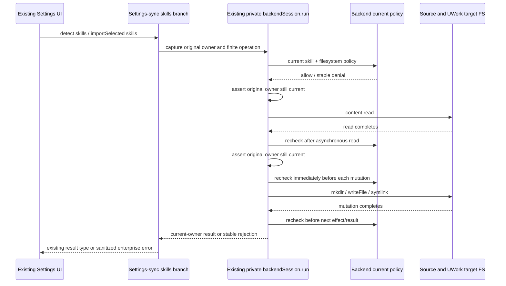

# Settings-sync personal skill admission and storage

## Objective and confirmed evidence

The external-Agent skill importer must obey the same current personal-skill policy and user storage root as the existing Host skill reader. This is a narrow correction to `ISettingsSyncService.detect` and the `skills` branch of `importSelected`.

Real Native evidence under `evidence/client-native-settings-live-20261017/` proves two independent defects: a Copy selection made while allowed still writes after `personal.skills=false` is published; the successful import targets `HOME/.zcode/skills` while the current reader scans `getUworkUserStorageRoot()/skills`. The UI then reports success for a skill it cannot list. The evidence is a reproduced defect, not verification of the repair.

## Owners and unchanged interfaces

| Responsibility | Existing owner and boundary |
| --- | --- |
| Private identity, session generation/revision, configuration and persisted-owner fence | `EnterpriseIdentityService` through its existing Host-private `UWorkBackendSession.run` port |
| Current policy | The backend execution authorization response, parsed by `readHostSkillPolicy`; no cached allow decision |
| Source discovery, duplicate detection and import ordering/results | `createSettingsSyncService`; existing `ISettingsSyncService` RPC and shared request/result types |
| User storage root | `services/src/paths.ts#getUworkUserStorageRoot`; the same path function used by `skillsService` |
| Actual skill file I/O | The existing settings-sync skill import path with an operation-local access callback; no Renderer authority or second identity store |

The composition root passes its existing private `enterpriseBackendSession` into `createSettingsSyncService`. Standalone/explicit UCAS use retains the current unmanaged behavior. No public RPC, token projection, new backend endpoint, accepted queue, policy cache or credential state is introduced.

## Admission and event order

Only a manual `detect` that actually selects the `skills` branch enters skill admission. An `importSelected` invocation containing skills selections enters exactly one `backendSession.run` for its whole ordered work. That existing scope captures the original owner/configuration; later skills selections cannot adopt a new owner or managed/unmanaged mode. Managed callbacks pass the I/O checkpoint only to skills helpers. Non-skills-only calls use the original path directly. An unmanaged result runs the original whole work once, without a second session or manual owner/mode state.

Every managed skills scope requires current `allowFilesystem`, `personal.skills` and `security.dangerousSkills`. A checkpoint reads the current backend policy and asserts the same captured private owner after that asynchronous read. The managed callback runs it at entry and exit, including after any last non-skill work in a mixed request. It runs before actual skill content reads and every filesystem mutation, and after fulfilled or rejected awaited skill I/O before processing its result/error or dispatching another effect. Neither discovery-time policy nor the UI selection is an authorization for the final import.



The existing recursive `fs.cp` does not expose the boundary between its internal reads and writes. Managed skill Copy therefore uses a small private recursive copier in the same skill path: inspect an entry with `lstat`, read a regular file, recheck after the read, then check immediately before an exclusive `writeFile` with `flag: "wx"`. Directories use exclusive `mkdir` at the skill root and below; files and directories receive their source mode with a separately admitted final `chmod`. Symlinks, including a source-root symlink, are read with `readlink` and recreated without recursion; a relative link target resolves against the source parent, matching fixed Node 24.14 `cp` defaults. Retain the existing non-managed `cp` path. Only `ENOENT` means an absent skill path; permission errors fail. A policy/identity error must escape metadata fallback and per-file failure counting instead of becoming a successful/partially successful import result.

A mutation already dispatched while authorized may finish after revocation. The guard prevents later unauthorized dispatch and suppresses stale results; it does not claim an OS sandbox or cancel an already submitted filesystem syscall. Earlier authorized files remain if a later checkpoint rejects. No deletion, rollback or transaction assumption is needed for correctness.

The shared bounded directory walker is reused without a new contract or parallel walker. Directory discovery is checked before and after the whole scan; this does not authorize every internal metadata syscall individually. The strict per-I/O boundary covers actual skill-content `readFile`, copier reads and every mutation. A revoked scan cannot publish its metadata or start a later content read. The managed copier also retains `cp`'s refusal to copy a directory into itself or descendants, including a target-parent symlink alias, before creating the skill target.

Desktop and attached phone calls use the same Host service and owner. This slice does not add a remote identity path or a new mobile delivery mechanism.

## Storage and migration boundary

All global skill targets and duplicate checks resolve to `join(getUworkUserStorageRoot(), "skills")`. This honors the established data-base directory and explicit CLI storage override. Project targets remain `<workspacePath>/.zcode/skills`. External source roots remain the existing Agent roots under the selected user home/workspace.

Do not scan, migrate, merge or delete historical `HOME/.zcode/skills`; do not add a second target/fallback root. An allowed new global import must be immediately visible through the existing `createSkillsService().list` reader.

Providers, commands, plugins, MCP, Claude `AGENTS.md` migration and first-run prompt state are outside this repair. Non-skills-only calls receive no new personal-skill or filesystem restriction. In a mixed request, their individual I/O retains the existing behavior and order, while the request's captured identity/configuration and final skill policy govern publication of the combined result. Earlier completed effects are retained if the combined result is rejected.

## Files and implementation sequence

1. Update this spec and add `packages/services/test/enterpriseSettingsSyncSkills.test.ts`; reproduce the bugs against the actual service and temporary filesystem before implementation.
2. After Root design review, add the narrow Host-private skill I/O/admission helper under `packages/services/src/settings-sync/`, thread its access callback only through skill helpers in `settingsSyncService.ts`, and pass `enterpriseBackendSession` from `packages/services/src/node.ts`.
3. Change only settings-sync's user skill root to `getUworkUserStorageRoot()/skills`. Reuse existing policy parsing and private session contracts; do not change them or the current reader.
4. Run focused skill/body/session regressions, source regression, typecheck, lint, target format and architecture checks. Root coordinates any Desktop-only rebuild and real Native retest; this task does not rebuild CLI/out or operate Root's Native process/fixture.

## Acceptance and verification

- With current policy denied, managed skills detect/import reject before source content reads or target mutations, including a stale discovery selection and both Copy/Symlink modes.
- Revocation or original-owner/configuration change while an actual source content read is paused prevents the subsequent target write; no compensating delete can make this assertion pass.
- A paused target-directory mutation followed by revocation cannot continue to a skill write/symlink.
- Policy/identity change after an allowed mutation prevents later effects and prevents a success result; earlier authorized output is not treated as rolled back.
- A multi-skill invocation cannot switch to a different owner or to unmanaged mode between skills selections; policy revocation during a last non-skill selection also prevents the combined success result. Backend policy failures or malformed responses fail closed without raw contents/paths/credentials in the enterprise error.
- Allowed Copy/Symlink imports target the current UWork user storage root, are visible in `skillsService.list`, preserve existing-target refusal and leave a sentinel in the legacy root untouched. Cover explicit storage override as well as relocated/default UWork root.
- Non-skills-only requests and unmanaged requests preserve existing behavior without enterprise policy HTTP for unrelated categories.

Tests use `node:test` with real `mkdtemp` files and the real `createUWorkBackendSession`; only backend HTTP and deliberate asynchronous pause points are controlled. Test filesystem patches delegate to real filesystem operations and assert persisted output, not mock call counts alone.

The subsequent approved skill-management slice mechanically moves this existing private access runner and copier to `services/src/skills/skillAccess.ts` for both services. Settings-sync keeps one captured scope, physical-I/O settlement, `enterprise_skill_sync_failed` sanitization and its existing non-skills/unmanaged behavior. The move does not add a second authorization/copy implementation; see `enterprise-skill-management.md`.

From `clients/uwork`, use the pinned Node and pnpm supplied for this task:

```sh
env PATH=/Users/ljp/.cache/uwork-client-toolchain/node-v24.14.0-darwin-arm64/bin:$PATH /Users/ljp/.local/share/dsh-tools/node_modules/.bin/pnpm exec tsx --test packages/services/test/enterpriseSettingsSyncSkills.test.ts
env PATH=/Users/ljp/.cache/uwork-client-toolchain/node-v24.14.0-darwin-arm64/bin:$PATH /Users/ljp/.local/share/dsh-tools/node_modules/.bin/pnpm exec tsc -p packages/services/tsconfig.enterprise-settings-sync-test.json
env PATH=/Users/ljp/.cache/uwork-client-toolchain/node-v24.14.0-darwin-arm64/bin:$PATH /Users/ljp/.local/share/dsh-tools/node_modules/.bin/pnpm exec tsx --test packages/services/test/enterprise*.test.ts packages/services/test/uworkBackendSession.test.ts packages/services/test/uworkDataMigration.test.ts packages/services/test/uworkProviderSettingsPolicy.test.ts packages/services/test/uworkConversationSharing.test.ts packages/services/test/uworkToolAuthorization.test.ts
env PATH=/Users/ljp/.cache/uwork-client-toolchain/node-v24.14.0-darwin-arm64/bin:$PATH /Users/ljp/.local/share/dsh-tools/node_modules/.bin/pnpm typecheck
env PATH=/Users/ljp/.cache/uwork-client-toolchain/node-v24.14.0-darwin-arm64/bin:$PATH /Users/ljp/.local/share/dsh-tools/node_modules/.bin/pnpm lint
env PATH=/Users/ljp/.cache/uwork-client-toolchain/node-v24.14.0-darwin-arm64/bin:$PATH /Users/ljp/.local/share/dsh-tools/node_modules/.bin/pnpm architecture:check --changed
```

## Review status

Root approved the single `backendSession.run` owner and canonical storage-root correction after independent design review. Required copier/error/final-checkpoint details above were aligned with the reviewer before implementation. Initial governance baseline: workspace freshness passed; architecture check reports 0 violations, 0 baseline and 0 new violations. Initial real-FS RED: 22 runner entries, 2 pass / 20 fail (14 failing leaf cases and 6 failing parent groups); the two unchanged non-skills/unmanaged controls pass.

Source verification before independent final review: 39/39 focused runner entries pass, including allowed Symlink visibility, root/nested source symlinks, modes, occupied/dangling targets, direct/aliased descendant targets, a real payload read followed by revocation with no payload write or rollback, rejected-read reauthorization, malformed/HTTP policy failure, and last-command mixed-result revocation. The services-only source regression passes 234/234. Root `pnpm typecheck` and the strict dedicated test config pass; `pnpm lint` reports 114 warnings and 0 errors, with no new warnings in settings-sync/test files (the composition file retains its three unrelated unused-variable warnings). Target format passes for the five changed TypeScript/JSON files; architecture reports 0 violations. No CLI/out build or real Native retest was run by this task; Root owns the Desktop-only rebuild and final Native acceptance.
