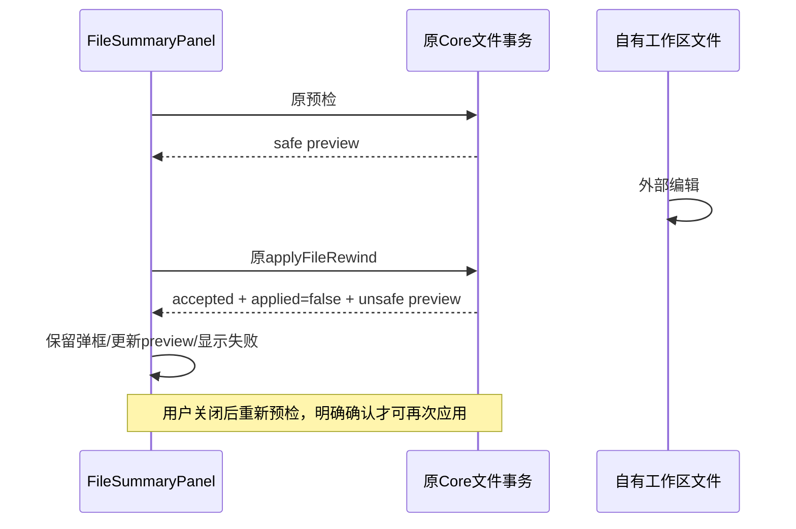

# 独立文件撤销以实际应用结果交付

原文件摘要预检通过后，文件仍可能被外部编辑。Core/runtime是文件与checkpoint事务的唯一所有者；`CommandAck.status=accepted|duplicate`只证明命令已处理，实际成功必须由`result.type=applyFileRewind && result.applied=true`确认。

UI唯一状态所有者仍是ConversationFileSummaryPanel的preview/error/applying/dialogOpen。失败应用必须保持弹框，采用命令返回的最新preview，显示现有本地化错误；unsafe preview使确认按钮禁用。缺少或不匹配result也不得关窗。拒绝/异常沿原错误路径，不能自动重试、伪造成功或创建第二份文件状态。

验收：原未打包UI真实Read/Write变更后，预览取消零写入/零推理；预检与确认之间外部改动时文件/对话/账本保持且原错误可见。外部撤销自己的改动后，原重新预检及确认恢复原字节、摘要已撤销、对话保持，reload无推理。源码回归执行原handleApply callback的accepted/duplicate成功/失败、缺结果、拒绝、异常及pending时序。不改变RPC/Core权限或文件事务；Desktop与其他复用该共享组件的交付语义相同，不创建移动/远程实现。
