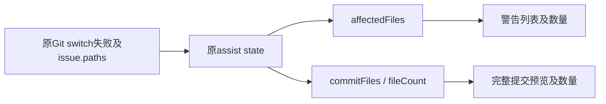

# 分支覆盖警告的文件数量

已确认原UI缺陷：main下1个文件会被target检出覆盖、另有无关未跟踪改动时，原警告列出conflict.txt一项，却显示2个受影响文件。buildGitBranchSwitchAssistState同时保留affectedFiles（Git overwrite issue实际文件）与commitFiles/fileCount（当前全部待提交改动）；警告错误读取后者。

Git repository仍是branch/HEAD/files唯一所有者，原hook仍通过IGitService返回结果构造原assist state。警告badge直接读取与警告列表相同的state.affectedFiles.length，提交预览仍读取state.fileCount和原commitFiles，确保原提交并切换行为完整保留当前全部改动。无新状态、schema、协议、服务接口或迁移，也不改变失败/取消/确认顺序。

验收：实际blocked JSX在1受影响/2总改动、2受影响/3总改动时显示1/2；实际commit JSX仍显示全部3。原页面需1项列表/1数量、取消无变化、原提交预览显示全部2、提交当前main后切target且两侧内容正确，reload无模型/账本重放。普通分支创建/搜索/切换已由独立v61通过，不重跑。
