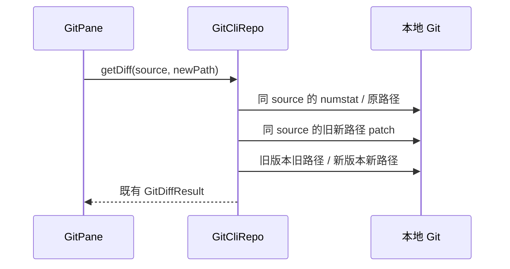

# Git 重命名审阅内容

GitCliRepo 是 Git 差异和原始路径的唯一读取所有者。GitPane 通过既有 GitService 合同消费结果，不增加 UI 状态或写路径。

原问题：暂存区纯重命名时仅以新路径执行 diff/show，Git 把新路径当新增文件，无法读取 HEAD 中的旧内容。列表的零增删与正文不一致。

先从相同来源的有界 `git diff --numstat -z --find-renames` 读取原路径，复用现有 parseNumstat；实际 patch 同时限定旧/新路径，完整内容分别取旧/新版本。已暂存读 HEAD 旧路径和 index 新路径；未暂存读 index 对应路径和 worktree 新路径，不能借用 staged rename 的旧路径；分支比较读 merge-base 旧路径和 HEAD 新路径。命令失败保持失败，不猜内容为空，不改 HEAD/index/worktree，不访问 remote。

验收：真实私有 Git 仓库的纯/带修改重命名、特殊字符路径、暂存重命名后未暂存修改、分支重命名、二进制与删除降级；原 UI 完整来源切换/刷新并验证文件、refs、index、模型请求和双方账本不变。内容不可读时仍保留原 patch 降级，两侧内容必须成对成功。

