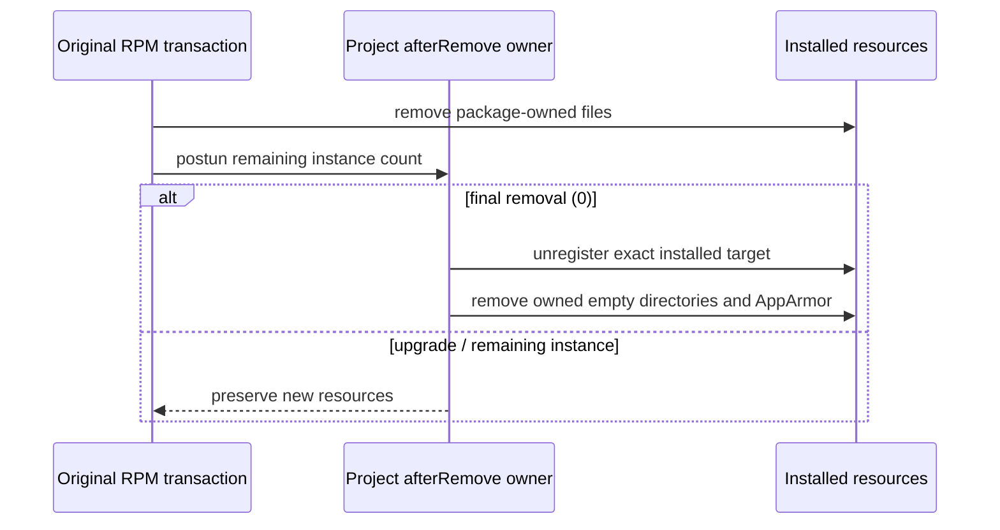

# RPM 最终卸载资源归属

Fedora 44 原 `dnf remove` 已重现：包数据库退出该包、原清单文件消失，但 `/usr/bin/<executable>`→`/etc/alternatives/<executable>`→已删除程序的链接和安装根的空目录残留。原 electron-builder 26.8.1 安装 alternatives target 为 `/opt/<sanitizedProductName>/<executable>`，卸载却传 `/usr/bin/<executable>`，身份不一致。

现有 RPM 配置声明分发面向 RHEL8+；本轮真实工具与包事务仅验证 Fedora44 的 alternatives CLI（支持无参数 `--list`）。不以 Fedora 结果宣称 RHEL8 或所有 RPM 发行版的 alternatives 实现均已实测。

项目自有 RPM `afterRemove` 模板是最终卸载清理唯一 owner，原 builder 配置仅在 rpm.afterRemove 选择既有入口；不改 vendor、现归档、app.asar 或其他平台。生产/Preview 保持独立 executable/package/root。

- RPM `$1=0` 最终卸载才清理；升级/非零剩余实例计数不移除新包链接、目录或 AppArmor。
- alternatives 删除安装时同一实际 target；没有 alternatives 时，只移除指向该 target 的直接程序 symlink。
- 原工具成功列出注册组、再成功 display 时才判断实际 target 是否仍在；组/target 已缺席是幂等清理，不阻断 AppArmor/空目录。查询或 remove 的真实错误必须保持非零和 stderr，不以宽泛忽略退出码掩盖。
- 原包管理器移除清单文件之后，find 只在本应用安装根内自底向上删除空目录，不删除非空自定义内容、其他产品根或跟随 symlink。
- RPM 的既有 fpm 追加依赖同时声明 findutils，保证最小 RHEL 的卸载工具可用；不替换默认依赖集合。
- 保留原 AppArmor profile 的最终卸载清理，不扫描用户 HOME/XDG；用户 URI 注册残留单列，不混成系统包清理。
- deb/pacman/AppImage/macOS/Windows 行为保持，不据单位回归宣称实际升级事务通过。

永久回归由原 FpmTarget.createScripts 和真实项目配置渲染模板，在显式自有目录映射下执行 shell，观测 alternatives 实参、生产/Preview、升级保护及非空内容保留，旧模板 RED。随后原 producer 只重产新 RPM（原 cdf/3658 载荷不变），真实 dnf install/remove 核包数据库、清单、链接和空目录；不 force/no-deps/改归档。

