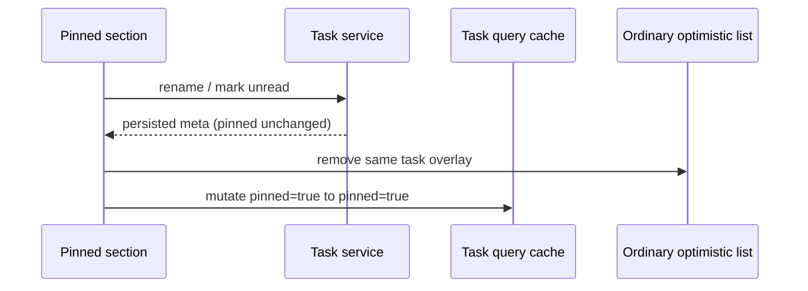

# 置顶任务更新保持列表归属

已置顶任务重命名或标记未读，只改变该任务元数据，不改变 tasks-index 的 pinned 状态，也不能在普通项目/时间线列表插入第二份任务。

持久所有者保持 tasks-index 与原 CLI renameSession；UI 继续使用 `applyTaskQueryCacheMutation` 的显式 pinned/archived 状态更新查询缓存。普通列表的 `optimisticTaskListByTaskId` 不能作为置顶任务元数据副本。完成置顶元数据更新后清除该任务的普通列表乐观项；未读指示器仍由原 action 更新，远端置顶投影继续使用已有 remote pinned store，不创建新的状态 owner。

真实回归要求：普通任务重命名→置顶→reload→置顶区重命名→同 task 只存在一行→reload仍置顶→标记未读不得增加普通行→取消置顶恢复普通行。标题与 CLI 持久记录一致，消息/parts及模型请求、双方计费不变。修复前 v14 已真实复现：同 task 两行（已置顶和项目各一行），持久 pinned仍1。
