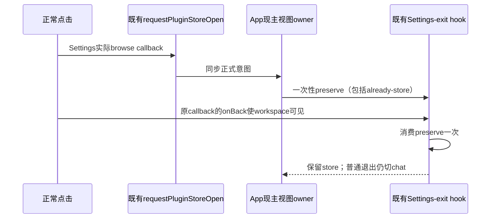

# Settings 的正式插件商店导航与一次性退出保留

## 目标与 owner

User“浏览插件”或添加市场的正式导航应显示商店。Settings不是第二个主视图owner：`App.tsx`拥有workspaceMainView；`useWorkspaceMainViewSettingsExit`仅拥有Settings进入时视图与一次性preserve标记；`pluginStoreNavigation`只传递正式意图，不能持久化或替代App的已接受视图。没有新服务、队列、identity或store。

现Source SettingsPage先 `requestPluginStoreOpen` 再onBack。App从chat进入store时会调用preserve，但already-store分支只更新version并return；hook退出Settings时仍见进入前相同视图且没有标记，就切chat。Native已收“浏览插件”真实点击后30s仅workspace的未满足结果，但未读取其React分支时序，不能仅凭Native候选把精确根因当已观测。

## 合同

1. 显式请求store，即使进入Settings前底层已经是store，也必须在退出Settings后保持store；returnScope归一User。
2. 首次chat→Settings→正式browse应进入store。
3. 没有显式导航的普通Settings退出仍回chat，沿现合同。
4. preserve只在Settings打开时设置，且只消费一次；显式browse成功后再次普通Settings退出仍回chat，不形成sticky保留。

## 回归方法

复用现有real ReactDOM/Vite/独占headless Chrome/browser-harness组件测试方式。直接import实际hook与正式导航helper；App的三个真实useCallback表达式、任务导航hook的真实打开callback、SettingsPage实际browse callback用TypeScript AST按确切符号/属性抽取，保留原正文/依赖数组，禁止重写同义实现来证明。抽取来源SHA、节点区间和原文作test evidence。

测试fixture只提供可见性和setter等输入port，主视图结果由实际App callback及hook产生。task-nav持久化边界只计数、不存一份accepted主视图。不是Native全App验收，不读取React隐藏状态；browser-harness只真实DOM点击并读取公开fixture output/AX/截图。用actual正常Open store callback先到store，不手写已接受store状态。

四个独立page情景：already-store→Settings→Browse（当前应RED）、首次chat→Settings→Browse、store→Settings普通Back、显式Browse后下一次普通Back（one-shot消费）。每个情景新React realm，不能串状态。测试失败不skip或弱化。Root独占App产品修复，本文执行者只新增spec/test/evidence，先保真实RED，再同一测试GREEN。

## 命令与边界

从clients/uwork使用Node24.14执行新增 `packages/ui/test/pluginStoreSettingsNavigation.e2e.mjs <新evidence目录>`；具体命令与结果写独立 `evidence/client-plugin-store-navigation-fix-20261018`。client AGENTS先freshness `--no-fetch`、architecture check/context ui；Source准备未声明新模块边界，ui当前unmanaged且无已声明直接合同。

只启动独占localhost component fixture和新headless Chromium/CDP/BH，Vite envFile/configFile关闭，cache/scratch仅新临时0700根；不启动Native、backend/DB、外网、用户Chrome或真实账号。只在内存转换测试模块，不写任何产品out/stage/dist或做Desktop build。禁访问所有retainedR、主3000/env/Vault、系统791；cleanup只按精确owned PID/birth/端口/IPC根，未知残留保根并报告。
