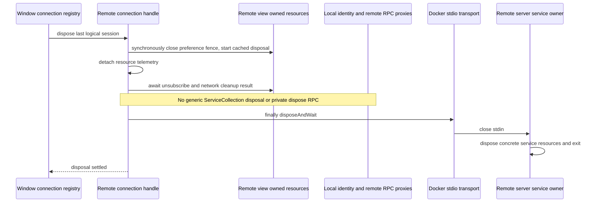

# Remote workspace service lifecycle

The window-scoped Local Host owns the remote connection registry. Each connection
handle owns its transport and remote attachment lifetime. The remote stdio server
owns the concrete remote services and their local resources.

The Desktop remote service collection is a routing view, not a second resource
owner. Remote File, Git, System, Terminal, Task, Agent, Session, Provider, and
watcher services are borrowed RPC proxies. The window's public client-config,
broadcast, and optional enterprise identity services are borrowed local views;
its identity and gateway owners must survive an individual remote disconnect.
The remote collection does not register or own the local gateway service.

The remote composition creates its own Host API network transport and subscribes
to the remote runtime-preferences event. Those two resources have one explicit,
private, idempotent asynchronous disposer returned with the routing collection.
The disposer stops new preference responses, removes the subscription, and waits
for its network transport to close. A preference callback already awaiting local
settings must check that fence before any further remote RPC.

The existing window broadcast service is reused. A remote connection must not
create another parentPort broadcast listener that cannot be released independently.
The source Local Host collection is required for this composition.
The connection handle captures that validated source collection before awaiting
remote connection setup; a later mutable global cannot change the borrowed owner.

Connection teardown always attempts transport closure even if one owned local
cleanup fails. It preserves the original error if transport cleanup also fails;
both attempts must be observable. Repeated dispose requests share the same
completion on success and failure. A single cleanup failure retains its original
error; multiple failures are reported in cleanup order as an AggregateError.
Telemetry, subscription, network, and transport cleanup each get an attempt.
It must not expose private `disposeAllAndWait` methods as public RPC
or infer resource ownership by method names on a proxy.

Regression checks cover the explicit owned disposer, a pending preferences
callback released after disposal, borrowed services surviving disconnection,
transport closure after owned cleanup failure, and ordinary production Desktop
Docker connect → File/System metadata → disconnect → reconnect. The latter uses
an isolated HOME and owned container, with no model, Provider, terminal, Bash,
login, paid supplier, or external enterprise integration requests. CLI and
Desktop out artifacts are built only through the coordinated owner.

The focused source regression runs the exact private production functions in an
isolated VM with resource-boundary doubles. It verifies ownership and failure
semantics without importing Electron's process entry, doing network IO, or
claiming a real remote acceptance result. The production metadata fixture is the
separate transport acceptance step after the coordinated build.

The prepared runtime entry is
`scripts/client-remote-docker-lifecycle-smoke.ts`, with its independent
`scripts/fixtures/client-remote-docker-metadata-launcher.mjs` and pure metadata
allowlist contract. `--schema-only` validates the production init/connect/attach/
dispose messages and positive/negative metadata allowlist cases without starting
Electron, Docker, a backend, or a session. The launcher allows only `system.info`
and `file.readTextFile`/`file.stat` for one exact owned seed path.

The runtime check starts one container from the cached task-owned official Node
24.14.0 dependency image, with an isolated HOME, no host mount, no external
network, and no published ports. It uses the coordinated existing CLI/out
artifacts read-only, stages the production server only in its temporary tree,
and checks two distinct production connection IDs, exact file bytes/hash,
closed events, and remote stdio process exit on both disconnections. Cleanup
matches the container's unique ownership label, checks host PIDs and root
removal, and retains logs/results under
`evidence/client-remote-docker-lifecycle-20261017`. The earlier broader probe is
not imported or executed by this fixture.
