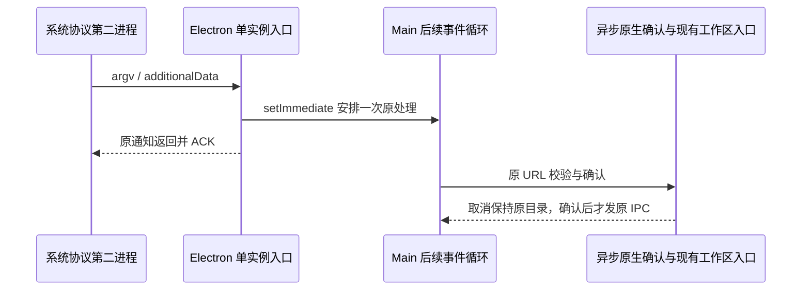

# 第二实例与外部工作区确认

Linux 实际 AppImage 的系统 xdg-open 投递到现有进程后，第二进程连接 SingletonSocket 成功，却在约 20 秒后向原 Electron 发出 SIGKILL；AppImage 父 runtime 随后返回 127。带完整窗口管理器及进程/信号追踪也复现。不能通过延长测试超时、移除用户确认或跳过单实例锁消除失败。

Chromium 只有在 notification callback 返回后才写回 ACK；Electron ready 后同步发出 second-instance。Main 原事件处理直接进入同步原生确认，会占住该返回边界。Main 继续是唯一协议 owner，但事件入口必须只安排后续处理并立即返回；实际 URL/路径校验、外部确认、已有 pending workspace 和 renderer ready gate 继续复用原处理函数。

使用 setImmediate 是事件循环交接，不能替换为任意毫秒延迟。每个事件独立捕获 argv，FIFO 处理，不合并/重放、不引入第二份任务状态。未识别请求的原窗口恢复/聚焦也在后续处理。已有 additionalData 优先级、UNC/非法路径拒绝、取消和 locale 文案不变。

验收：纯事件顺序/回退/两事件隔离测试；正常客户端构建和原配置打包；系统真实 URI 取消与确认。原确认停留至少 25 秒时第二进程应已正常退出、原实例和窗口存活，取消不切换，确认才切换，模型/账本无增量。追踪用于定位，最终还要无追踪器复测。macOS/Windows 同步原入口保持相同后续处理语义，平台原生验收分列。

确认停留期间再从系统投递一个未知的自有 zcode URI，核对它也能完成握手退出，且仅保留原 Electron Main；不能只证明第一个请求不再误杀，而让随后请求仍因确认未决而卡住。

未持锁的第二实例只沿已有退出屏障收口，不得进入 app.whenReady 的应用 bootstrap。早期修复运行中观测到多个 Main 和额外窗口；单独的进程快照不能证明每个进程均已获得锁。原 app.quit 调用后继续注册的 ready 回调也不能启动新的窗口、Host 或 Agent。

提取运行模式还必须独立验证实际发行 runtime 的并发文件生命周期：第二 runtime 退出时原实例的文件仍应存在，原 owner 退出后再核对清理。实际包已否定“第二次运行必然删掉共享目录”的假设，因此不改 .desktop 环境前缀或加入 NO_CLEANUP；上游源码推测不能替代当前产物证据。

依据：[Electron 41.10.7 通知封装](https://github.com/electron/electron/blob/v41.10.7/shell/browser/api/electron_api_app.cc) 与 [Chromium Singleton ACK 顺序](https://chromium.googlesource.com/chromium/src/+/HEAD/chrome/browser/process_singleton_posix.cc)，以及本仓库 `client-linux-desktop-appimage-wmtrace-v8-20261020` 的真实连接/kill/终态记录。产品重建复测仍负责证明该修复适用于当前发行运行时。

## 确认未决时继续接收系统协议

v13 实测区分了两个问题：首次通知 ACK 正常、原 Main 存活，但 8 秒后发送的并行 URI 对应 Electron 仍在等待握手。25 秒采样时该并行进程仅等待约 17 秒，不能据此断言它已拿锁或越过 ready 门禁。同步 GTK 确认仍阻塞 Main 接收后续通知，单次 setImmediate 不足以覆盖确认未决期间的新请求。

Main 的外部工作区确认统一使用 Electron 异步 showMessageBox。desktopOAuthDeepLink 是确认顺序的唯一 owner，以单条 Promise 尾链串行展示确认，不存储第二份已接受任务；每个原生通知仍立即返回 consumed 布尔值，确认成功后才走原 handleOpenWorkspacePath。无效 URL/UNC 仍在任何文件系统探测前拒绝。冷启动 bootstrap 必须 await 同一确认入口，取消仍回退原默认启动。

每个请求绑定发起时业务窗口；队列等待、确认返回时均复核窗口未销毁和 Main 未进入退出屏障。失效、取消或对话框失败均不投递，不转交其他窗口，不触发兜底目录打开；异常记录并使后续请求继续。未知 URI 不等待确认队列。新增受控原代码测试必须先 RED，再证明未决期间返回、两个确认串行、取消/同意、窗口销毁、退出失效、异常后队列恢复和冷启动等待。

平台限制：Electron 41 的 macOS 无父窗口 showMessageBox 仍可能同步执行；本轮 Linux 运行中确认结果不能外推 macOS 冷启动确认已完成原生验收。
