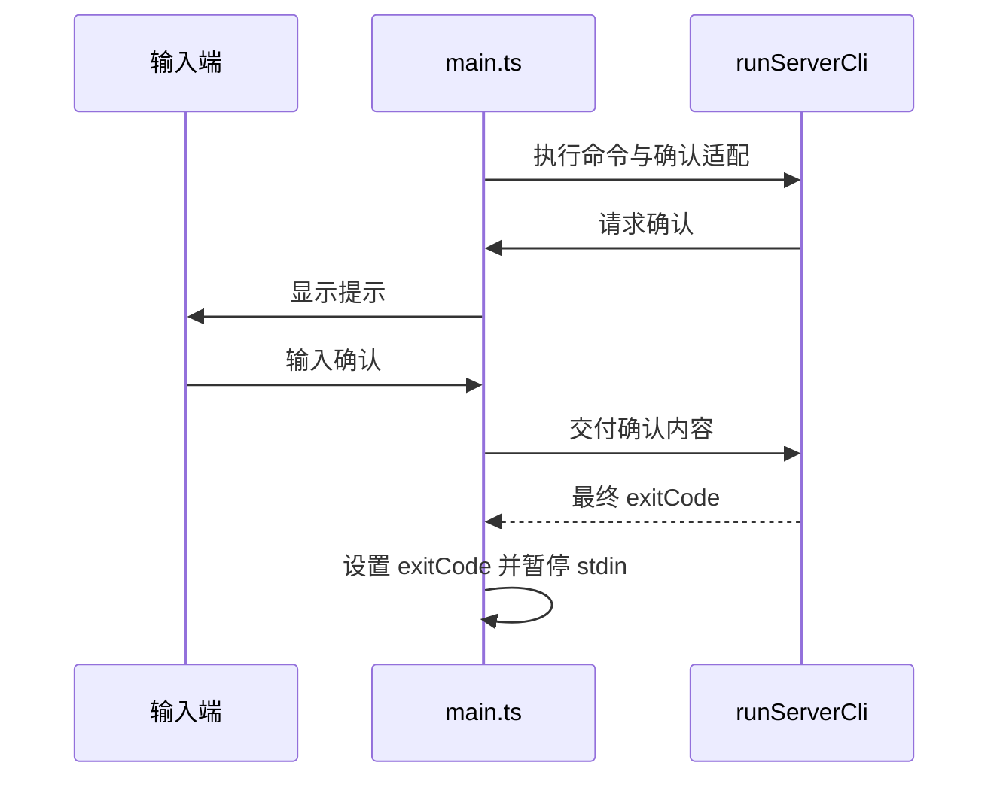

# Server CLI 确认输入的终态

原入口 main.ts 唯一拥有进程 stdin 与确认提示适配；runServerCli 继续拥有命令/卸载业务。确认后 stdin 进入 flowing 状态，`once("data")` 的监听结束不会自动暂停流。终端或父进程保持输入打开时，已完成卸载的 CLI 不应继续等待输入。

仅在原命令 Promise 完成后暂停 stdin，不能在长运行 serve 期间提前结束，也不能用强制 process.exit 丢失待完成写入。不改变双确认、安装归属检查、卸载白名单、launchd 所有权或其他平台服务管理语义。

验收：

1. 永久测试运行实际 main.ts 转译后的独立 Node 进程，业务端口仅替换为需要双确认/取消/无确认的固定命令；父进程保持 stdin 打开，子进程仍须自然退出并保留原退出码。旧源码至少确认分支失败。
2. 正常构建后运行原 macOS serve --daemon→重复启动→restart→stop→uninstall 双确认完整链。输入端仍保持打开，原卸载 CLI 必须自然 exit 0，服务/进程/端口及本轮安装文件闭合。
3. 定向 ESM、类型、Lint、架构、格式门禁通过；本机结果不替代三平台或企业远端 authority。
