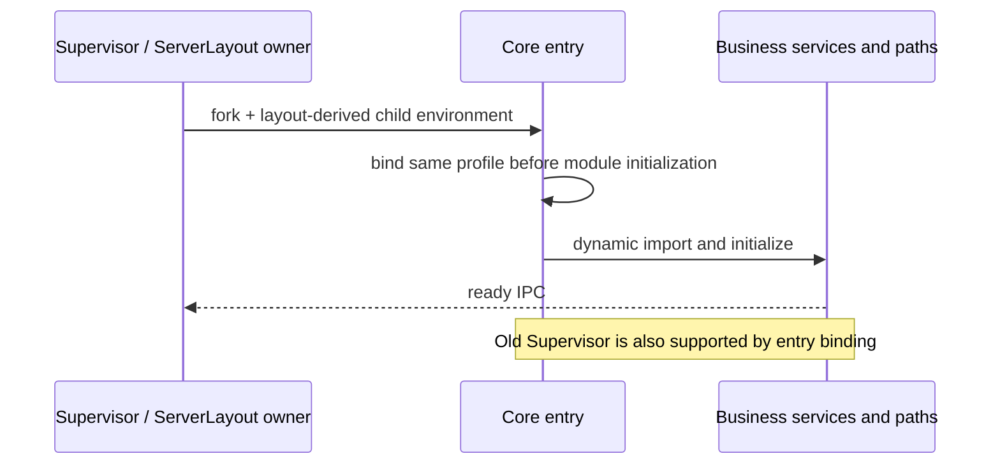

# Server 默认用户 profile 跟随原 data-root

ServerLayout.dataBaseDir 是服务默认用户数据的唯一所有者。现有 inferDataBaseDir 对非标准显式 server-root 已约定隔离且不向父目录扩散；标准 `<home>/.zcode/server` 则继续映射原home。不新增CLI参数，不改变Desktop默认profile。

Core仅继承旧 ZCODE_DATA_BASE_DIR不足以实现此合同：路径模块优先读UWORK_DATA_BASE_DIR；Setting优先读DESKTOP_HOME/HOME；SettingSync和其他默认用户目录只读HOME/USERPROFILE/homedir。注册服务也不会自动继承启动CLI时的私有HOME。

采用一个纯Server profile环境工厂，根据原layout映射Core子进程的HOME/USERPROFILE、ZCODE_DESKTOP_HOME_DIR、UWORK_DATA_BASE_DIR/ZCODE_DATA_BASE_DIR和ZCODE_STORAGE_DIR（base/.uwork），显式server-root的计算结果优先于继承的这些默认profile变量。其他命令/代理/凭据环境保持既有行为。只修改Core孩子，禁止改父进程或launchctl全局环境。

正常Supervisor在fork前合入同一工厂；Core entry在服务及paths模块初始化之前再次幂等应用该工厂，再dynamic import真正Core，以支持旧Supervisor更新新Core。不能仅在runServerCore函数开头修改env，因为静态imports已经捕获旧路径。

边界：这是默认profile隔离，不是文件系统sandbox，不禁止显式FS路径/外部工具自定义路径；默认Server root的原home行为保持。真实MCP/网盘或第三方工具行为不因本修宣称全部隔离。

验收：

1. 正常当前平台发行Core由原fork/IPC启动；父HOME、UWORK、DESKTOP_HOME和Storage分别冲突的目录全部位于自有临时根，模拟旧Supervisor传入server-root。原SDK System/File/Setting必须统一本轮server data-root，不能写其他候选profile。旧包真实RED，新包GREEN。
2. 父进程环境逐项保持；继承的非profile环境不由工厂删除。无原source/schema/数据库/服务替身。
3. 正常新Darwin原包注册唯一launchd服务，先核job不存在、Core真实exec环境及SDK返回profile-root，再执行SDK写入、原update/Core换代、历史冷恢复、restart/stop/uninstall。所有写入仅自有prefix，后台3000和其他service保持。
4. 旧/新Darwin原包、Linux原包、cdf Agent及Desktop产物分别保留/哈希核对。不同SHA同版本只称构建替换，不能声称跨发行版本升级。
