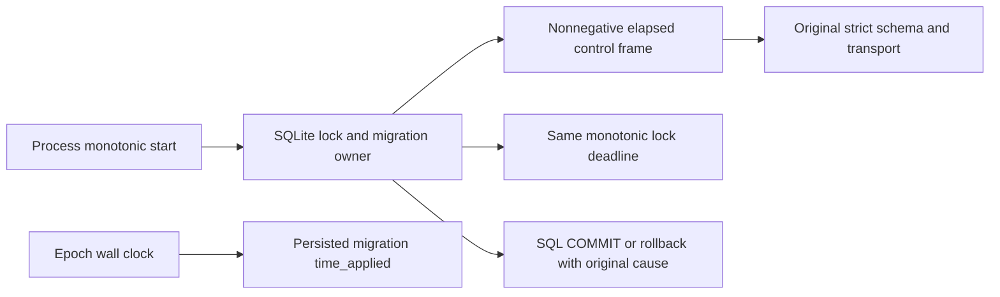

# SQLite startup local timing

Owner: CLI storage adapter `session-store/migration-runner.ts`. SQLite remains the only migration coordinator (`BEGIN IMMEDIATE`, immutable migration journal and rollback); no new lease, queue, timeout owner or cross-process clock is added.

## Product rule and evidence

The original Server stateful v10 run failed before session creation: the startup control frame rejected `elapsedMs < 0` as a Zod error, then the original startup boundary classified that error as `sql_failed`. Adjacent owned VM log timestamps went backwards. This was not evidence of a failed SQL statement.

Progress elapsed time and the process-local lock-wait deadline must use the same monotonic clock. Wall-clock corrections must neither create a negative strict-schema control frame nor extend/shorten the lock budget. Keep the finite/nonnegative elapsed schema unchanged; never hide SQL, schema, transport or rollback errors to obtain ready.

The default synchronous five-second lock wait, asynchronous one-hour lock wait, 25 ms native busy interval, retry backoff, one shared deadline across lock stages and finally restoration to five-second native `busy_timeout` remain unchanged. The budget bounds busy retries; it does not forcibly interrupt arbitrary long SQL or an uncooperative progress callback.

Persisted `schema_migration.time_applied` remains epoch wall time. Other cross-process leases, startup snapshots, user timestamps and business data are outside this change.



## Permanent acceptance

1. Actual `openProtocolStartupStorage` uses actual SQLite, original strict startup schema and Writable JSONL. Under deterministic wall-clock rollback the old implementation rejects elapsed time; repaired code reaches ready and the committed journal matches emitted committed counts.
2. A real SQLite writer remains locked beyond a short budget. A finite wall rollback must not extend the asynchronous lock deadline. The test must terminate even against the old implementation.
3. Under a finite wall forward jump a real writer releases before the valid monotonic budget; startup must wait and succeed rather than time out early.
4. A real migration SQL error retains `sql_failed`, SQLite cause and migration ID; transaction rollback and native `busy_timeout` restoration still occur. Successful journal timestamps remain epoch values.

Use new source-built Agent and Server artifacts for runtime retesting; preserve all original archives, the stateful v9 success and v10 startup failure. New runtime evidence must record actual artifact digests and must not reuse the old Agent bundle as the repaired binary.

From the integrated client root with the repository's Node 24 toolchain:

```sh
pnpm exec tsc -p apps/zcode-cli/tsconfig.storage-startup-clock-test.json
pnpm exec tsx --tsconfig apps/zcode-cli/tsconfig.storage-startup-clock-test.json --test --test-concurrency=1 apps/zcode-cli/packages/adapters/test/sqliteMigrationClock.test.ts apps/zcode-cli/packages/bootstrap/test/storageStartupClock.test.ts
```

The versioned test project maps the public adapters storage entrypoint to its source, so a stale `dist` cannot falsely pass this repair's bootstrap integration test.
