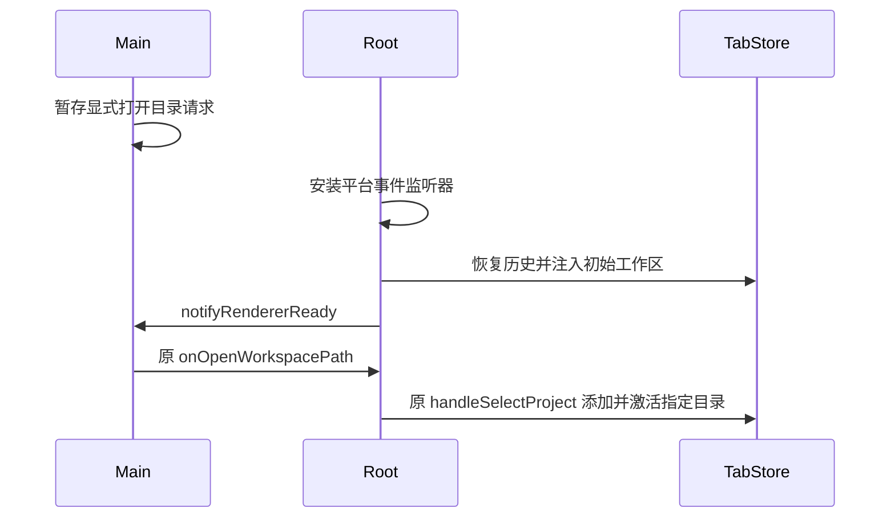

# 启动恢复与显式打开工作区的顺序

Main 是未就绪窗口 `--open-workspace`/deep-link 请求的唯一暂存所有者。Renderer 的 Root/TabStore 继续拥有窗口导航；沿原 `handleSelectProject` 打开路径，不添加平行队列或新的业务状态所有者。

Renderer 必须安装平台事件监听器，并完成初始工作区恢复/注入，才通知 Main `notifyRendererReady()`。否则 Main 过早释放显式目录，之后默认 initial workspace 的注入会再次激活默认目录，导致指定目录进入最近项目但实际运行 cwd 错误。



约束：恢复未完成时不发送 ready；恢复完成后原默认入口仍可用，显式目录最终激活且历史 tab 保留。StrictMode 清理或卸载后的旧 microtask 不发通知，Main 的原一次性消费保证不重复打开。恢复后的常规打开目录行为不变。Web/远端路径沿既有 ready 能力，不按延时猜测就绪。

验收需包括真实 React hook 的 held-restore、恢复后显式目录胜出、StrictMode、卸载和正常路径；最终在真实打包应用中，从启动期间原 secondary 命令进入指定目录，完成首次引导后核对实际模型 cwd。单纯 recentProjects 或 secondary exit 0 不算完成。

在客户端根目录使用固定 Node 24 运行：

```sh
pnpm exec tsx --tsconfig packages/ui/tsconfig.json --test packages/ui/test/startupWorkspaceReady.test.mjs
node --test packages/desktop/test/rendererReadyWorkspace.integration.mjs
pnpm exec tsx --test packages/desktop/test/startupFallbackCwd.test.ts
node --test packages/desktop/test/startupFallbackCwd.integration.mjs
```
