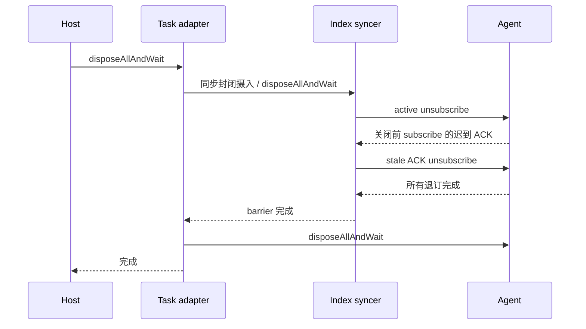

# 任务索引退订与 Host 关闭顺序

`zcodeTaskIndexSyncer` 是 sessions-index/workspace-config 后台订阅的唯一所有者；`zcodeTaskServiceAdapter` 负责先关闭索引摄入，再关闭 Agent 协议与进程。当前同步 `disposeAll()` 只发起异步 unsubscribe，不能作为退订完成证明。

新增内部 `disposeAllAndWait()`：同步设置 disposed、移除监听和重试计时器，随后等待已经发出的 subscribe/unsubscribe 完成。关闭后迟到的 subscribe ACK 沿现有 stale-generation 分支退订，也必须纳入等待；禁止重新激活摄入、广播或生成任务。现有 RPC 自身的有界超时不变，不增加固定 sleep、不屏蔽失败日志。

任务 adapter 的异步释放等待该屏障后才销毁 Agent，并释放 memory diagnostics 与本地资源。重复异步释放共享同一个进行中的完成 Promise；同步退出入口仍为 best-effort，不冒称已等待网络完成。

回归包括 active 订阅的异步退订、关闭中迟到 ACK、重复关闭和关闭后 ensure 无新调用；真实未打包 UI 任务执行、排队、归档删除、reload 和自然关闭不得再出现 Protocol client disposed 退订警告。桌面与 Web 都调用相同 Task adapter，不改变 continuous/replayable 消息交付合同。
