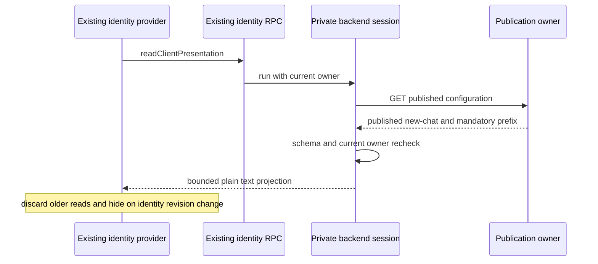

# UWork published client presentation

The backend remains the only publication owner. The existing private UWorkBackendSession reads `/api/client/configuration` for the current authenticated issuer/tenant/member and rechecks the owner after parsing. EnterpriseIdentityService exposes only a validated `readClientPresentation` projection through its existing RPC channel; it does not persist configuration or obtain another identity session. UCAS/unconfigured standalone Hosts return unmanaged. Managed request/schema/owner failures return unavailable, with no body or credentials.

The initial slice projects only the published `new-chat` welcome/risk notice, mandatory server risk prefix and nonnegative published version (zero is the backend default before first publication). Other configurations, including MCP Hub addresses, never reach Renderer through this projection. Welcome text is plain text, wraps at 320px, and an empty published welcome deliberately suppresses the built-in greeting. The risk prefix and notice appear beneath every existing conversation composer. UI projection is bound to the base identity owner and revision; logout/owner replacement hides configured text synchronously. The fixed localized AI-generated prefix remains visible during loading, errors and logout. Identity events, window focus and a bounded 30-second refresh read current publication. Failed refresh drops the previous projection; responses older than a newer read cannot replace it. This is presentation, never authorization.

Verification must cover real local HTTP, publish changes, malformed/missing response fields, owner change during reads, signed-out/UCAS behavior, and responsive real-browser rendering. This does not complete menu dispatch, personal-model/MCP mutation policy, conversation sharing/collaboration authorization, assistant entry gating, remote workspaces or installed-platform acceptance. Those must be integrated into their existing Host operation owners, not inferred from hidden buttons or this display snapshot.
