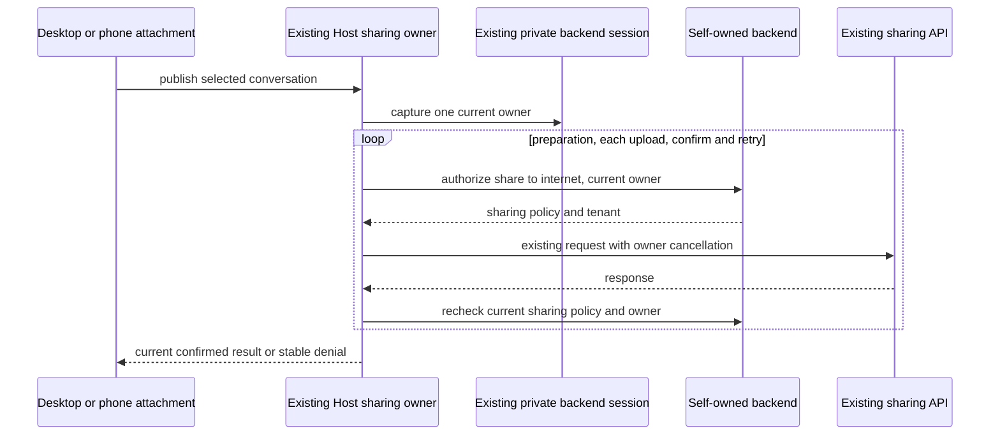

# Enterprise authorization at the conversation sharing exit

The existing Host-owned ConversationShareService owns publication, artifact upload and confirm retries. EnterpriseIdentityService and its existing private UWorkBackendSession remain the only identity/session authority. The sharing policy adds no credential store, allow cache, publication queue or Renderer permission field. Desktop attachment facades and phone clients call this same Host publication owner.

Every existing sharing access mode (`private`, `public_readonly`, `public_importable`) sends content to the external ZCode sharing API. None establishes organization-bound storage or access, so all require backend `POST /api/client/authorize` with `{action:"share",target:"internet"}`. The Host validates tenant identity and the full `sharing` response (`publish`, `collaborate`, `files`, `wechat`, `wecom`). Only an explicit internet publish allowance permits this exit. Preparation with an artifact manifest, every artifact upload and final confirmation containing artifacts additionally require `sharing.files=true`. Importable snapshots are not live collaboration; no collaboration or WeChat/WeCom operation is invented.

A publication captures one private backend owner. Before every outbound publication API request, after any asynchronous API-token lookup, the Host rechecks the current backend policy and the same owner. A Host-local `ApiRequestInit.beforeDispatch` callback carries this same guard into the existing NodeApiClient after endpoint resolution, and into the existing HostApiNetworkTransport after proxy/CA/dispatcher initialization. The final URL is checked against `security.allowNetwork` and the exact `allowedDomains` hostname set from the same share decision. Missing security fields deny the operation; the callback is removed before the native fetch and is never sent over RPC. It propagates the owner's abort signal to the actual HTTP request, disables redirects, and checks again after the response against the request-local last successfully authorized actual URL. Network or hostname permission revoked during the response wait cannot return a late success. Final confirmation and each safety-check retry use the same guard. Logout, token/store revision change, issuer/config switch, missing/malformed sharing fields, revoked permission and unavailable backend fail closed. An initially unmanaged publication rechecks configuration before every request; becoming managed cannot preserve an earlier unmanaged bypass. Explicit UCAS behavior remains unchanged.

Revocation prevents the next dispatch and suppresses stale success. Content already dispatched or uploaded can have external effects; local cancellation cannot prove deletion or reverse publication, and this change does not automatically replay or claim rollback. External service authentication remains its existing provider-owned mechanism; a UWork backend token must never be sent to that service. Remote workspaces retain their existing explicit unsupported publication boundary.

Acceptance covers actual Host service/HTTP-client wiring, current policy changes between preparation and confirm, files disabled, every access mode classified as internet, identity changes during asynchronous token reads and external responses, bounded confirm retry checks, unchanged UCAS, malformed response rejection, and no backend credential in external headers. Domain policy checks do not establish DNS rebinding isolation or proxy-side DNS/address verification. The existing network transport and its proxy/CA owner are retained; fixed-DNS public egress remains outside this slice and T13d is not accepted on this evidence.

Controlled loopback HTTP and real private identity session code establish the local contract; they do not establish external service provisioning, public link availability or installed-platform acceptance.

Verification entry: `pnpm test:enterprise-sharing` builds the existing shared declarations, strictly typechecks the dedicated sharing test project, and runs the real Host service/NodeApiClient/network-transport regressions. Cross-repository verification is `node --import tsx --test scripts/client-sharing-contract-smoke.ts` from the backend checkout, with `UWORK_CLIENT_PATH` selecting this adapter checkout.
