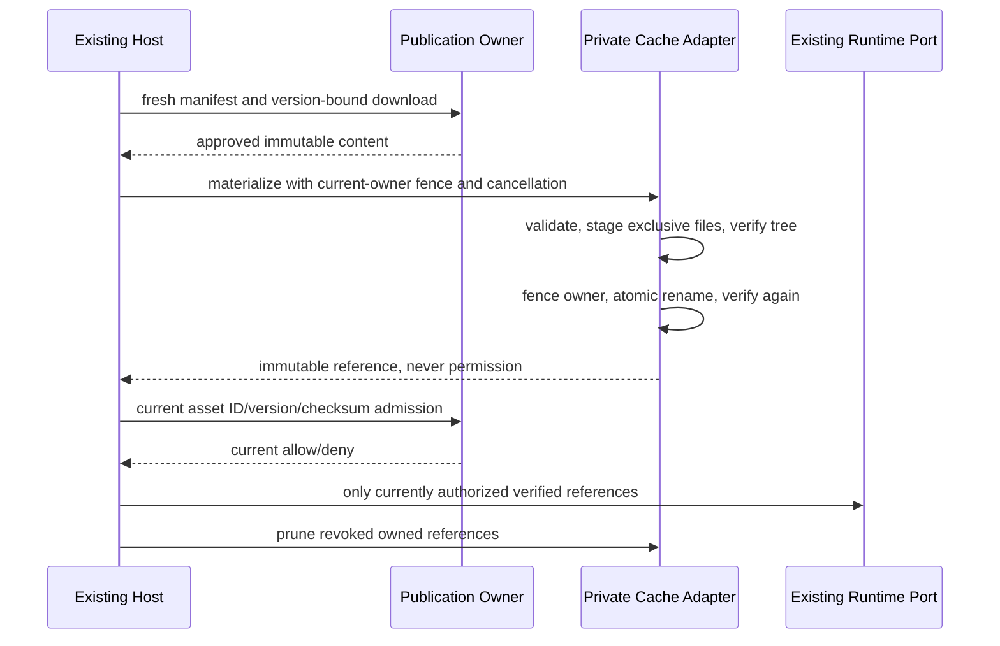
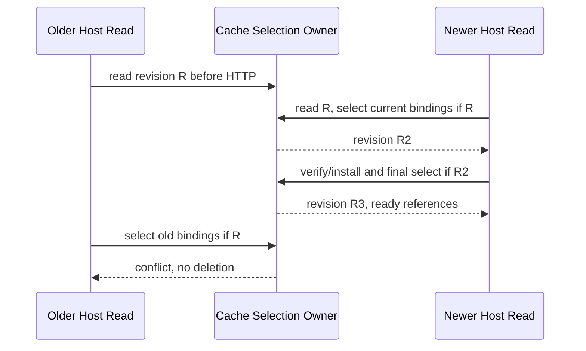
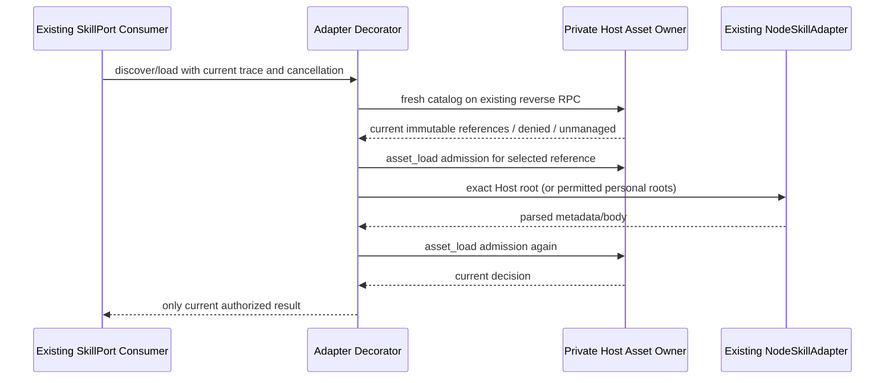
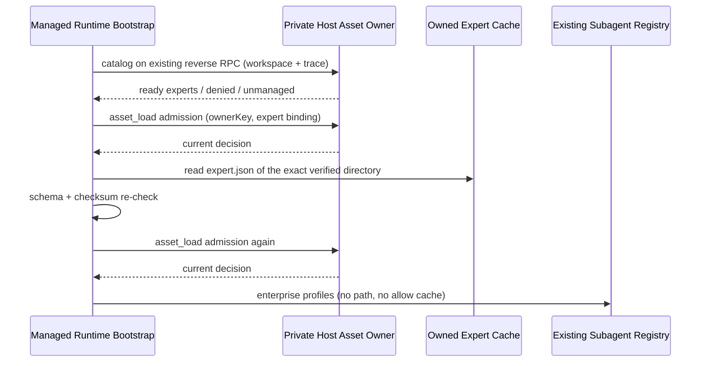

# UWork Enterprise Assets

## Contract And Ownership

Backend publication/review/scope and the existing EnterpriseIdentityService remain authoritative. The Host's asset adapter owns only derived installation bytes in a dedicated enterprise-assets namespace, never identity, permissions, tasks or personal/plugin configuration. No Renderer token or arbitrary destination is accepted. Root composition will partition caches by SHA-256 of issuer/tenant/member; cache presence never grants execution.

The first slice is a private filesystem adapter used by Host orchestration: `materialize(download, context)`, `verify(reference, context)` and `prune(keepKeys, context)`. A reference includes a deterministic content key, the validated immutable descriptor, and its owned content directory. The caller supplies cancellation and a synchronous current-owner fence; no allow decision is cached. Connectors stay behind the backend proxy and are not treated as cleartext filesystem bundles.

Every operation requires the caller's traceId. The adapter exposes a bounded outcome observer containing only fixed event/operation/status, traceId, duration and stable error code; it never reports paths, content, asset identifiers or ownership markers. Safe failures retain the traceId. Missing/unsafe trace IDs fail before filesystem IO, and observer failure never repeats or changes a committed filesystem operation. Root Host composition will route these events through the existing service logger, not create another log/identity owner.

## Filesystem Rules

- The trusted root must be absolute, not a volume root, and have no symbolic-link ancestor. Existing unmarked roots are rejected rather than adopted. A private format marker identifies the cache; unexpected root files, corrupt metadata and symlinks fail closed.
- Validate schema, well-formed Unicode, kind, positive version, package size and exact SHA-256 of `JSON.stringify(content)` before writing. Skill packages contain SKILL.md, at most 100 files/1 MiB, safe portable relative paths, at most 20 path components, no Unicode Cc/lone surrogates, device names, leading/trailing ASCII spaces or trailing dots, NFC/caseless/ancestor-file collisions. No archive extraction or arbitrary uploaded executable runs.
- Content keys hash the complete id/kind/version/checksum binding. Files are exclusively created (0600), directories private (0700); no file is overwritten. Each immutable object contains a bounded manifest plus a separate content directory. Other textual asset types have one explicitly named data file; they do not become global prompt injection.
- Existing objects must verify their manifest, every file's exact bytes, and the complete directory tree before reuse. Unexpected files, hardlinks, symlinks, missing files or changed bytes are rejected. Verification is repeated before returning a published reference.
- Installation writes into a unique owned staging directory, checks cancellation/current owner before commit, then atomically renames under the existing shared file lock. A failed/cancelled operation removes only its own unchanged staging directory. A crash before publication cannot expose a partial object; stale staging content remains non-executable and is safely cleaned under the lock when its ownership marker can be verified.
- Pruning accepts only validated keys, verifies ownership/manifest/tree before removing an object, and never recursively deletes an unknown path. The root itself and unrelated content are never deleted. A corrupt or unknown object is reported, not adopted or silently removed.
- All filesystem work is asynchronous. Stable errors never contain content or credentials. Native-platform acceptance and protection against a privileged same-user process continuously racing directory replacement remain separate; this is a validated data cache, not an OS sandbox. Consumers must still use current backend authorization and verify immediately before load.
- One shared lock lives next to the cache at `.enterprise-assets-<SHA256(absoluteRoot)>.lock`, under the trusted private Host storage parent. It serializes bootstrap as well as updates, avoiding a marker-creation race between windows. Before using the shared lock utility, reject symlinked locks, unknown entries, oversized owner files and linked owner files; stale-lock reclamation must never touch a substituted personal directory. Root object candidates must have valid ownership and manifest metadata; complete content trees are checked before reuse/removal.

## Host Skill Reconciliation

The Host uses its single private backend-session port for a fresh manifest, current local-channel admission, personal-skill policy and per-asset immutable admission. Roots are partitioned at `<trustedStorageRoot>/enterprise-assets-<SHA256([issuer,tenant,member])>`, never a personal/project/plugin directory. Its private catalog contains only verified skill references, names/distribution flags and current filesystem/personal/dangerous constraints, not content or credentials.

Personal allowances and security come from the same backend execution-admission response, not separate configuration/security HTTP reads. The backend exposes only the published personal booleans, never the MCP Hub address. Upgrade the backend before this consumer; a missing personal field fails closed. Legacy body-bearing Host outlets run their before/read/after checks inside one private backend-session scope, so identity/configuration replacement invalidates the result without distributing any owner credential.

Each catalog read freshly authorizes assets, prunes verified obsolete keys, downloads missing exact versions and rechecks manifest/policy/current identity before returning. Only an explicit not-cached result permits download; corruption is not silently repaired. Manifest changes produce a stable retryable denial rather than mixed generations. Prefetching visible skills into the private cache does not force-enable or modify personal/plugin assets; distribution flags never override deny policy.

The cache owns a derived selection revision, not an authorization snapshot. A reconciliation reads that revision before any manifest/policy HTTP and conditionally selects/prunes under the existing mutation lock. Selection advances the revision before deletion; final pruning compares the revision again. Every unconditional cleanup also advances it. A stale job may leave an unselected immutable object, but must never delete a newer successful selection. Concurrent windows use the same on-disk revision, not a Host-local mutex. The bounded private selection record is atomically published from an owned stage; an abandoned stage is handled by the existing crash recovery. Network requests never hold the filesystem lock.

Skill-load authorization checks current backend permission, same-profile ownership and verified cache bytes, then checks permission again. Personal skills require both current personal-skill and dangerous-skill allowances. CLI consumers must call this before and after actual loads; catalog presence alone grants nothing. Unknown/foreign references, logout, cancellation, changed config, unavailable backend and stale cache fail closed.

Root composition starts maintenance prewarm from existing authenticated identity events and clears only touched owned profiles after a current signed-out event. Only maintenance may coalesce an in-flight prewarm; runtime requests never reuse its allow result. Dispose aborts/awaits owned work and unsubscribes identity notifications through the existing Host lifecycle. No new Renderer identity/task channel is created.

Strict connection/workspace-bound reverse RPC must connect the existing SkillPort and draft composer catalog, including inherited subagent/workflow ports; legacy Host skill-content projection must obey the same personal/dangerous restrictions. The expert owner is wired below; the Playbook/instruction/MCP owners, other UI policy views and installed-platform acceptance remain full-scope follow-ups.

### Private Reverse RPC

`interaction/readEnterpriseSkills` is an automatic request from the policy-required CLI to its existing Host connection. It carries only a bounded request ID, session ID and the bootstrap-captured workspace reference, plus propagated trace context. The result uses the strict 1 MiB catalog schema. A missing port/trace, mismatched workspace, obsolete connection, cancellation, invalid result or 60-second Host deadline returns a stable denied catalog, never unmanaged fallback. The CLI deadline is 65 seconds so the Host owns completion first.

The existing enterprise interaction bridge owns one shared 32-entry pending map for tool authorization and catalogs. Its existing connection/workspace/session-bound cancellation notification covers both request kinds; request prefixes differ but no second accepted queue exists. This channel carries references/policy projection only, no tokens/content or Renderer authority. Merely wiring this catalog RPC does not replace the separately required before/after load authorization or SkillPort adapter.

Explicit protocol-client dispose/disposeAndWait is a terminal connection boundary even when transport closure is no longer observable. The client owns one disposal AbortController; isDisposed projects its signal, and reverse RPC listens to that signal as well as the existing transport-close event. Aborting it precedes listener removal and process transport shutdown. Pending work is cancelled synchronously, not kept alive until its deadline. Explicit disposal does not synthesize a transport-close event, reenter manager cleanup or invoke unrelated close observers; a throwing close observer cannot prevent explicit transport teardown.

### Guarded Runtime SkillPort

The existing SkillPort is decorated once at bootstrap with the private catalog and authorization ports. Missing one of those ports fails closed; a standalone app with neither keeps the original adapter unchanged. Current Host `unmanaged` results retain legacy local behavior, while a denied/invalid catalog never falls back. Managed caller-supplied roots are ignored: enterprise discovery uses only verified Host directories, scope `admin`, source `remote`; personal discovery uses the configured personal adapter only when current filesystem/personal/dangerous allowances all permit it. The separate existing NodeSkillAdapter instance for enterprise roots does not inherit personal disabled-path overrides, so a distributed administrative asset cannot be hidden by a personal override.

Each enterprise item exposes only its root SKILL.md, with stable qualified name `enterprise:<assetId>` and the backend display name. Nested SKILL.md files remain supporting files, not independent grants. Personal/plugin metadata cannot claim that reserved namespace. Unqualified ambiguous matches fail; loading selects one exact verified directory/path and rechecks the returned path. Discovery and body loads both authorize before and after actual adapter reads. A denied/cancelled late result never returns body or metadata. The adapter stores no allow result or second persistent catalog.

Reserved-prefixed requests match only the immutable qualified identity, never an asset display name. Managed body byte budgets must be positive safe integers at most 1 MiB. Each guarded public operation has a 70-second ceiling and combines direct/context cancellation; uncooperative port promises are cancellation-raced and late results discarded. The existing Skill tool's shorter execution deadline remains in force. Host composer catalog observation waits at most 75 seconds without classifying backend latency as a broken CLI process.

Authorization uses the existing tool RPC with phase `asset_load` and optional strict immutable skill reference (absent means personal). That phase is handled only by the Host asset owner, never by generic execution admission. The ordinary Skill tool gate may accept low-risk skills while dangerousSkills=false only when core derives `assetGuarded` from the actual injected SkillPort; MCP/model input cannot provide the marker. High-risk enterprise assets still require current backend dangerous-skill admission, and personal skills require both personal and dangerous allowances.

Ready catalogs include an opaque ownerKey derived by the existing private backend-session owner from issuer/tenant/member, local identity generation, shared revision and captured configuration fingerprint. It contains no token or raw identity, does not grant permission, and is not another identity owner. Every asset_load RPC requires that key; the Host compares it with its current scope before admission. This binds both personal and enterprise reads across logout/relogin or configuration replacement, rather than treating two individually valid but differently owned decisions as one continuous load. Cache paths remain profile-based, so legitimate relogin may reuse verified bytes only after fresh current admission.

The main runtime, child Agent filter and workflow factories share the same guarded SkillPort; child requests propagate their current trace/session rather than the parent session. Draft composer discovery receives the same ports and bootstrap-captured workspace. Managed session catalog projections refresh current metadata without pretending to erase instructions already read into a running model's context. Legacy Host list/buildPromptContext body outlets are guarded before and after their existing reads; the settings/mutation UI policy work remains a separate required slice.

### Expert Owner

Console evidence (`evidence/workbuddy/`, this round): the expert page declares WorkBuddy and enterprise-agent support with an upload affordance and a distribution policy (限定/屏蔽, intersection, deny wins within the default visibility scope). Connectors declare the same WorkBuddy support and keep credentials server-side. The custom-instruction page marks WorkBuddy and enterprise agents unsupported, and the Playbook page is a read-only Cookbook with no create/upload request, so neither kind has a current UWork owner.

One profile cache root per issuer/tenant/member serves every distributable kind (skills and experts), matching the documented partition; the selection revision covers all authorized keys of both kinds, so one reconcile can never prune the other kind's objects. `readHostAssetManifest` keeps only kinds with a current owner and rejects the rest before any download, independent of the server-side support matrix.

Experts enter the existing subagent owner as in-process `AgentProfile` entries with source `enterprise`: name = backend display name, description = profession (falling back to the name), systemPrompt = the published instructions. They carry no `path`, are never written to the personal/project/plugin directories, and are appended after local and plugin profiles so an enterprise binding wins a same-name collision instead of being shadowed. Reserved built-in names and duplicate display names are dropped with a stable warning; the expert `modelId` is not interpreted in this slice, because backend model ids are not client provider selections.

Body reads go through the same `asset_load` admission on the existing reverse RPC with the catalog ownerKey, using a strict expert body schema, a 1 MiB bound, one 70-second ceiling and parent cancellation. The parsed body's `JSON.stringify` digest must equal the binding checksum, so bytes swapped between admission and read cannot become a profile. A denied, unavailable, timed-out or cancelled catalog yields no enterprise experts and never falls back to a local profile of the same name; an unmanaged catalog keeps the previous standalone behavior. Profile changes apply when a managed runtime is created, not to an already-running session.

Playbook, instruction kinds stay off the UWork client until an existing owner applies them; a manifest that still contains them is rejected by the Host before caching.

### Connector Owner

Console evidence (`evidence/workbuddy/`, this round): the connector page declares WorkBuddy support with a 新建连接器 affordance, an allow-list of tools and a server-side credential reference; the remote address and credential never appear in a client payload. The backend therefore keeps the remote MCP session: `POST /api/client/connectors/:id/rpc` re-authorizes on every dispatch, injects the vault credential, keeps the remote session encrypted and returns a masked descriptor (`transport`, `description`, gateway path) only.

A connector has no cleartext bundle to install, so it is never materialized in the asset cache: the published checksum covers the private server-side content, and a cached descriptor could not be re-verified against it. The catalog carries connector references as metadata only (`id`, `version`, `checksum`, display name, distribution flag); the Host keeps no connector file, no remote address, no credential and no backend session id at rest. The masked descriptor is fetched through the same private backend-session port when the runtime actually loads the connector, so the descriptor binding is current at load time.

Connectors enter the existing MCP owner as a decorator over the `McpPort` the App already built (`withEnterpriseConnectorServers`), exactly as the guarded SkillPort decorates the existing SkillPort. The decorator adds one synthetic server per admitted connector, named `enterprise-<assetId>` (a namespace reserved by the sanitized MCP server-name rule; a configured or plugin server of the same name wins and the connector is skipped), and produces tool descriptors through the existing `normalizeMcpToolDescriptor`, so tool naming, approval, permission and UI paths are unchanged. MCP framing (`initialize`, `notifications/initialized`, `tools/list`, `tools/call`, `notifications/cancelled`) is carried by the MCP SDK over a private transport whose only outlet is the reverse-RPC connector request; no HTTP client in the CLI holds a backend credential and no remote URL is dialled from the CLI. The backend-issued MCP session id is held by the Host per connection and released when the connector disconnects or the connection closes.

Per-load admission uses the existing `asset_load` phase with the connector binding and the current catalog ownerKey before a connector is connected and before every tool call. A denied, cancelled, timed-out or obsolete admission yields no tools, never a cached descriptor, and never falls back to unmanaged behavior. The backend gateway independently re-admits each dispatched request, so a revocation that happens between the client admission and the dispatch still fails closed; a revoked connector's tools disappear at the next catalog read, and its already-registered tools fail on their next call rather than continuing to run.

Delegated requests/notifications carry the same bounded JSON contract as other enterprise interactions (262 KiB input, bounded depth and node count, strict result schema). Connector tool arguments and results are not persisted by the Host and are not written to logs; the CLI-side failure classification stays stable (`enterprise_*` codes) and never surfaces backend addresses, credentials or remote session ids.

## Cache Acceptance

1. Real filesystem materialization/reuse/update/removal preserves personal directories and never rewrites an old version.
2. Tampered checksum, bad schemas/paths, aliases, symlinks, hardlinks, unknown files and corrupt ownership metadata fail closed without writes outside the namespace.
3. Cancellation/stale owner before publication leaves no executable partial object; competing stores serialize without overwriting objects. Crash staging is not discoverable as a published object.
4. A controlled actual-backend HTTP download can be materialized and loaded through the existing NodeSkillAdapter using explicit roots; revoke/version changes are verified separately from cache presence.
5. Root typecheck/lint/architecture and focused source tests pass. Current authorization at every runtime load, all asset-kind owners/UI and three-platform installation remain required follow-up slices, not claimed by cache/Host maintenance alone.

## Verified Cache Slice

`pnpm test:enterprise-assets` builds the referenced shared declarations, strictly typechecks the new adapter/Host and their tests, then runs 35 tests (16 cache, 2 selection, 10 Host including experts, 6 catalog bridge, 1 expert-kind). The broader `test:enterprise-policy` also includes these tests plus the CLI owner tests (adapter guard, expert profile loader, draft catalog, dispatch). Current macOS evidence includes a real stopped child killed with SIGKILL before publication; the next store reclaims its abandoned lock and verified owned stage, preserves the old object, and publishes a new version without replaying the interrupted operation. The SIGSTOP/SIGKILL test is explicitly POSIX-specific, not Windows acceptance.

The controlled backend's `scripts/client-assets-contract-smoke.ts` uses real loopback HTTP, UWorkBackendClient, this cache and the existing NodeSkillAdapter's explicit admin/remote root. It proves immutable version one/two loading, old-download conflict, preserved old bytes, current asset authorization denial after revocation and owned pruning. It does not wire automatic Host reconciliation or allow a stale cached object to stand in for current authorization.

`scripts/client-assets-host-contract-smoke.ts` separately connects real loopback backend HTTP to the existing EnterpriseIdentityService, shared private session store, backend-session port, Host orchestration and identity-event lifecycle. Controlled login triggers maintenance prewarm without a manual catalog call; reuse and published version updates now traverse the actual CLI catalog protocol factory and Host bridge with JSON-serialized requests/responses. Current revoked-load denial and signed-out event cleanup are observed. `scripts/client-assets-rpc-contract-smoke.ts` verifies trusted workspace/trace propagation, input bounds, cancelled late responses, missing port and strict response rejection. This proves the source/lifecycle/RPC foundation, not an installed Electron/stdio/Runtime load or real enterprise callback. The factory still needs bootstrap SkillPort/composer attachment and per-load authorization. Full policy regression is 14 CLI + 107 Host tests, with no failures/skips. Root and CLI typecheck/architecture pass; lint remains 111 root and 53 CLI existing warnings, zero errors.

### Connector Verification Slice

`pnpm test:enterprise-assets` also covers connector catalog metadata (no cache object, no `key`/`directory`), admission bound to the published version/checksum, the relay's frame forwarding/session passthrough, stable denial codes, explicit `DELETE` release and the owner-key fence; `test:enterprise-policy` covers the same reverse-RPC channel end to end (workspace/trace refusal, missing relay fail-closed, cancellation) plus the CLI owner: normalized tool names, before/after admission per load and per call, revocation pruning with session release, version-change reconnect, reserved-name collision and unmanaged passthrough. The controlled backend's `scripts/client-connectors-mcp-contract-smoke.ts` drives the packaged CLI over real stdio against real loopback backend HTTP and a controlled remote MCP server: the runtime reads the catalog, admits the connector twice, completes `initialize`/`notifications/initialized`/`tools/list` through the Host-only proxy, never puts the remote URL, credential or backend session into any frame, and does not dial a revoked connector again in a new session. Real third-party MCP service behaviour, executed-code semantics for remote tools and three-platform installation remain required follow-up slices.

Two bounded Host review cycles reproduced stale concurrent pruning with a red real-filesystem two-Host test, repaired it through on-disk revision comparison, and found no substantive issue in cycle two. Cross-model skipped: non-interactive context.

Three bounded catalog-RPC review cycles reproduced explicit client disposal failing to abort Host work, then a throwing-close-observer regression in an intermediate repair. The final disposal-signal owner avoids synthetic close events/manager reentry and both failures; real-client sync/async/transport-first disposal and throwing-observer tests pass. Cycle three found no remaining substantive issues. Cross-model skipped: non-interactive context.

Three bounded adversarial review cycles led to repairs for substituted lock paths, bootstrap serialization, hash-shaped unknown root entries and normal lock-release races. The reviewer's independent 8-worker/3,200-verification stress completed with zero failures after repair. Cross-model was skipped in this non-interactive execution. No user directory or real identity credential was used by tests.
