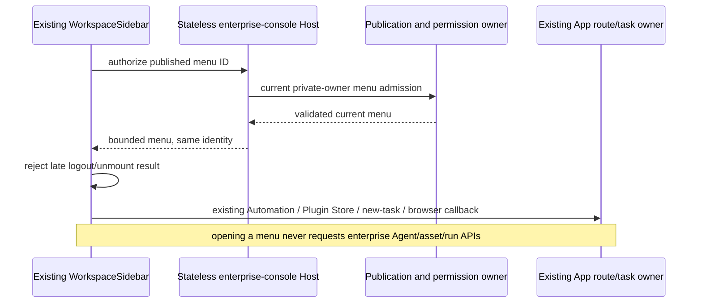

# Published enterprise menus on existing UWork pages

The user chose the existing UWork pages as menu targets. The wire IDs `chat`, `agents` and `assets` remain compatible: `chat` invokes the existing Sidebar new-task command, `agents` is a legacy ID for the existing Automation page, and `assets` is a legacy ID for the existing Plugin Store. Do not add enterprise-Agent/Assets main views or fetch Agent/asset/run catalogs when opening these menus. Only new backend defaults use `自动化`/`Automations` and `插件商店`/`Plugin Store`. Every previously published title remains authoritative, including a title identical to an old default: it cannot be distinguished from a deliberately chosen administrator title. Routing always uses the compatible ID and never rewrites published names or their revisions.

The existing App navigation and task commands remain the only route/task owners. The base Root provides the stateless enterprise-console Host once, so a workspace-scoped ServiceProvider cannot replace its identity. Published order/name/English name/icons are validated and projected without credentials. Disabled menus are omitted. Every managed Sidebar dispatch first authorizes the current menu ID through the private backend session, then calls the existing `handleOpenAutomations`, `handleOpenPluginStore`, chat/new-task or browser-tab callback. Custom links remain HTTPS and do not acquire SSO credentials. Late replies after logout, owner replacement or Sidebar unmount do not dispatch.

A confirmed managed Sidebar uses the published entries in place of the old New Task, Automation and Plugin Store buttons, including during temporary failure or logout. UCAS and Hosts without the feature retain their existing buttons. The retained managed-mode bit is a conservative display mode, not a permission cache or another identity. Existing keyboard, command-center and task-menu local commands remain separate from this Sidebar-entry policy; assistant channels and actual Host/Gateway authorization still govern execution. Hiding an entry does not delete sessions or claim that every local command is prohibited.

The existing enterprise-console Agent/asset/run RPC methods remain as compatibility contracts. Their operations do not depend on legacy navigation IDs, because an Automation or Plugin Store menu cannot grant or revoke enterprise-Agent execution or asset installation. These methods use the current private owner and the backend's independent channel, seat, subscription, IP, resource scope and caller-run checks. Reads validate bounded metadata/results and recheck the same identity after HTTP. A 202 receipt contains only accepted summary metadata. Creating/cancelling work is never automatically retried; cancellation remains available for already accepted caller-owned work. T13b continues to own asset installation, version verification and loading.

Verification: `pnpm test:enterprise-console` preserves current menu denial, independent API denial, accepted receipt/cancellation, malformed data, owner-change and unmanaged regressions, and tests the existing-owner dispatcher. `node packages/ui/test/enterpriseConsole.e2e.mjs` uses the production dispatcher and real WorkspaceSidebar to verify order/custom names, existing Automation/Plugin Store callbacks, zero Agent/asset/run calls on menu open, revocation, logout/unmount races, UCAS fallback and 320/768/1440 layouts. From the backend checkout, `node --import tsx --test scripts/client-console-contract-smoke.ts` verifies the current source trees over real HTTP; Agent/API lifecycle acceptance remains independent of menu routing. Real external SSO, paid models, organization login and installed-platform acceptance remain separate.
