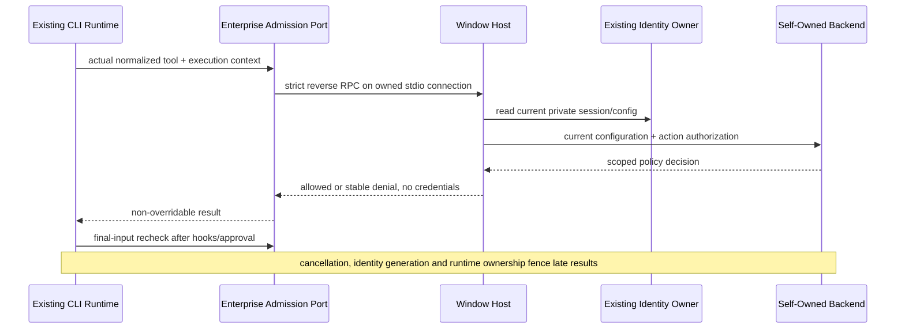

# UWork Enterprise Host Policy

## Scope And Owners

The self-owned backend (`backend: "uwork"`) publishes enterprise assets and policy. The existing EnterpriseIdentityService remains the only identity/session owner; credentials never enter Renderer projections or tool requests. Each window-scoped Host applies policy to its existing Agent runtimes. Phone attachments use the same Host and decisions, not a second policy or Agent owner.

The complete integration includes published menus/new-chat/risk notice, assistant channels, sharing/personal restrictions, asset distribution/revocation, and local execution restrictions. This document does not replace real organization login, supplier, or three-platform installer acceptance.

## Execution Admission Slice

### Shared Private Backend Session

Execution admission and asset reconciliation use one Host-private backend-session port in Root composition. It delegates to the existing identity owner/shared private store; it creates no identity, accepted work queue, token cache or Renderer RPC. The existing managed-profile-observed latch moves into this one port. A scoped callback receives only issuer/tenant/member identifiers, cancellation, current-owner checks and a finite same-origin client-API request function, never a token.

Each request checks the captured private generation/revision/token/issuer/member/tenant, current trusted configuration fingerprint and persisted shared revision before and after HTTP. The whole scoped callback is checked again before its value can leave the port. Relative client paths are allowlisted, redirects forbidden, JSON bodies/responses bounded, and per-request cancellation/deadline applies to response reads. Execution responses retain the existing 64 KiB cap; asset downloads/manifest have their explicit larger bounded limits. Trace IDs supplied by the runtime propagate in the existing x-zcode-trace-id header; legacy direct callers may omit a trace, while new asset operations require one. Invalid trace IDs fail closed.

The refactor must preserve current denial codes and unmanaged UCAS behavior. Callback-owned errors remain owned by the callback's service; private credential/config/HTTP errors become stable backend-session errors without raw body, URL or credential text. Asset synchronization and runtime-load changes follow as separate increments on the same port.

Shared-boundary verification: 11 focused session tests pass, including cancellation at every capture/pre-request/post-response/final private read, uncooperative fetch/body streams, token-echo rejection and raw-owner-error sanitization. The existing authorizer maps detailed private transport errors back to its established denial contract. Root typecheck, strict new-test typecheck, 14 CLI and 91 Host regressions, four controlled cross-repository source smokes, lint (111 existing warnings/0 errors) and architecture (0 violations) passed. Two bounded review cycles found and repaired cancellation coverage and denial-code drift; cross-model review was skipped in the non-interactive run.

- Introduce a narrow EnterpriseToolAuthorizationPort in CLI contracts and a strict V4 `interaction/authorizeEnterpriseTool` reverse request. Host is the decision authority; Renderer receives no approval prompt or credential.
- Desktop-local Host sets `ZCODE_ENTERPRISE_POLICY_REQUIRED=1` when spawning its managed CLI. This is a trusted process bootstrap input, not a workspace/session configuration field. The protocol bootstrap captures it and injects the port into every main, subagent, and workflow runtime. Standalone CLI without this input retains current behavior.
- The Host resolver checks its current trusted backend configuration and private identity session on every request. Non-UWork profiles remain unmanaged. Config/read/network/protocol failures in a managed profile deny execution; no cached successful decision is reused after failure or logout.
- A Host that has observed a UWork configuration retains a fail-closed admission latch if that configuration disappears, including after logout. This latch stores no allow decision or identity; an explicit valid UCAS profile remains unmanaged. Unconfigured initial startup keeps the existing behavior.
- Requests carry workspace identity/path, session, tool-call and trace identifiers, the actual tool name, capability facts, and bounded execution input. Routing uses the existing stdio connection and its bound workspace, not a payload-supplied Host. Results contain only allowed/denied plus a stable reason code.
- Enterprise admission is separate from interactive permissions. Yolo, plan/read-only, project allows, session grants, Hook allow, and user approval cannot override an enterprise denial. Check before PreToolUse effects and again on the final normalized input immediately before handler dispatch, including approval/Hook input modifications.
- Cancellation and a bounded request deadline propagate through CLI -> Host -> backend HTTP. A late success after cancellation, identity change, or obsolete runtime cannot dispatch a tool. Existing trace/event/error lifecycles report denial without logging full input or credentials.
- Identity fencing reads a private synchronous authority snapshot from the existing identity owner (generation, store revision, current session, invalidation signal). Logout invalidates this snapshot before awaiting storage. Authorization also checks the existing shared private store before and after HTTP so a peer's logout tombstone fences execution before its notification arrives; it rechecks the owner snapshot and trusted backend configuration fingerprint after every asynchronous check.
- Self-owned opaque sessions retain a private issuerOrigin binding. Restore, logout revocation and policy HTTP must not send such a token to a different endpoint. Older UWork sessions without a binding require re-login; UCAS sessions keep their existing flow. issuerOrigin is not a Renderer projection or a second identity owner.
- Final admission occurs after async ToolCallStarted emission, includes current workingDirectory/root/identity, and dispatch consumes that same captured context. Native execution also requires admission so an allowed tool cannot start a denied shell/network Hook, workflow script or subprocess.
- Decisions classify shell, filesystem, network, skill, MCP, and system effects from trusted tool registration/capability plus known built-in semantics. Server-reported MCP read-only annotations alone do not grant local privileges. Unknown capabilities are explicitly unsupported under restrictive managed policy.
- Native shell/REPL/plugin execution is not an OS sandbox. Mixed policies that cannot be guaranteed by the local execution boundary must return a precise unsupported/denied result until an isolation adapter proves them; never claim arbitrary subprocess network/filesystem confinement from a tool-name check.

## Acceptance

### Personal Model And Connector Runtime Admission

The existing Registry Model factory and MCP owner remain the only model/server owners. A Host-bound reverse authorization permission `model_request` checks the current local assistant channel and the published `personal.models`; `personal_connector` checks `personal.connectors`. The same execution response supplies security and personal flags. The model's actual HTTP target is authorized at the shared proxy-aware fetch boundary after asynchronous body/proxy preparation, including SDK retries. A model routed to the current private backend origin under `/v1` is enterprise-managed and remains subject to that backend's model/credential/entitlement checks; a copied provider name or UI flag grants no exemption. Personal targets also require current network/domain permission.

The MCP owner checks personal servers before connecting and before/after calls; its actual HTTP and stdio transports recheck before dispatch after asynchronous setup. Enterprise relay servers continue through asset/version/owner admission. Only Host-generated builtin provenance bypasses the personal-connector switch; public config schemas reject that provenance and ordinary plugin/user/project servers remain personal. Builtins retain their existing shell/filesystem/network checks when executed.

The existing strict authorization response adds an optional opaque ownerKey for these runtime consumers. The private Host supplies it; request input cannot declare it outside the existing asset-load contract. A model invocation binds its owner in request-local async context and each MCP transport binds its connection owner. A new identity, or a managed/unmanaged mode change, cannot publish an old operation's result. This is an operation/connection fence, not a second identity store. Desktop's actual protocol connection pool receives the guard too; decorating only the App's fallback adapter would leave pooled discovery unprotected.

Model results and each model stream event are checked again before leaving the existing owner, including bound models and subagent/workflow reuse. Revocation, invalid or missing personal fields, identity changes, absent required Host, and denied local assistant channel fail closed. Standalone and explicit UCAS behavior stays unchanged. These guards do not create a second provider registry, model cache, MCP pool, queue, or identity owner.

Desktop-local and phone attachments sharing that Host are in this slice. A remote Host without a securely forwarded enterprise identity cannot be assumed managed; SSH/WSL/Docker and remote identity propagation remain the T13d acceptance boundary, rather than claiming the local guard proves remote enforcement.

1. A real ToolExecutor in yolo mode cannot run a backend-denied shell/filesystem/network tool; allow Hooks and an approving broker cannot bypass the denial.
2. Hook/broker-modified input is rechecked; a target or capability change cannot reuse the original decision.
3. Current backend policy, revoked session/seat/asset, logout, unavailable Host/backend, malformed response, timeout, and cancelled request fail closed when enterprise policy is required.
4. Strict protocol schemas reject forged workspace routing and oversized input; stdio responses remain connection-bound. Desktop and attached phone share the same authority.
5. Main, subagent, workflow and resumed runtimes use the same required guard; no unguarded child construction path.
6. Existing UCAS and standalone CLI behavior remains unchanged when not managed. No secret is added to shell environment, logs, request parameters or UI state.
7. Run root and CLI typecheck/lint, architecture check, focused real-source tests, and controlled backend integration. Report existing warnings and missing platform/installer coverage precisely.

## Verified Admission Slice

The managed HTTP adapter authorizes every manual request, rejects automatic redirect-following, and forces public-egress DNS/IP checks. Trusted `not_managed` responses preserve existing UCAS redirect and egress behavior. WebFetch's real redirect loop is covered with an initial approved hostname and a rejected `www` hop. Native ExecutionPort foreground/background paths are authorized separately, so a read-only tool cannot start a shell through a Hook. Enterprise denials emit both permission and terminal tool-error events.

The controlled cross-repository smoke uses actual CLI executor, protocol port, Host bridge, private identity owner/shared store, a real loopback backend HTTP listener, and NodeExecutionAdapter. It verifies default denial, published allow followed by an actual `42` process result, policy revocation during a Hook, and logout. Its JSON-RPC transport is an in-process round trip, not an installed Electron/stdio or enterprise WeCom acceptance test.

Unknown capability registrations fail closed. Only enumerated session-only permissions are exempt from resource classification; workflow disk readers require filesystem permission. Legacy UWork sessions lacking an issuer binding require sign-in again. The private CLI source packages depend on parent monorepo packages and are delivered through root-workspace installation and the checked-in Agent/distribution build scripts. An isolated nested source install is not a delivery requirement; the nested lockfile warning alone is not a complete diagnosis of its missing parent-workspace dependency graph. On 2026-10-15, root `pnpm install --frozen-lockfile --ignore-scripts` passed for all 34 workspace projects using the exact Node.js 24.14.0/pnpm 10.33.2 toolchain, without changing the root or nested lockfile. This confirms locked resolution/linking, not native lifecycle execution or target-platform installer acceptance.

Verification entry: `pnpm test:enterprise-policy` runs the dedicated CLI test typecheck, 14 CLI admission regressions and 63 Host identity/gateway/admission regressions. Root and CLI typechecks passed; architecture reports 0 new/baseline violations. Root lint retains 111 existing warnings and 0 errors; all 14 CLI lint tasks pass with 53 existing warnings and 0 errors (17 packages are in scope, three have no lint task). Turbo warnings about the nested workspace are recorded separately from the supported root-workspace build and do not introduce a requirement to install the private CLI source in isolation.

Three bounded adversarial review cycles identified and reproduced Hook subprocess, delayed logout, final dispatch context, config/issuer switching, unknown capability, redirect target and missing-config regressions. Each actionable finding received a code repair and regression; native mixed-policy isolation remains an explicit unsupported boundary, not an accepted security bypass. Cross-model review was skipped because this is non-interactive execution; no external review CLI was invoked.

## Remaining Host Slices

### Dynamic Workflow Direct Execution Boundary

The GUI's existing `startSavedWorkflow`, `resumeWorkflowRun` and settings amendment commands are real execution entrypoints, separate from model tool approval. A GUI click grants interactive consent only. Every direct entry must use the same current enterprise execution/identity owner before consuming a saved definition or persisted script, and before creating a run or starting its VM. `allowFilesystem=false` at entry must produce a refusal with no definition-body consumption, run, VM or actor; existing definitions and approved history remain intact. A default-disabled feature rollout and a model tool's unsupported capability do not prove these direct paths are safe.

Use the existing supported filesystem/read classification and private EnterpriseToolAuthorizationPort. A workflow operation binds the first decision's opaque ownerKey and managed/unmanaged mode; it rechecks current permission and the same owner after asynchronous context preparation, persistence, draft preparation, transcript import and VM-entry preparation, immediately before the next side effect. This is a process-local operation fence, never an allow cache, identity store, model field, journal column, VM input or Renderer capability. Missing required owner binding, cancellation, logout, configuration/identity replacement and unavailable Host fail closed. Existing standalone/UCAS behavior remains unmanaged.

The Core direct-start owner must check before resolving saved definitions and before writing drafts after earlier awaits. Permission/cancellation failures must escape best-effort draft and VM-entry IO fallbacks rather than becoming a successful launch without a draft. The shared run owner applies the same fence to submit/amend/resume and carries it through preparation to the VM spawn boundary, so direct GUI commands, model tools and other existing callers cannot choose a weaker path. Initial denial precedes driver/engine creation; a revocation after an accepted launch must be a truthful failure/stop, never relabeled as a successful user cancel.

The workflow's direct world filesystem reads and artifact publication must check current filesystem permission and their run's owner before reading and before releasing/publishing returned bytes. Shell/world-run, actor models and Skill reads keep their existing independently guarded adapters; a successful actor Skill denial alone is not proof that raw world IO or artifact publication obeys policy. Metadata/history retention and public workflow query outputs must retain their existing scope and receive appropriate current content-read checks; none of these guards deletes old accepted data.

Acceptance includes real formal CLI/Host/backend evidence for V4 start + approved Skill body in the actor's next model call, current asset/filesystem revocation, identity fencing and cold resume of the same durable run without replaying completed asks. The observed initial-filesystem-denial bypass must remain a failing regression until repaired and rerun against a newly built formal artifact. Do not add model execution permissions to the session-only allowlist just to bypass this boundary.

### Personal Ports Controlled Live Acceptance

The controlled live check uses the current in-repository packaged CLI, its existing Registry/Skill/MCP owners and the real Host identity/Gateway/private admission path against a temporary backend reached over HTTP. Only owned user/project skill files and a harmless loopback MCP server are seeded; those files are test setup, not product settings creation or an external MCP acceptance claim. Backend policy mutations use the public configuration revision/publish HTTP contract.

1. With both published `personal.skills` and `security.dangerousSkills` true, the actual Skill tool must deliver the owned user and project bodies to the controlled model. Publishing either switch false must prevent a subsequent Skill load in the same runtime from delivering the requested body in that call's result, while preserving the owned files. Previously accepted conversation history is not erased by this check. A seeded personal name cannot acquire the enterprise namespace or enterprise asset provenance.
2. A seeded personal loopback MCP server connects through the normal CLI configuration/connection owner and executes an actual harmless tool with independently observed call markers while `personal.connectors` is true. Publishing false must prevent a subsequent call in that already connected runtime from dispatching to the server; the user configuration stays byte-identical. This check does not assert remote MCP availability or relax SDK/core egress controls.
3. After the real identity owner logs out, a new conversation turn in the existing runtime must fail before a new model dispatch, so the previously connected personal ports receive no request. No model/server request or new tool marker may appear, and the pre-existing personal files/configuration remain intact. Refusal is measured against request/side-effect counts and current runtime terminal evidence, not just configuration booleans; this path does not assert a separate direct-tool API logout test.

Asset reconciliation must use owned enterprise paths/metadata, immutable version/checksum checks, atomic writes, safe relative paths, scoped removal, disabled/high-risk filtering, and current backend authorization. Do not overwrite or delete personal/plugin assets. Expert/playbook/instruction and masked MCP configuration must feed their existing runtime owners.

Published UI configuration must be a derived Host projection through existing services/hooks, including mobile attachments. It must not create another identity, task queue, model configuration or permission owner. Desktop-attached remote workspace enforcement and native isolation combinations require their own transport/runtime evidence before the full Host integration is accepted.
