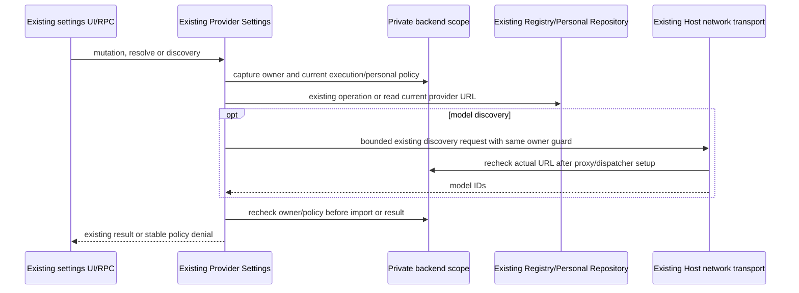

# Enterprise policy at Provider Settings

ProviderConfigService/Personal Repository and ProviderRegistry remain the only configuration/model owners. The existing Host-private UWorkBackendSession supplies current execution, personal and security policy; no Renderer flag, provider name or provider ID establishes enterprise ownership.

Each personal create/edit/delete/reorder/model-toggle, model discovery and configuration resolution enters one captured private backend scope. Personal operations require the same `POST /api/client/authorize` execution decision to allow the local assistant channel and `personal.models=true`. Missing/malformed policy, denied seat/subscription/channel, unavailable backend, logout and owner/config changes fail closed. Existing disk configuration is preserved and grants no execution permission. Read-only settings views remain available; CLI model/MCP owners independently enforce actual runtime dispatch.

Configuration resolution and connectivity testing may identify a managed model only from the Registry's actual API base URL matching the current private backend origin with `/v1` path. A user-supplied enterprise ID or provider name grants no exemption. Personal model discovery requires personal permission even for a saved UCAS row; automatic Gateway provisioning already obtains its model list from the private backend owner.

The public `applyUcasGatewayProvisioning` method also requires personal admission. Root's existing private Gateway provisioning target uses a Symbol-only entry on the same service to reach the same original writer; string RPC cannot address it. It is not a second configuration owner or public bypass.

Policy is rechecked after existing provider-operation waits and before discovery import. Discovery uses the existing Host transport, owner cancellation, redirect rejection and final actual-URL network/domain checks. It retains existing bounded pagination and atomic revision-checked imports. Mutations already admitted before an external revocation may have local disk effects; suppressing their stale result is not rollback. Saved configuration still cannot bypass later runtime authorization. Unmanaged/explicit UCAS behavior remains unchanged. Remote identity propagation, fixed-DNS/remote proxy isolation and installed-platform verification remain separate acceptance boundaries.

Verification entry: `pnpm test:enterprise-provider-settings` checks the dedicated test project with strict TypeScript and exercises real Registry/Personal Repository operations, the private Symbol provisioning port and real Host network dispatch. Actual model generation remains separately enforced in the existing CLI model owner.
