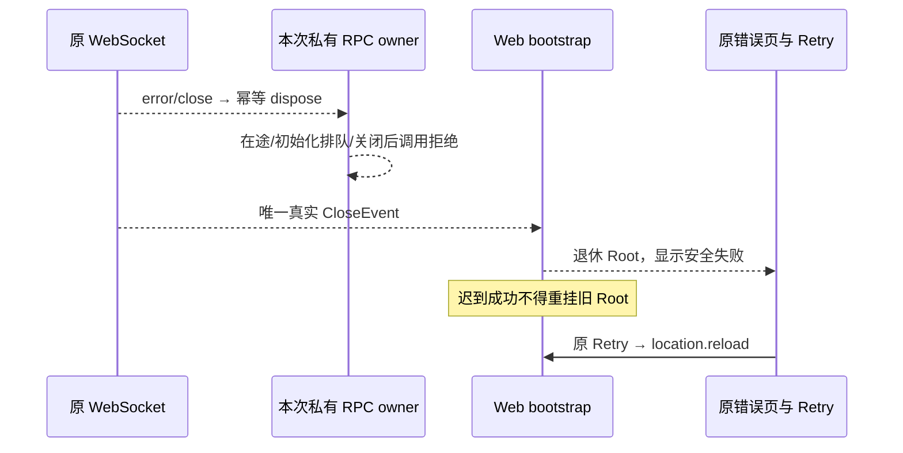

# Standalone Web 连接关闭与原 Retry 恢复

Standalone Web 成功连接后断开必须退休当前 RPC 与 Root。只有用户操作原 Retry，才通过原 `location.reload` 重新 bootstrap；没有自动重连、输入重放、业务回滚承诺或新的连接/身份所有者。

## 所有者与事件顺序

`connectViaWebSocket` 私有持有本次 ChannelClient、SocketProtocol 和 socket。error 可先 dispose 资源，令在途、Initialize 前排队及后续 RPC 拒绝；onClose 仍仅代表随后真实 CloseEvent，保留原 code/reason/wasClean 且只通知一次，不伪造 close，也不能因资源已释放而丢通知。实际 close 后移除本连接 listeners 并释放协议/socket。公开 connectViaProtocol、MessagePort 与全局 RPC 协议不变。

Web bootstrap 只持有本次渲染的 closed fence。初始失败或 close-before-ready 保持原“Web 启动失败 / Web bootstrap failed”；Promise 已 resolve 但 close 先于 await continuation 时，禁止迟到 Root 覆盖错误。成功挂 Root 后的实际 close 显示“连接已断开 / Connection lost”。onOpenSocket 观察回调同步 close/error 时不能再返回死连接代理，正常 open 观察保持一次。

断开正文固定为“请重新连接后确认之前操作的结果。”及“Reconnect, then check the outcome of your previous operation.”，不使用 event.reason、URL 或原 exception/cause。初始失败正文也采用静态安全连接提示。复用原样式、alert、语义 button 和“重试 / Retry”；聚焦 tabIndex=-1 的 h1，不自动聚焦 Retry，让真实 Tab→Retry→Enter 完成唯一原 reload。

## 有限验收与边界

- 原生 Node24 WebSocket、真实 loopback ws、原 RPC/RemoteServiceAccess：正常文件响应、在途 close、Initialize 前排队 close、关闭后拒绝；error→实际 close 的原值一次通知、onOpenSocket 关闭/报错竞态、listeners 释放及精确端口终态。服务端仅挂住本次自有文件 IO，不替换客户端 Promise 或结果，零模型。
- 原 bootstrap helper 和真实 React 静态 markup：正常/迟到/重复 close/初始失败，中英文静态文案及原生按钮语义。测试不把静态 markup 当成实际焦点或物理键盘输入。
- 原正常 Web/Server 与独占浏览器：Cookie/原项目/文件→仅停止精确自有 Server→同 document 明确失败且 Root 退休→恢复同配置 Server→物理 Tab/Enter 操作原 Retry 一次→新 document Cookie200及项目/文件恢复。先保留旧版真实浏览器 RED，再记录修复候选 GREEN；不注入身份/Cookie，不用直接 Page.reload 或 connect 调用替代按钮。

永久 Node 合同位于 `packages/client/test/websocketLifecycle.test.mjs`、`packages/client/test/websocketOpenRace.test.mjs` 和 `packages/web/test/webBootstrapConnection.test.mjs`。执行者在任何客户端/tsx imports 前设置全新隔离 HOME/USERPROFILE/TMPDIR，再使用仓库 Node24 与 tsx 的 web tsconfig 执行三个 `--test` 入口；WS tests 自建独占临时 seed，关闭本次服务和精确端口后才删除。失败不重演业务，也不删除未知或保留根。

W01 手动建立第二条 WS、Web v8 reload 与本项分别记账。本项不证明自动重连、跨 WS 输入重放、Web 企业认证、模型计量、Chrome 修复、managed 远端、手机或三平台安装通过。
