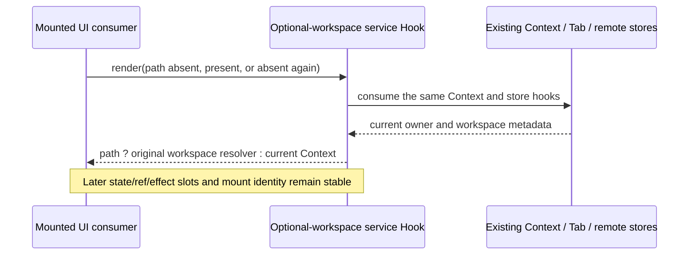

# Workspace service Hook stability

Session, Agent and Task service hooks resolve a workspace through the existing
window-scoped service Context, Tab store and remote-session registry. They do not
own a transport, workspace state, connection retry or business replay.

An already mounted consumer may receive no workspace path, then a restored path,
and later no path again. Every render must consume the same React Hook sequence;
service selection happens after that fixed sequence. In particular, switching
between `useServices` and `useWorkspaceServices` conditionally is invalid because
the workspace resolver also subscribes to Zustand stores.

When no path is supplied, the selected services are the current ServiceContext,
even if registered base services differ. This context-only use remains valid
without a TabStoreProvider. The named Tab access option defaults to requiring its
provider. Only the no-path service resolution permits the existing empty Tab
fallback; a real workspace path without a provider still rejects before invoking
its selector. That option preserves the same Hook sequence on every valid
render; an invalid missing-provider render retains its original early error.

With a path, local and remote routing retain the existing resolver. Explicit
remote session and workspace identity keep their original owner, including
different remote identities sharing a path. A remote target missing its registry
entry remains disconnected and must not fall back to local base services. Task
service proxy and snapshot-cache behavior stay unchanged.

The regression uses installed React 19 with the real production hooks,
ServiceProvider, TabStoreProvider and remote Zustand registry. Each of Session,
Agent and Task is tested through the absent → present → absent transition with
later state/ref/effect slots and one mount. Compatibility checks cover no-path
context-only rendering, required-provider rejection, remote identity changes and
missing-registry rejection. Inert service objects make no business, model,
backend or external network calls. A fresh real Web recovery run separately
verifies that the original Retry/workspace restore completes with no console
error; the Hook regression does not replace that browser acceptance.
