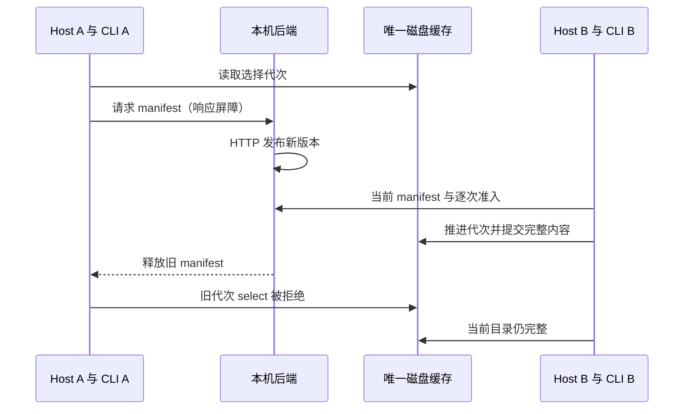

# G03 实际 Host 与打包 CLI 并发、中断验收

目标是在自有临时目录、真实本机 TLS/HTTP 后端和当前已打包 CLI 上验证两个场景。此脚本补充现有缓存故障测试，不修改产品实现，也不以 adapter 单测代替链路证据。

状态所有者沿用产品：EnterpriseIdentityService 管身份，加密 shared session store 持久化身份；EnterpriseAssetStore 在共享文件锁内管理缓存与磁盘选择代次；后端逐次裁决权限；CLI 通过现有私有 Host bridge 请求目录和准入。fixture 只观测返回结果，不另建缓存或授权所有者。

1. 双 Host：两个独立进程共享身份库和缓存。A 的实际 CLI 请求停在已经生成的旧 manifest HTTP 响应；通过 HTTP 发布 v2，B 的实际 CLI 完成当前目录和逐次准入；释放 A 后旧选择必须失败且不能删除 B 已返回的完整内容。B 的第二次实际 CLI 请求仍必须成功。
2. 崩溃恢复：实际 CLI 请求触发 Host 下载和 materialize。生产 `readAuthority` 回调中的只读观察器保持真实身份返回值，在逐文件 current 检查时确认真实 stage 已有第 21 个正文文件且尚无 manifest，然后暂停并 SIGKILL 整个自有 Host/CLI 进程组；确认仅有未提交 stage。此屏障避免 macOS 文件事件批量迟到导致错过 stage，不修改生产文件 IO 或授权结果。通过 HTTP 发布新版本，然后新 Host 从加密身份库冷恢复，实际 CLI 只发现完整当前授权版本。旧 stage 被既有缓存机制回收，缓存内脚本不执行，工作区哨兵不变，没有模型/工具副作用重放。

另有一项驱动异常回归，不计成第三种 G03 业务故障：实际 Host 与 CLI 已发出 ready 后，父驱动仅丢弃该回执，触发 5 秒准备超时。必须在异常返回前确认这两个实际 PID 和自有进程组均已退出，此时临时根仍在；随后统一清理才删除根。清理从 spawn 时立即登记，失败诊断不拼接原始 stdout/stderr。macOS 的已消失进程组可能在 signal-0 探测时返回 EPERM，故用只读 OS 进程表确认组成员，不能将信号已发出当作退出证明。

事件顺序：

bootstrap 只创建初始租户与用户；身份会话由公开 email login 真实 HTTP 取得，再经生产 adapter restore 和生产加密 store 初始化。后续资产、审核、发布、配置全部通过 HTTP。此初始化不宣称真实企微扫码验收。Host worker 不附加自动预热生命周期，以便屏障只覆盖当前被测 CLI 请求，身份、Host、文件锁、缓存、协议和准入均为产品实现。

命令：根目录使用 Node 24 执行 `node --import tsx --test scripts/client-assets-concurrency-crash-live-smoke.ts`，随后 `npm run typecheck`、目标文件 ESLint 和 Prettier。Worker 与 CLI 固定使用已提供的客户端 Node 24.14.0。CLI 与 desktop bundle 哈希保持一致且不重建。证据写 ignored `evidence/client-assets-concurrency-crash-20261017/`。

边界：不读写主 `.env`、主数据库、3000 实例或其他客户端目录；不调用真实企微、外部 MCP、网盘、模型供应商；不提交。清理必须确认自有子进程退出、全部临时监听端口关闭和临时目录移除。SIGKILL 的操作系统语义只在本机 macOS 验证。
