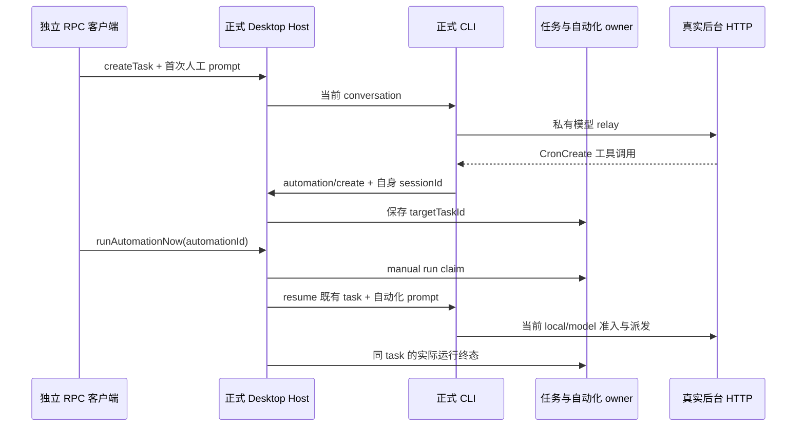

# 已有任务绑定自动化的真实 Desktop Host 恢复联测

2026-10-17，对应 G05。使用 production Desktop Host utility process、服务 MessagePort、实际任务/自动化 owner、正式 CLI、真实后台 HTTP 和本机受控供应商；不替代 Native 按钮、Main 定时 scheduler 或外部服务验收。

## 所有者与唯一派发路径

独立无窗口 Electron launcher 只负责 `utilityProcess.fork(out/host/index.js)`、`init-local`、MessageChannel RPC 与有界退出。业务响应均来自正式服务，不替换身份、模型工厂或数据库。身份只从真实 email HTTP 会话初始化生产加密 store；Host 使用同一随机 cipher secret 恢复，由生产身份 owner 管理。

最初人工输入通过真实 `zcode-task.createTask/sendPrompt`；供应商返回 `CronCreate`，CLI automation port 从当前 conversation 注入 `targetTaskId`。测试不直接写 targetTaskId，也不直接操作自动化数据库。后续只调用实际 `zcode-agent.runAutomationNow`，其已装配 `dispatchManualAutomationRun → dispatchCronRun` 执行 `resumeTask → apply config → sendPrompt` 并由现有运行终态回写账本。

该无窗口测试以真实 `yolo` task 模式创建受控自动化，避免等待不存在的人工审批 UI；后台 filesystem/local/model 权限仍逐次准入，先通过 HTTP 显式发布 filesystem 允许。`deferPersistenceUntilFirstPrompt` 是公开可选字段，未传或 false 都是合法调用，不能要求调用者加 true 来规避首发外键错误。首次 V4 输入 admission 必须先经过 runtime 的幂等持久化 owner，再保存输入账本；`record.persistence` 只是协议投影，不能凭其 immediate 标签推断 session 行已存在。显式 deferred 的 Native 草稿语义保持：创建期不持久化，首条输入才落行，不直接补写数据库。浏览器 ambient-context 仅回正式 Main 在无 executor 时的 `backend_unavailable` 默认响应，不创建或伪造浏览器状态。

## 验收

1. CronCreate 实际创建且 `targetTaskId` 等于原会话；run-now 的实际供应商请求包含自动化 marker，运行记录 sessionId 与原会话相同，不创建第二个任务。
   初始 createTask 不传可选 defer 字段，首次 sendPrompt 成功并持久化用户输入；重启后实际模型仍消费该原始输入。默认 immediate 投影、显式 deferred、已持久会话三类 admission 均验证；真正的存储失败继续向上传播，不吞 SQL 错误。
   公开 mode 必须真实生效且返回一致：createTask 的 task metadata、活跃 session metadata 与 runtime/current 设置使用同一事实。活跃态不得拿零事件 projection 的 build 缺省遮住实际 yolo；冷历史没有 runtime 时继续使用其持久投影。`readSessionMessages` 必须复用现有消息 wire mapper，保持 Host 严格 schema，原 user messageId 在重启后保持一致；不得直接泄露 Core 原始字段或放宽协议校验。
2. HTTP 发布 `assistants.local=false` 后再 run-now：记录实际派发/拒绝终态，不因 queued 或接受次数递增误算成功；供应商与模型账本均不增加。
3. 再发布允许，关闭并重启真实 Host，保持隔离数据根。自动化和绑定持久化仍在；再次 run-now 恢复同 task，真实模型包含合法历史上下文并成功，任务数仍不增加。

每个 RPC/轮询有界。退出先调用正式 Host `dispose` 并等待 Host/CLI 实际退出，再关闭 Electron；异常路径逐项继续清理自有资源。仅隔离临时目录、随机密钥与 loopback；不读取主 `.env`、主业务库或接触 3000 实例。cipher secret、identity token、供应商 credential 不落 RPC/日志/证据。证据保留 HTTP、供应商请求、运行记录、任务 id、artifact SHA、进程/端口/目录清理。

## 命令与文件

`node --import tsx --test scripts/client-automation-bound-resume-live-smoke.ts`。脚本入口位于 `scripts/`，Electron 传输夹具位于 `scripts/fixtures/`，使用现有 `client-native-session-fixture.ts` 的实际后台及私有身份初始化。新增测试源执行 TypeScript、lint/format；生产逻辑不变时不重建 CLI。输出在 ignored `evidence/client-automation-bound-resume-20261017/`。本机 macOS/Electron 成功不推断 Windows/Linux 安装或 Main scheduler 的定时唤醒。
