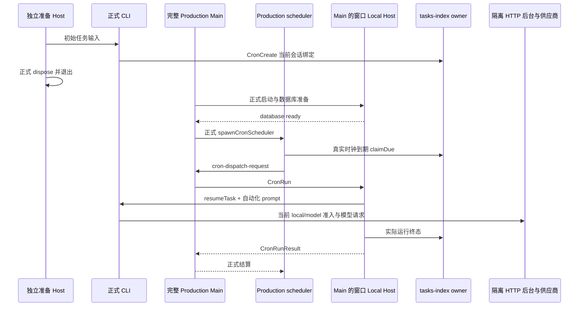

# Production Main 定时调度真实到期验收

2026-10-17，G05 的 Main 启动集成补充。验收对象是正式构建的完整 Desktop Main、其自行启动的 scheduler、窗口 Local Host、正式 staged CLI 与真实后台 HTTP。模型供应商仅为本机受控 HTTP 服务。

## 所有者与入口

先用已有独立 Host launcher 的公开 RPC 创建任务并发送首次输入；实际 CLI 调用 `CronCreate`，由当前 conversation 注入 `targetTaskId`，cron 为 `* * * * *`。随后完整退出该 Host 和 CLI。

正式 `out/` 只读复制到独立 app 目录，核对 Main、Host、scheduler 与 CLI SHA256。独立 launcher 只导入该复制品的 `out/main/index.js`，抑制系统默认协议注册，支持 `app.quit()` 收尾；不实例化 scheduler、不手动 tick、不替换权限或业务响应、不注入 Renderer 状态。复制产物用于避免 unpackaged Main 的本地环境加载器读取原工作区环境文件。依赖和 staged CLI 保持只读引用。

任务、绑定和调度状态由生产 task/automation owner 持有；scheduler 唯一认领真实到期并维护运行台账。测试只通过 `node:sqlite` 的 `readOnly` 连接观察隔离 tasks-index，不写任何调度字段。



## 验收与失败边界

1. 原会话创建出一个每分钟 automation，绑定原 task；准备阶段没有运行记录。完整 Main 真实启动 scheduler 后，等原 `nextRunAt` 自然到期，出现 `trigger=schedule` 的实际成功终态，`scheduled_at` 与准备时记录一致，供应商收到自动化 marker 且含原始会话上下文，模型账本全部 settled。
2. 完整退出并重启 Main，保留同一隔离 HOME；下一次自然到期再次恢复同一 task，仍只有一个任务、一个 automation，无 manual run。
3. HTTP 发布当前 `assistants.local=false`，等待下一次真实到期。记录正式拒绝状态，供应商调用数与模型账本均不增长；不把接受/排队当成功。
4. 每次等待有截止时间并每 15 秒输出短进度。只观察真实 `Date.now()`；禁止 run-now、手动 sendText 代替触发、改时钟、直接写数据库 nextRunAt 或新增缩短 tick/TTL 的环境变量。
5. 报告真实失败后再协调窄修复；本验收驱动本身不修改 production 源码、不重建 out/CLI。

## 执行与保护

后端根目录执行：

```sh
/Users/ljp/.cache/uwork-client-toolchain/node-v24.14.0-darwin-arm64/bin/node --import tsx --test scripts/client-automation-main-scheduler-live-smoke.ts
```

正式产物更新后以 `UWORK_MAIN_SCHEDULER_EVIDENCE_DIRECTORY=evidence/client-automation-main-scheduler-a684e407-20261017` 指定新的独占证据目录；该入口只选择仓库 evidence 根下的输出目录，不改变生产调度时钟、tick 或 TTL。旧 `0d958862` 版本证据另存 `evidence/client-automation-main-scheduler-0d958862-20261017/`，不得以新版本覆盖。

脚本与 launcher 分别位于 `scripts/` 和 `scripts/fixtures/`；输出仅在 ignored `evidence/client-automation-main-scheduler-20261017/`。测试用真实 Fastify TCP、临时 SQLite、合成 email 身份、生产加密 store 和仅向自有子进程传递的随机 cipher secret。secret/token 不进 RPC、日志或证据；退出采集所有自有 PID、端口和目录清理结果，异常仍逐项清理并验证残留。

不读取主 `.env`、主业务库或 Vault；不重启/修改 3000 主后端，不使用付费模型、真实企微、外部 MCP 或网盘，不修改另一客户端目录，不删除无关本地测试文件。结果限本机 macOS/Electron 及受控供应商，不扩展为跨平台安装或外部服务验收。
