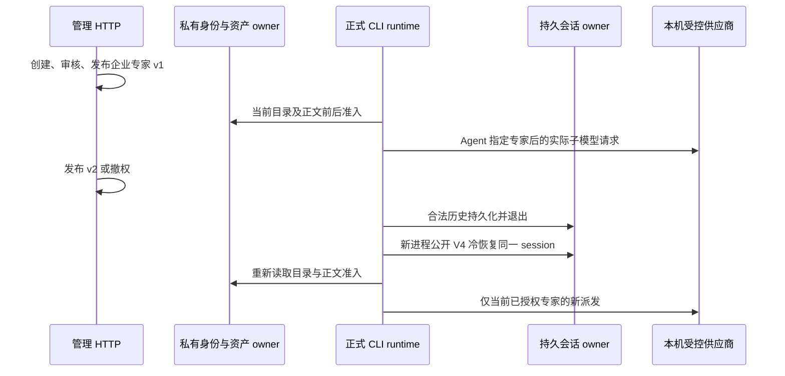

# 企业专家与已有会话恢复的真实联测契约

2026-10-17。对应覆盖矩阵 G02/G05 中的指定专家正文与既有任务恢复切片。只验证已有产品行为，不新增工作流产品或自动化入口。

## 状态与边界

后端发布版本、分发策略、席位和模型准入是唯一权限事实；现有企业身份 owner 从真实 email HTTP 登录取得的会话经生产加密 store 恢复。测试只初始化这一受控身份，不调用企微适配器的登录入口。Gateway/Registry、Host 私有 relay、当前正式 staged CLI、既有子智能体 owner 和持久 session store 都使用生产实现。

专家正文在 managed runtime 创建时装入现有 AgentProfile。已运行 runtime 保持已取得的合法版本快照；新 CLI 通过公开 V4 conversation subscribe 冷恢复同一 session，重新读取当前目录、校验并准入当前版本。已合法保存的历史消息不因撤权而任意删除。撤权后不允许把同名个人专家当作原企业绑定继续执行。

## 验收场景

1. 企业专家与同名个人 profile 同时存在：实际父模型返回 Agent 工具调用选择企业专家；后继子模型请求包含已发布 v1 指令 marker，不含个人 marker；每次真实供应商调用对应 settled 账本。
2. 发布 v2：同一在运行 runtime 的后续任务继续使用 v1；退出并公开冷恢复原 session 后，新子请求使用 v2，保留合法父会话历史，重新产生 v2 的正文准入。不能用新建 session 冒充 resume。
3. 撤销专家或当前模型权限：新进程冷恢复原 session 后不以同名个人 profile 回退；撤销模型派发权限后当前新请求也不产生供应商/账本。拒绝专家选择可让已授权父请求接收失败工具结果，不等于整轮无派发。
4. 显式允许个人 profile 时，managed 名字为 `personal:<source>:<originalName>`：企业批准名仍优先；撤销企业并冷恢复后旧 plain 名不能回落到个人，显式 canonical 个人名可实际派发。随后同 runtime 关闭 `personal.skills`，再次 canonical 请求不能产生个人子模型；分别记录父请求、子请求和标题的真实数量。个人 profile 由同一当前 catalog 的 `personalSkills && dangerousSkills && allowFilesystem` 准入，并在已解析目标后按当前 `personal_agent` 权限再次准入；Standalone 旧名字保持原行为。

## 实现与验证

新增 `scripts/client-expert-resume-live-smoke.ts`；只给共享实际 fixture 增加可选冷恢复、sessionId 与幂等退出测试 driver，保留默认创建行为。所有业务写入通过真实 HTTP，bootstrap 独立列明。每例隔离临时根、随机主密钥、loopback HTTP/TLS 与受控供应商；不读取主 `.env`、主数据库或 3000 实例。

执行 `node --import tsx --test scripts/client-expert-resume-live-smoke.ts`，并回归原 stdio、Agent、builtin smoke。执行后端类型检查、新脚本 lint/format；fixture 不修改客户端源码，仍执行现客户端架构检查。证据写入 ignored `evidence/client-expert-resume-20261017/`，包含实际私有模型消息、HTTP 状态、账本、CLI SHA 和端口/进程/目录清理。Native UI、自动化绑定已有任务、真正动态工作流资产执行与三平台安装不由该切片替代。
