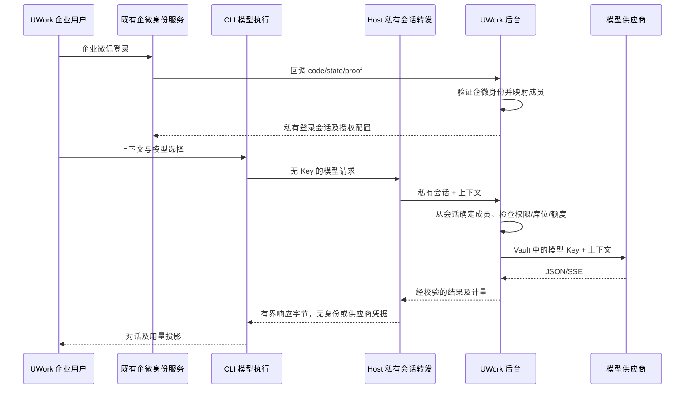

# UWork 客户端与后台真实联动验收

2026-10-17，Asia/Shanghai。本轮完成客户端源码收拢、企业会话模型转发及用户管理补齐。仅在本仓库开发；企微、外部 MCP 和网盘按用户约定不做真实接入测试。

## 当前调用边界

图中的真实企微扫码尚未联测。本轮通过公开 email 登录 API 初始化合成身份，再由生产加密会话存储和实际身份 owner.restore 接管；不伪造 owner 代次，不调用企微 provider。后台不能信任客户端自报 userId，实际租户与用户均从认证会话派生。

托管 Provider 只保存 `access: { type: "enterprise-session" }`、后台地址及公开模型能力。登录 Token 留在 Host 私有身份存储；供应商 Key 留在后端 Vault。旧 device API 保留兼容，但当前桌面同步不再签发或下载模型 API key，迁移会清除旧 Key/鉴权头并吊销旧终端凭据。个人供应商及旧 UCAS 协议保持原规则。

## 实际验证

| 层次                | 结果                   | 主要内容                                                                               |
| ------------------- | ---------------------- | -------------------------------------------------------------------------------------- |
| 后端全量测试        | 245/245                | 新增 13 项真实 TCP 私有输出/取消/缓存检查，旧计量和错误合同保持                        |
| 客户端服务          | 254/254                | 身份 owner、Gateway、Provider、Relay、资产和策略                                       |
| HTTPS 联动          | 9/9；31 个有名业务检查 | 实际 Host custom CA、磁盘、身份换代、迟到响应、模型能力、无 Key 配置；196 次 HTTP 响应 |
| 实际 SDK            | 3/3                    | JSON/SSE、3 段正文、合法思考档位及工具参数；5 次受控上游、5 条 settled                 |
| 打包 CLI stdio      | 4/4                    | JSON、SSE/标题生成、open/read 阶段取消；3 条 settled、2 条 uncertain                   |
| CLI 合同            | 8/8                    | 缺 relay 拒绝、HTTP 错误、UTF-8 字节保持、取消与出口准入                               |
| 会话授权            | 54 次实际 HTTP 检查    | 用户不可伪造、席位/停用/模型范围、成员及祖先部门额度、本人用量隔离、管理员聚合         |
| 独立 Host 安全      | 6/6                    | 跨 workspace/session/runtime、32 流回收、JSON/SSE 转义及工具参数中的会话回显           |
| 后台真实浏览器      | 通过                   | owner 行内绑定企微 UserId、保存刷新；operator 不显示绑定操作；未配置企微应用时正确拒绝 |
| 原生 macOS Electron | 通过                   | 正式 React/Main/Host/CLI 构建实际对话、迁移、停止、用量、退出、跳过登录及重启后拒绝    |

以上测试存在覆盖重叠，不相加成一个总数。供应商为本机受控 HTTP 服务，HTTPS 控制面使用独立测试 CA，经产品 custom CA 设置注入，未关闭证书校验。打包 CLI 不接收身份 Token、供应商 Key 或测试 CA，模型网络请求由 Host 转发。

原生界面实际验证：

- 磁盘 Provider 只有企业会话访问模式，旧 Key 字段已移除；当前终端凭据数量为 0。
- 流式回答“联动测试完成。”实际显示，后台计量包含对话和自动标题两个物理调用。
- 上游故意等待 30 秒时点击停止，后端约 4.3ms 后转 uncertain，不再等完整响应。uncertain 是已派发调用的保守预留，不表示退款或供应商未执行。
- 用量面板显示同一隔离账本的 8 次请求、154 Token；其中一条中断保留 55,234 本机 Credit，均不是实际供应商费用或主企业额度。
- 退出后菜单/身份投影清除，再次发送不进入供应商，账本仍为 8 条；重启并“跳过登录”也不能绕过认证，界面提示重新登录。

原始证据位于 ignored `evidence/`：`client-live-20261017-keyless-gateway/summary.json`、`client-live-20261017-relay/summary.json`、`client-session-auth-20261017/report.json`、`client-relay-security-20261017/review-summary.json`，以及 `client-live-20261017/native-private-*.png/json/txt`。

## 修复及原始失败

1. 旧不透明模型 ID 继承 UCAS 的 1M/Vision/最高思考档位，并发送后台不支持的参数，真实 Native 请求返回 400。改为后台能力描述沿私有 writer 写精确模型配置，实际 SDK/Native 复测通过。
2. 退出或同用户重新登录后，迟到目录/用量可能沿旧身份写 Provider。复用唯一身份 owner 的 generation/revision/signal，逐次准入与提交均复查。
3. 无 Key 迁移曾受固定 URL 校验阻止，重启播种又恢复为 API Key 模式。改为同一 Repository 原子更新 endpoint/access，保留企业会话访问模式，清除旧鉴权头。
4. 模型工厂曾遗漏独立注入的 beforeDispatch guard。真实 TCP RED 后修复，拒绝时上游收到 0 次请求。
5. Host 的原始字节扫描不能识别 Unicode 转义、SSE 跨 delta 和嵌套工具参数中的会话回显；Gateway 也会返回供应商响应中回显的 Key。两层增加有界语义检查，已知 Key 候选尾部暂存，安全前缀仍实时输出；拒绝后不缓存新结果，按原计量合同保留 uncertain。该检查不是任意未知秘密或任意编码的通用 DLP。
6. 企业会话不再出现手工模型 Key 引导；退出后的内部错误码改为本地化、可操作的提示。

原直连 Native 测试曾出现界面已停止、后台仍等待 30 秒后 settled；独立相同 SDK/Node/stdio 直接链路未复现，旧根因没有确认。当前托管链路已改用 Host relay，并以新的 Native 与 open/read 取消证据验收，不以旧界面“已停止”冒称旧链路已修复。原始 RED 和测试夹具连接、工作区规范化、V4 终态断言等前置失败均保留，未算作产品通过。

## 构建、运行与边界

客户端完整受控源码位于 `clients/uwork/`，初始快照见 [源码布局](client-source-layout.md)，保留许可证和工作区规范。使用 Node 24.14.0/pnpm 10.33.2；正式 CLI 构建与 staged 文件 SHA256 均为 `3518f71cd0979fc86b22534fdc78ad06b52aa6f681fa4f7fd441f7eb63cf04ee`，16,549,244 字节。原生使用仓库内独立 Electron 41.10.7（Node 24.18.0），未修改用户已安装 UWork 或原客户端仓库。

后端及客户端类型检查、Lint、定向格式、架构检查、构建通过。客户端保留 114 条既有 Lint 警告、CLI 保留 53 条既有警告，均 0 错误；Vite 既有大 chunk/插件耗时提示保留。后端镜像 `uwork-backend:client-session-20261017` 构建成功，Docker 上下文排除 clients。

主后端已在线备份后正常释放租约并更新，`http://localhost:3000` 的健康、管理端、认证模型目录均返回 200；实际已配置供应商目录 probe 成功（580ms）。原资源/版本、配置/历史、策略、成员、Vault、订阅及账本哈希保持不变；原账本仍是 settled 23 条/8,474 Credit、released 1 条/0、uncertain 1 条/5,150。本轮新增真实供应商生成与费用为 0，登录/探测审计按正常业务保留。

主后端和项目专用 Colima 保持运行；本轮自有 Electron、浏览器、后端夹具、端口及临时身份数据清理。未改默认 Docker context。真实企微扫码和生产 HTTPS 域名、外部 MCP、网盘、Windows/Linux 安装及手机/远程工作区端到端仍未验收，不能由合成身份、本机 Electron 或源码合同替代。
