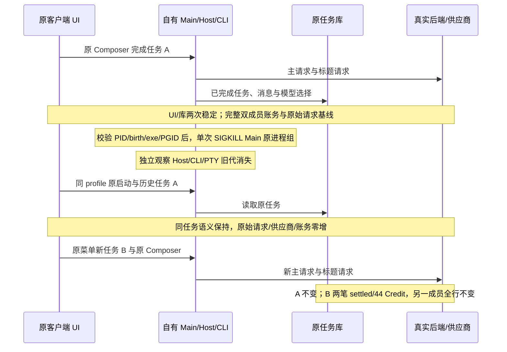

# Mac 已完成任务崩溃恢复与后续执行验证范围

2026-10-21。此文是待执行范围，不是通过报告。目标仅为正常签名 ARM64 v12 包、原客户端 UI/Host/CLI、隔离真实后端及受控供应商。新 profile 为 `client-native-packaged-macos-clock-arm64-consistency-v2-20261021`；保留 v1 的正常 TERM 冷恢复证据。外部 MCP、网盘、真实企微浏览器和 Linux 不参与。

## 状态与动作

Main 只管理原生进程和转发，不拥有任务业务状态。任务身份与消息以原 UI 和实际 CLI FD 绑定的只读原库联合证明；后端拥有 actor 与计费，不能从 UI 文案推导结算。

## 验收边界

1. 原七项控制保持。暖阶段已完成任务 A 的 UI/session/task/title/model/reasoning/workspace 与只读消息、part、状态语义稳定两次；主与标题共两笔 settled、44 Credit、24 input/20 output。保存两成员完整账务、配置及原始 inference POST/供应商计数和请求摘要。
2. 保存 Main child handle 与内核 PID/birth/executable/PGID，PGID 必须等于原 detached Main PID。实际发信号前再次核对同一身份；只发一次 `SIGKILL`，记录该原 child 的真实 exitCode/signalCode。不能用正常 stop、应用退出或伪造信号替代。
3. 杀前保存自有 Host/CLI/PTY 的身份与归属，PTY 另存 cwd/TTY/PGID；杀后逐一验证旧代消失，不能由 Main 进程组消失推导 PTY 消失。残留先形成失败收据，再按精确、即时复验的归属清理；不扫杀同名进程。组内被强杀的进程不称自然 exit0。
4. 关闭旧 browser-harness 后，同 controller/profile 走原 launch。仅通过原 UI 打开任务 A，禁止 Resume、重发或 observer runtime getter。UI 与原库语义完全保持；完整双成员账务、原始 POST 和供应商均零重放。身份或锁异常照实失败，不删锁、lease、WAL 或修改 store。
5. 完成零重放快照后，经原 `enterprise-menu-chat` 与 Composer 发唯一新任务 B；B 是不同 session，模型/reasoning/workspace 正确，新代真实 CLI 映射/cwd 已核对。本人恰新增两笔 settled/44 Credit、24 input/20 output，原账务行保留；他人全部行不变。重新读取 A 的语义保持。
6. 原撤 seat 与 logout/cold 无复活检查继续以 B 完成后的新基线验证。原 renderer 30 秒、secondary 单次 10 秒和既有业务预算不放宽。结果分列新边界，不把重复暖检查累加为能力覆盖。

CLI 库仅用既有 `mac-completed-task-readonly.mjs` 的固定只读 SELECT。`gateway_calls.result` 与 ledger 按实际 actor/request key 关联；Trace 没有该外键，只能核实际 actor/model/application、tokens 及集合，不能发明逐请求对应关系。

运行前冻结准备文件、全部派生依赖、v12 manifest/ASAR/原生资源签名；Root 与独立 reviewer 审核确切 SHA。Mac UI 串行运行，其他 Agent 只做准备。收尾核自有全部 PID、BH/UNIX、四 TCP、OS 协议恢复、源码与包未变以及常驻后端健康。

## 首次执行的有限阶段

为先取得真实崩溃收尾事实，第一次计划仅执行原暖阶段前五项及上述第 1–3 步。若有旧代残留，立即记录失败并按归属清理；若旧代自行全部关闭，只能称崩溃观察阶段通过。该次不启动恢复、新任务、seat 或 logout，不能称原七项或本页完整目标通过。后续恢复与新任务必须另冻结准备，不能在未审脚本中临时继续。这样保留阶段结果，不用较大夹具掩盖首先需要定位的残留问题。
