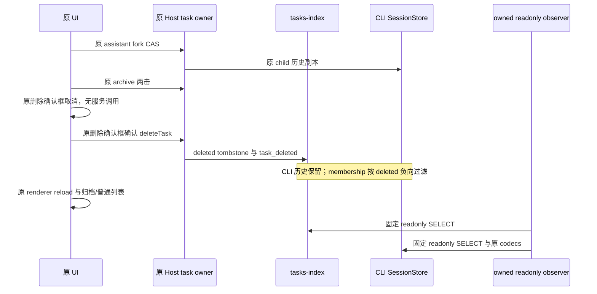

# Mac 单条归档任务删除 Native 薄切片

状态：prepare-only。只使用独立 owned profile `client-native-packaged-macos-clock-arm64-task-delete-v1-20261021`，复用正常 v16 manifest `aca34443c6adcd0ad203508edef1cc8bdc85e65df6b561ad880755dd50921118` 与 d14eef/84 来源。Root 和 peer 审查 exact plan 后才由 Root 唯一运行 App。本轮不覆盖删除全部、不触碰原任务或旧 case，不修改产品。

原暖五项完成后保留 active parent，沿同一完成态 assistant 的 `v4-fork-<rowId>` 原 UI 创建一个 child，不编辑、不发送新 prompt、不调用模型。读取新 UI session ID，再以原 codecs 和 owned readonly DB 核 child.parentID、taskType=fork、父历史完整语义副本及独立 message IDs。只对该 child 执行原两击 archive，归档列表先打开同 ID 证明 title/workspace 行绑定，然后原行 `aria-label=删除任务/Delete task` → 取消 → 再打开 → 确认。最后关闭归档视图、回到 parent、renderer reload，再开归档视图核 child 不复活，最终回到 parent 供原七项 tail。

真实源路径：`WorkspaceArchivedTasksFlatSection.tsx` 的单条按钮调用 `confirmDialog`，取消直接返回，确认调用原 `zcodeTaskService.deleteTask`。它并非 batch 专用 `deleteArchivedTask` 的 archived 同事务检查。adapter 经原 `updateTaskState({deleted:true})` 持久写 tasks-index deleted tombstone，保留 archived 标志并广播 `task_deleted`。`taskIndexRepo.listDeletedTaskIds` 及 `buildTaskListResultFromSessions.ts` 的 deletedIds 负向 membership 防止 CLI 保留历史被 sessions-index 重加。不得把“从列表移除”描述成擦除 CLI 文件。

阶段固定为 baseline / forked / archived / cancel-dialog / cancelled / delete-dialog / deleted / reloaded。每阶段只读核父 CLI 原始 session/messages/parts/session-entry 与模型/cwd不变；child 从 forked 起 CLI 历史不变，删除后仍存在。child 的 tasks-index 标志按阶段为 0/0 → 1/0 → 1/1（archived/deleted）；父任务始终 0/0，membership SELECT 含 deleted=0。确认框只允许原唯一 `[role=dialog]`、原标题/描述与 `confirm-dialog-confirm`，取消沿该框唯一文字按钮；不加 TID、DOM/store 注入或业务 API。归档行只允许唯一 child title+owned workspace，先以原 pane session ID 绑定，歧义立即失败。

暖 baseline 后所有阶段 supplier/raw/modelRequests 都固定 4，本人 settled2/44、other2/44，原本人所有账务行和 other 完整 identity/ledger/traces/gateway rows逐字不变，所有 actual request payload digest 不变。fork/archive/delete/reload 不得增加模型或计费。只读 observer 使用 DatabaseSync(readOnly=true)、固定 SELECT 和原 decodeSessionRow/decodeMessageRow/decodePartRow/decodeSessionEntryRow；不得创建 Repo、migration 或写业务表。

控制器沿现有 MemoryCaseBudget 实际 namespace、真实 Fixture constructor/env、正常 v16 strict loader、packaged ASAR Main readonly helper、原 renderer30/secondary10、work160/case180/cleanup20。保留原 warm5 与原 seat/logout/cold tail，finally 使用已审 safe_native_cleanup。默认 prepare/driver 不启动 App/backend。纯测试必须覆盖真实 DOM producer/回调取消与确认、SQL tombstone与保留历史、错 SID/child/root/model/重复行/缺 CLI、同阶段顺序/账务增量拒绝、实际 constructor env、实际派生 namespace/phase以及 cleanup budget。

