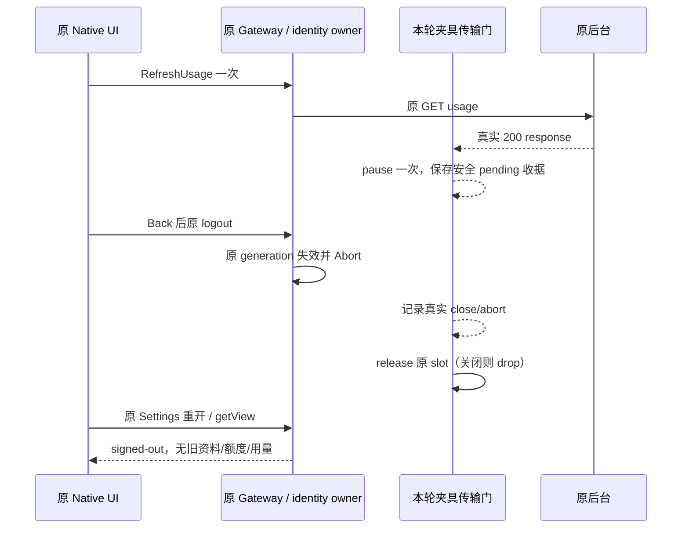

# Native 用量读取 pending 时原 UI 退出

状态：仅测试夹具与准备，尚未执行 Native。G09a 的十项真实 React 合同不替代本项 Host/HTTP 取消联动；G04h v8 已核对完成的 Gateway 视图后才退出，也未制造在途 usage 请求。

## 原路径与所有者

使用新独占 profile，由现有受控 email API 和生产加密 store 建立已登录基线，不重跑 G04h 空身份登录，不读取旧 R。普通原 Gateway 面板 ready 后，物理点击 `ucas-gateway-refresh-usage`；原 `refreshUsage` 读取套餐后访问 `GET /api/client/usage?period=month&metric=requests`。夹具只在真实后台返回 200 后暂停这一个 response，原 headers/body 不改、不解析、不记录，不造 DTO 或新的身份 authority。

若新 profile 仍需职业引导，只复用已审 `file-restored` 原 FirstRun 动作，不 skip/reopen 登录或改身份。Host 原 20 秒请求期限不变；退出前必须仍有真实 pending，不能把此前超时/关闭当作本轮 logout 取消。

EnterpriseIdentityService 继续拥有 generation/session/AbortSignal；Gateway 原 scope 和投影 admission 决定结果是否仍可提交。原 Back 会卸载 Gateway 面板，工作区身份菜单才可交互。因此本项证明真实 Host 取消与重开面板不回灌，不声称同一已挂载 Panel 收到迟到成功。

## 固定编排与验收

1. 基线面板已 ready 且非 busy，当前身份、套餐及用量来自实际事实；单列夹具初始化 model/ledger/Trace 基线。
2. arm 一次传输门，再物理 RefreshUsage 一次。Input 前保存实际毫秒时间；proxy 从原请求入口捕获 `requestStartedAtMs`，到真实 200 暂停时捕获 `replyHeldAtMs`。必须满足 requestStartedAtMs 不早于该 Refresh Input、`oneShotId=1`/`oneShotCount=1`/`matchedResponses=1`/`held=true`/`response200=true`，安全 pending 收据先于退出 Input journal。若后台/启动旧读误占门，本次失败保留，不能重臂。
3. 原 Back → 身份菜单 → 原退出一次。固定公开 signed-out 投影与真实 backend logout 均成立；记录该响应的实际 downstream close/upstream abort。
4. release 原响应一次。若原 owner Abort 已使其关闭，仅记录 abort/drop，绝不重放或伪称成功晚到；仍可交付时只交付同一原始响应一次。
5. Back 后先记录 `settings-page` 和 `ucas-gateway-panel` 均不存在、原 workspace surface interactive。退出后经匿名仍可用的 `task-settings-button` → `settings-section-nav-usage` → `settings-usage-tab-enterprise` 重开，必须重新观察到 `ucas-gateway-panel` 及静态「未登录企业账号」，不能把空 Settings 认作成功。旧「企业账号」「套餐」「用量」卡片、`enterprise-effective-allowance`、`ucas-gateway-refresh-usage` 不可见，无旧选择/busy 回潮；console/script 无新增异常。该路由只依赖原 Settings 回调与 service 可用性，不依赖已退出的 Badge 菜单或注入导航。
6. 本轮 Native model/ledger/Trace 增量分别为 0，和初始化基线分列。没有模型发送、身份切换、第二次登录或业务重试。

## 有限夹具控制与保留

仅新测试模式 `UWORK_NATIVE_GATEWAY_USAGE_HOLD=controlled`、`UWORK_NATIVE_CLIENT_EXPERIENCE=enabled`、`client-native-gateway-usage-*` 新名字可启用；不与 Primary/File/Viewer/Workflow 模式混用。其余默认和命令原样保留，Primary/File 白名单不变。

四个固定无参 PTY op：`armGatewayUsageHold`、`gatewayUsageHoldStatus`、`releaseGatewayUsageHold`、`disposeGatewayUsageHold`。拒额外字段、二次 arm；只有一个 pending slot。release/dispose 幂等且不重放；stream error/abort 必须由门观察，不输出原错误、URL、headers、body、token 或 Cookie。门默认 disarmed，不开 timer、连接或文件。

新模式从启动即要求保留独占 0700 根，旧 close/EOF/TERM 路径也不得递归删除该根。实际 runner 仍复用已审 owned PID/PPID/birth 控制器，优先关 Native/BH、dispose 本门，按已知 identity 有界收口 Common；不查询未知 holder。查询不确定时保根，不调用旧 root 删除流程。

本项暂无 Runtime Go，不创建 R/浏览器/服务。未来分列 Git HEAD（允许仅 docs/fixture 变化）与正常构建 Source `cd0127ad1af132978715d2631c09e9895d4c9e72`，核验全部 7,332 client Source 与 Desktop/CLI03ad 产物；不因 docs-only HEAD 改变而重建。旧私有根、opaque 输出、主 PID42125 均不参与。
