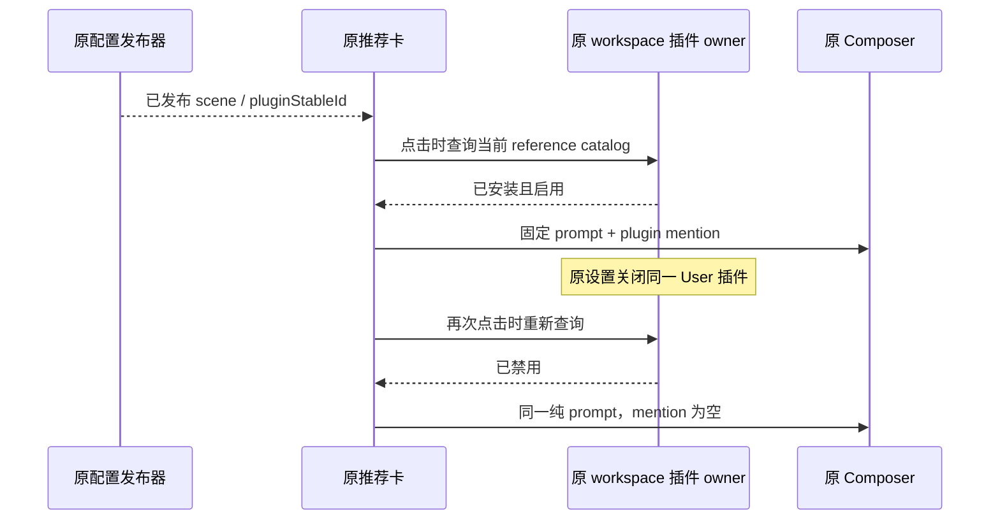

# Native 已安装插件推荐卡联动

状态：G04j 待执行。本项补齐已发布推荐卡到原 Composer 的 installedOnly 分支，不重做插件生命周期或 Skill 正文消费验收。

## 合同与所有者

后端发布器拥有 `scenes.draftSuggestions[].pluginStableId` 的已发布配置；原 CLI 插件 resolver/配置拥有同 workspace 的安装、User enabled 与实时 catalog。原 Host 仅转发。推荐卡点击时必须从原 workspace catalog 重查，唯一、启用、无冲突的已安装插件才生成 mention；缺失、禁用或不可用时填普通 prompt，不安装、刷新市场或恢复插件。

Composer 仍由既有 `requestComposerTextInsert` 消费，测试不得注入 React/store、身份、RPC 或复制安装记录。不创建新的产品入口、状态或权限 owner。

## 有限验收

前提为全新独占 Native profile、一个 workspace、编程模式新草稿与已有受控登录基线。同一 Native 插件 owner 通过正常安装器安装仅含 manifest 和文本 Skill 的自有测试包，读回准确 ID；不从另一 HOME 复制安装状态，不运行任意插件代码。基线安装可沿原 Native 安装 UI，必须与本轮来源、路径和原安装结果绑定。

1. 通过原 API 发布一个固定 scene。原推荐卡物理点击一次，原 Composer 出现精确 prompt 与一个本轮插件 mention；没有安装/市场刷新分支。
2. 经原设置的 Plugin→User scope→同 ID enabled 开关关闭一次，等 pending 结束、有效状态为 off。原 Back 后整个设置页卸载，回同 workspace 草稿，再点同卡一次；Composer 为同一纯 prompt、mention=0，插件仍已安装且没有被恢复启用。

不发送模型请求，Native 模型/账本/LLM Trace/Credit 增量均为 0，初始化单列。物理动作先持久 journal，每项一次；固定布尔/geometry 投影，原菜单 modal 的 aria-hidden 与整页卸载分开判断。首错停依赖动作，保留失败，不在旧 profile 重试。

安装接线、固定 wrapper 与合同检查、最终来源锁及实际 Runtime 尚待完成；准备文件不等同验收。Common 默认 close 会删除根，本项不得调用该路径或暗借 G09 hold 模式；原 Native/BH 收口后由 Root 精确核 Common/已知 helper 身份再终止，根保留 0700，不检查未知 holder。

真实企微、外部 MCP、网盘、官方市场、签名安装与其他平台继续按各自边界。本项不声称旧 session 热禁用、同挂载组件迟到交付或所有插件兼容性。
